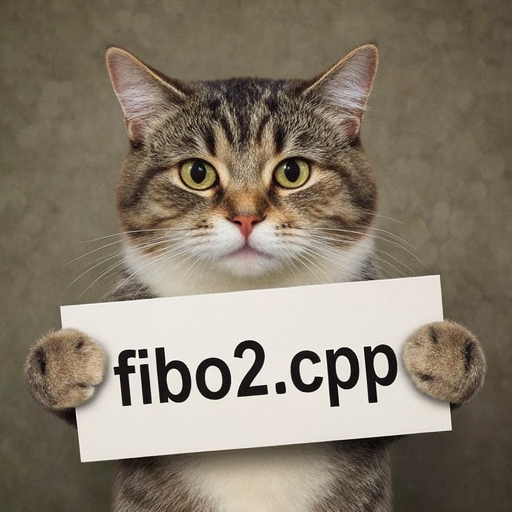
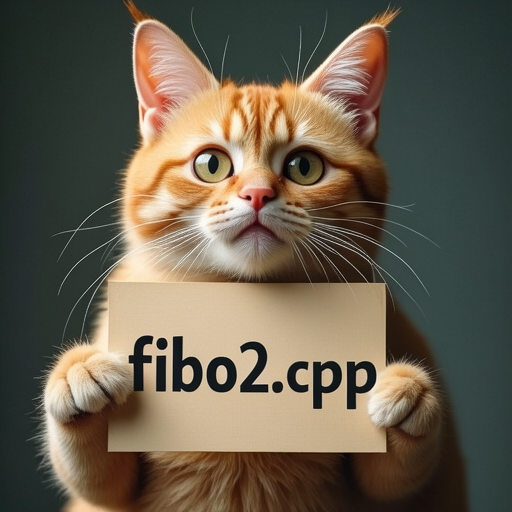

# How to Use

Fibo 2.0 uses a Fibo diffusion transformer, the standard FLUX.2 VAE, and Qwen3-VL 4B as the LLM text encoder. The Qwen tokenizer is built in.

## Download weights

- Download Fibo 2.0 Dev
    - safetensors: https://huggingface.co/Comfy-Org/Fibo-2.0/tree/main/diffusion_models
- Download Fibo 2.0 Edit Turbo
    - safetensors: https://huggingface.co/Comfy-Org/Fibo-2.0/tree/main/diffusion_models
- Download vae
    - safetensors: https://huggingface.co/black-forest-labs/FLUX.2-dev/tree/main
- Download Qwen3-VL 4B
    - safetensors: https://huggingface.co/Comfy-Org/Fibo-2.0/tree/main/text_encoders
    - gguf: https://huggingface.co/Qwen/Qwen3-VL-4B-Instruct-GGUF/tree/main

The original Diffusers weights from [briaai/Fibo-2.0-dev](https://huggingface.co/briaai/Fibo-2.0-dev) and [briaai/Fibo-2.0-edit-turbo](https://huggingface.co/briaai/Fibo-2.0-edit-turbo) are also supported. Pass the transformer's `diffusion_pytorch_model.safetensors.index.json` to `--diffusion-model` and keep its shards alongside it.

INT8 convrot weights load directly; see [INT8 convrot](./int8_convrot.md) for backend requirements.

## Examples

### Fibo 2.0 Dev

Dev supports both text-to-image generation and reference-image editing.

```
.\bin\Release\sd-cli.exe --diffusion-model ..\models\diffusion_models\fibo2_dev_int8_convrot.safetensors --llm ..\models\text_encoders\Qwen3-VL-4B-Instruct-Q4_K_M.gguf --llm_vision ..\models\text_encoders\Qwen3-VL-4B-Instruct-mmproj-BF16.gguf --vae ..\models\vae\flux2_ae.safetensors -p "a lovely cat holding a sign says 'fibo2.cpp'" --cfg-scale 5.0 --sampling-method euler -v  --offload-to-cpu
```



```
.\bin\Release\sd-cli.exe --diffusion-model ..\models\diffusion_models\fibo2_dev_int8_convrot.safetensors --llm ..\models\text_encoders\Qwen3-VL-4B-Instruct-Q4_K_M.gguf --llm_vision ..\models\text_encoders\Qwen3-VL-4B-Instruct-mmproj-BF16.gguf --vae ..\models\vae\flux2_ae.safetensors -r ..\assets\flux\flux1-dev-q8_0.png -p "change 'flux.cpp' to 'fibo2.cpp'" --cfg-scale 5.0 --sampling-method euler -v  --offload-to-cpu
```



### Fibo 2.0 Edit Turbo

Edit Turbo is distilled for reference-image editing in 4 steps with CFG 1.

```
.\bin\Release\sd-cli.exe --diffusion-model ..\models\diffusion_models\fibo2_edit_turbo_int8_convrot.safetensors --llm ..\models\text_encoders\Qwen3-VL-4B-Instruct-Q4_K_M.gguf --llm_vision ..\models\text_encoders\Qwen3-VL-4B-Instruct-mmproj-BF16.gguf --vae ..\models\vae\flux2_ae.safetensors -r ..\assets\flux\flux1-dev-q8_0.png -p "change 'flux.cpp' to 'fibo2.cpp'" --cfg-scale 1 --steps 4 --sampling-method euler -v  --offload-to-cpu
```

The BF16 files accept the same options. Use dimensions divisible by 16. Repeat `-r` to use multiple reference images; instructions can refer to `<image_1>`, `<image_2>`, etc. See [Image Editing](./edit.md) for reference-image preprocessing options. Separate GGUF text encoders need their vision projector passed with `--llm_vision` for editing.

The automatic `fibo2` reference preset combines `resize_single_ref_to_target=true`, `vae_size_buckets=true`, `vae_center_crop=true`, and `vlm_use_vae_input=true`. A single reference is scaled to cover the output dimensions and center-cropped. Multiple references use dimensions divisible by 16, chosen within ±10% of one megapixel to minimize cropping for each image's aspect ratio; `vae_input_max_pixels` overrides that target area. The VAE and vision encoder receive the same crops, with smaller copies used by the vision encoder. These are generic reference-image options and can be overridden individually: for example, `--ref-image-args vae_center_crop=false` uses direct resizing, while `resize_before_vae=false` skips this automatic crop and resize step entirely.

The vision encoder defaults to `vlm_resize_mode=longest_side,vlm_max_size=768`. Override these with `--ref-image-args`, for example `vlm_max_size=512`, or use `vlm_resize_mode=none` to skip size-based scaling. Vision inputs are still aligned to the encoder's patch grid.

Plain prompts and structured JSON captions are accepted. Caption-only text rendering is the default. To render auxiliary images for the caption's `text_render` entries, build with `-DSD_FREETYPE=ON` and pass `--ref-image-args "render_text_images=true,text_render_fonts=/path/to/Aileron-Regular.ttf|/path/to/DejaVuSans.ttf"`. The first font should be Pillow's default Aileron font; subsequent fonts provide missing glyphs in order. FreeType and the fonts are optional and are not bundled. This path also requires the Qwen3-VL vision projector (`--llm_vision`). Bria VGL prompt expansion is not connected.

Each nonempty string in a top-level `text_render` entry is rendered in black on white at size 20, with whitespace collapsed and lines wrapped at 256 characters. Rendered images are limited to 16,777,216 pixels. The resulting images are passed only to the vision encoder, after any editing references. Text-to-image generation starts with the caption alone while the noise level is above 0.9, then uses the text images; editing uses them throughout. Step caches are disabled for the two-condition text-to-image path. A caption with no text to render keeps its existing behavior.

With Pillow 10.1 or later, export its built-in primary font once with `python -c "from PIL import ImageFont; open('Aileron-Regular.ttf', 'wb').write(ImageFont.load_default(20).path.getvalue())"`. The renderer uses the basic FreeType layout, matching Pillow's default font; optional fallback fonts should also be outline fonts.
