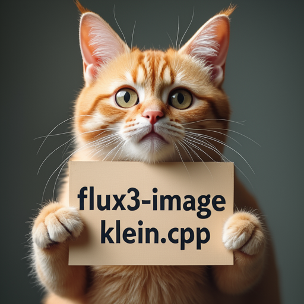

# How to Use

FLUX.3 Image Klein uses a FLUX.3 diffusion transformer, the FLUX.2 VAE, and Qwen3-VL 4B as the LLM text encoder.

## Download weights

- Download FLUX.3 Image Klein
    - safetensors: https://huggingface.co/black-forest-labs/flux-3-image-klein/tree/main
    - gguf: https://huggingface.co/leejet/flux-3-image-klein-GGUF/tree/main
- Download FLUX.3 Image Klein Base
    - safetensors: https://huggingface.co/black-forest-labs/flux-3-image-klein-base/tree/main
    - gguf: https://huggingface.co/leejet/flux-3-image-klein-base-GGUF/tree/main
- Download vae
    - safetensors: https://huggingface.co/black-forest-labs/FLUX.2-dev/tree/main
    - The `ae.safetensors` included with FLUX.3 can also be used.
- Download Qwen3-VL 4B
    - safetensors: https://huggingface.co/Comfy-Org/Krea-2/tree/main/text_encoders
    - gguf: https://huggingface.co/Qwen/Qwen3-VL-4B-Instruct-GGUF/tree/main

Use the root `model.safetensors` for the diffusion model.

## Examples

### FLUX.3 Image Klein

The distilled model uses 16 steps and CFG 1.0.

```
.\bin\Release\sd-cli.exe --diffusion-model ..\models\diffusion_models\flux-3-image-klein.safetensors --llm ..\models\text_encoders\Qwen3-VL-4B-Instruct-Q4_K_M.gguf --vae ..\models\vae\flux2_ae.safetensors -p "a lovely cat holding a sign says 'flux3.cpp'" --cfg-scale 1.0 --steps 16 --sampling-method euler -v --offload-to-cpu
```


```
.\bin\Release\sd-cli.exe --diffusion-model  ..\models\diffusion_models\flux-3-image-klein.safetensors --vae ..\models\vae\flux2_ae.safetensors --llm  ..\models\text_encoders\Qwen3-VL-4B-Instruct-Q4_K_M.gguf -r ..\assets\flux\flux1-dev-q8_0.png -p "change 'flux.cpp' to 'flux3-image-klein.cpp'" --cfg-scale 1.0 --sampling-method euler -v  --offload-to-cpu --steps 16
```



Repeat `-r` to use multiple reference images, up to 10. See [Image Editing](./edit.md) for reference-image preprocessing options.

### FLUX.3 Image Klein Base

```
.\bin\Release\sd-cli.exe --diffusion-model ..\models\diffusion_models\flux-3-image-klein-base.safetensors --llm ..\models\text_encoders\Qwen3-VL-4B-Instruct-Q4_K_M.gguf --vae ..\models\vae\flux2_ae.safetensors -p "a lovely cat holding a sign says 'flux3.cpp'" --cfg-scale 3.5 --steps 20 --sampling-method euler -v --offload-to-cpu
```


The default discrete scheduler uses the upstream time shift of 6.93 for both models. Use `--flow-shift` to override it.
