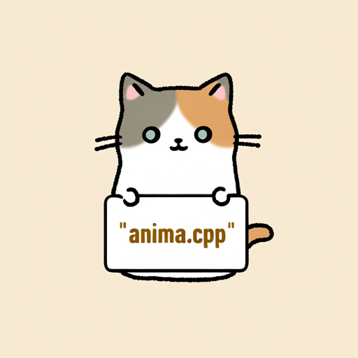

# Anima

Anima generates images from text using a Qwen3 text encoder and a compatible Qwen Image VAE.

## Model files

| Component | Weights and downloads | CLI option | Requirement |
| --- | --- | --- | --- |
| Anima | [Safetensors](https://huggingface.co/circlestone-labs/Anima/tree/main/split_files/diffusion_models)<br>[GGUF](https://huggingface.co/Bedovyy/Anima-GGUF/tree/main)<br>gguf Anima2: [GGUF](https://huggingface.co/JusteLeo/Anima2-GGUF/tree/main) | `--diffusion-model` | Required |
| vae | [Safetensors](https://huggingface.co/circlestone-labs/Anima/tree/main/split_files/vae) | `--vae` | Use matching VAE |
| Qwen3-0.6B-Base | [Safetensors](https://huggingface.co/circlestone-labs/Anima/tree/main/split_files/text_encoders)<br>[GGUF](https://huggingface.co/mradermacher/Qwen3-0.6B-Base-GGUF/tree/main) | `--llm` | Use matching text encoder |

## Usage

CLI examples use the [shared path and shell conventions](README.md#example-conventions).

### Web UI

Follow the [Web UI guide](../../examples/server/README.md#web-ui) to start the
server, then select the recipe matching your weights. Fill the component slots
below and click **Load models**.
Use the files and compatibility requirements in [Model files](#model-files).

| Recipe | Component slots |
| --- | --- |
| Anima (`anima`) | `diffusion_model`, `llm`, `vae`, `tae` |

Slot IDs correspond to CLI component options: `diffusion_model` uses
`--diffusion-model`, `llm` uses `--llm`, and `model` uses `-m` / `--model`.
Select optional components when required by your checkpoint or task.

### CLI

**Windows (PowerShell)**

```powershell
.\bin\Release\sd-cli.exe `
  --diffusion-model ..\models\diffusion_models\anima-preview.safetensors `
  --vae ..\models\vae\qwen_image_vae.safetensors `
  --llm ..\models\text_encoders\qwen_3_06b_base.safetensors `
  -p "a lovely cat holding a sign says 'anima.cpp'" `
  --cfg-scale 6.0 `
  --sampling-method euler `
  --offload-to-cpu `
  -v
```

**Linux/macOS**

```sh
./bin/sd-cli \
  --diffusion-model ../models/diffusion_models/anima-preview.safetensors \
  --vae ../models/vae/qwen_image_vae.safetensors \
  --llm ../models/text_encoders/qwen_3_06b_base.safetensors \
  -p "a lovely cat holding a sign says 'anima.cpp'" \
  --cfg-scale 6.0 \
  --sampling-method euler \
  --offload-to-cpu \
  -v
```


