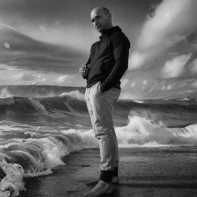
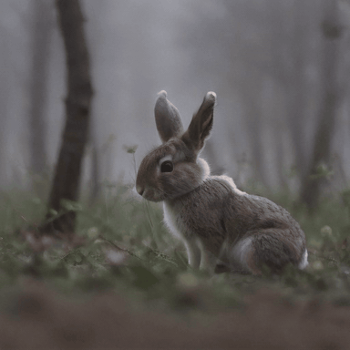
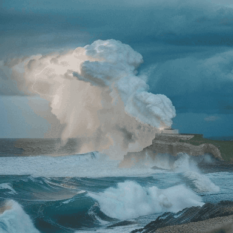
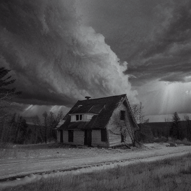
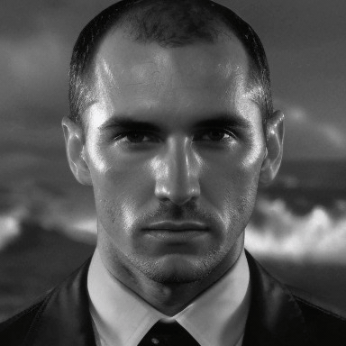
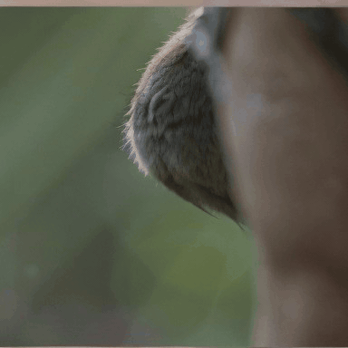
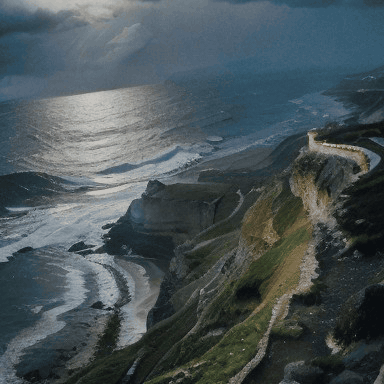
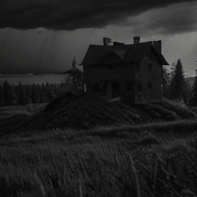
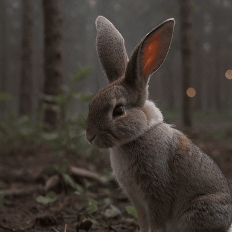
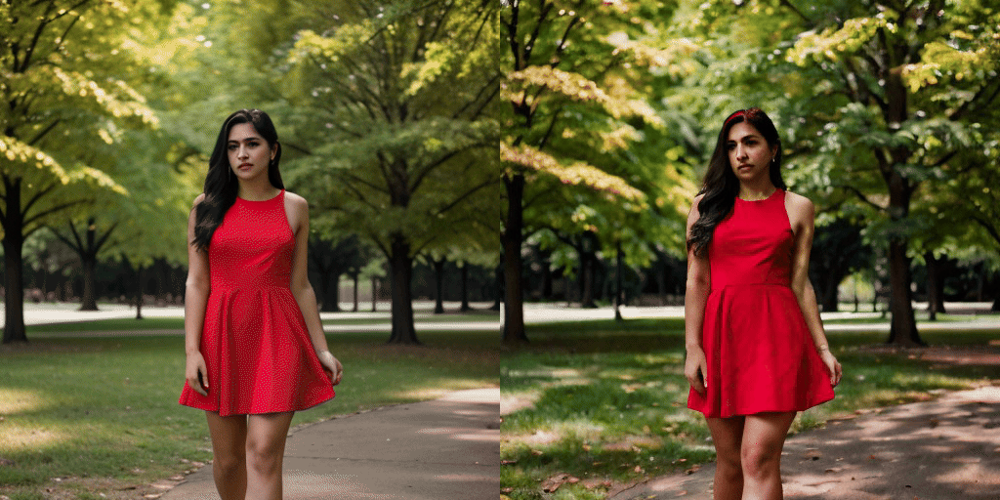

# AnimateDiff

AnimateDiff adds video generation to an SD 1.5 checkpoint using a compatible motion module.

Use the SD 1.5 checkpoint for the desired characters and style, and choose the
motion module and resolution below. See the
[AnimateDiff paper](https://arxiv.org/abs/2307.04725) for the model reference.

**Currently supported only through dgl.**

## Supported variants

Per [animatediff.net/models](https://animatediff.net/models):

| Module              | Base | Native res | Character |
|---------------------|------|------------|-----------|
| `mm_sd_v14.ckpt`    | 1.5  | 256x256    | earliest, more jittery |
| `mm_sd_v15.ckpt`    | 1.5  | 256x256    | improved stability over v1.4 |
| `mm_sd_v15_v2.ckpt` | 1.5  | 384x384    | significantly better motion dynamics |
| `v3_sd15_mm.ckpt`   | 1.5  | 512x512    | smoothest, highest quality; pairs with a Domain Adapter LoRA |
| `mm_sdxl_v10_beta`  | SDXL | 512x512    | experimental, not yet supported here |

Match `height` and `width` to the module's native resolution for best results. v3 is
trained at 512x512 - going smaller (e.g. 384x384) still works but the motion
character is closer to v2.

## Model files

| Component | Weights and downloads | DGL usage | Requirement |
| --- | --- | --- | --- |
| SD 1.5 checkpoint | [Compatible SD 1.5 checkpoint](sd.md) | `load_unet`, `load_text_encoder`, `load_vae` | Required; SDXL motion modules are not supported |
| Motion module | v1/v2/v3 motion weights listed below | `animatediff::load` | Required; match the resolution and version |
| Domain adapter LoRA | v3 adapter listed below | `load_lora`, `apply_lora` | Optional; v3 only |

- Motion module (v3, recommended)
    - fp16 safetensors: https://huggingface.co/conrevo/AnimateDiff-A1111/resolve/main/motion_module/mm_sd15_v3.safetensors
    - original checkpoint: https://huggingface.co/guoyww/animatediff/resolve/main/v3_sd15_mm.ckpt
- SD 1.5 base model
    - any SD 1.5 checkpoint works. `realisticVisionV60B1` and `toonyou_beta3`
      are the ones used in guoyww's reference configs.
- Domain Adapter LoRA (optional, v3 only, sharpens the base UNet's output
  toward the motion module's trained distribution)
    - ckpt: https://huggingface.co/guoyww/animatediff/resolve/main/v3_sd15_adapter.ckpt
    - load it with `load_lora` and apply it to the UNet with `apply_lora`.

The motion module is `~836 MB` and loads alongside the SD 1.5 UNet via
`animatediff::load` / `animatediff::apply`.

## Usage

### Web UI

Open the server's **DGL editor**, edit the same script, and submit it.
Model and input paths must satisfy the server's file-access policy; save outputs
inside its `output/` directory. See the [Web UI guide](../../examples/server/README.md#web-ui).

### DGL

| Example | Description |
| --- | --- |
| [Text to video with CPU offload](../dgl/animatediff/animatediff-realisticvision-v6-txt2video-cpu-offload.dgl) | 8 frames at 512 x 512. |
| [Text to video, 16 frames](../dgl/animatediff/animatediff-realisticvision-v6-txt2video-16-frames.dgl) | Native motion-module context at 384 x 384. |
| [Text to video with a VRAM budget](../dgl/animatediff/animatediff-realisticvision-v6-txt2video-vram-budget.dgl) | Run with `--max-vram 2.0`. |
| [Domain Adapter LoRA](../dgl/animatediff/animatediff-realisticvision-v6-domain-lora.dgl) | Add the v3 adapter before sampling. |
| [Generate the initial image](../dgl/animatediff/realisticvision-v6-txt2img.dgl) | Prepare a still image for the image-to-video example. |
| [Image to video](../dgl/animatediff/animatediff-realisticvision-v6-img2video.dgl) | Animate an existing image. |

#### Run a script

Edit paths, prompts and settings in the script's `var` block, then run from
the build directory. Paths inside the script resolve from the working directory.

**Windows (PowerShell)**

```powershell
.\bin\Release\sd-cli.exe -M dgl --script ..\docs\dgl\animatediff\animatediff-realisticvision-v6-txt2video-cpu-offload.dgl
```

**Linux/macOS**

```sh
./bin/sd-cli -M dgl --script ../docs/dgl/animatediff/animatediff-realisticvision-v6-txt2video-cpu-offload.dgl
```

Choose another script from the table to run a different task. Add `--check`
to validate syntax and types without loading weights. See the
[shared run instructions](../dgl/README.md#run-an-example) for build paths
and the server's file-access rules.

Load the SD 1.5 UNet with `load_unet` and the motion weights with
`animatediff::load`. Use the same compute backend for both models.
`animatediff::apply(unet, motion)` returns a denoiser that shares the original
UNet and adds the motion module. Pass it to both CFG predictors and set the
frame count through the latent shape, for example with
`latent_shape(vae, width = 512, height = 512, batch = 16)`.
The motion checkpoint's positional encoding sets the frame limit.

Use `load_lora` and `apply_lora` for an optional v3 domain adapter.

#### Text-to-video

Generate an 8-frame animation at 512x512, seed 42, 20 steps. The sampler /
scheduler / CFG values in the scripts match what mm_sd15_v3 was trained with; using
SD 1.5 defaults (euler_a, low CFG) produces noise-like output.

Generate at the motion module's native 16-frame context (recommended for
best temporal quality). Needs more VRAM at 512x512, so drop to 384x384 or
use the VRAM-budget example.

The streaming example uses `--max-vram 2.0` (verified on RTX 3060).

#### Reference-quality reproduction

Using guoyww's official reference configs on this impl (RealisticVision v6.0
base + `mm_sd15_v3` or `mm_sd_v15_v2` + native resolution + 16 frames + euler
+ 25 steps + CFG 8 + linear beta schedule) reproduces the reference
AnimateDiff output style.

##### v3 (512x512, `mm_sd15_v3`)

| Prompt                                | Sample |
|---------------------------------------|--------|
| B&W man on stormy coastline           |     |
| Close-up rabbit macro shot            |  |
| Coastline, storm, waves, lightning    |   |
| Old house, storm, forest, night       |   |

##### v2 (384x384, `mm_sd_v15_v2.ckpt`)

| Prompt                                | Sample |
|---------------------------------------|--------|
| B&W man on stormy coastline           |     |
| Close-up rabbit macro shot            |  |
| Coastline, storm, waves, lightning    |   |
| Old house, storm, forest, night       |   |

Motion is strong for scenes with motion cues in the prompt (storm/waves/wind)
and subtle for static subjects (close-up macro), matching reference behavior.
v2 has an additional motion module at the UNet middle block that v3 dropped;
this impl auto-detects the topology from the checkpoint.

##### v3 + Domain Adapter LoRA

Attaching the `v3_sd15_adapter` LoRA sharpens the base UNet output toward
the training distribution the motion module was fine-tuned against. Same
prompt, seed, config as above:



Individual fur strands, glowing inner-ear, and richer forest detail become
visible compared to the no-LoRA rendering.

#### img2video

Set `input_path` to the pre-rendered image. All output frames start from its encoded latent, then receive noise according to `strength`. Character identity, composition, and quality are anchored by the init image; the motion module adds subtle motion on top.

Left: generated starting image. Right: 8-frame AnimateDiff output.



`strength` controls how far the motion module is allowed to deviate from the init image (higher = more motion, lower = more static).

## Notes and limitations

- The motion module was trained at `video_length=16`. Running with
  `frames = 16` gives the best coherence; F=8 works but shows a shorter
  motion arc. Frame counts up to 32 are supported by the positional encoding
  but exceed the trained regime and produce more static output.
- At `frames = 1` the motion module is skipped entirely and the output
  is bit-identical to ordinary image sampling. This avoids the single-token
  temporal-attention degeneracy that would otherwise emit an untrained-magnitude
  residual on a single-frame sample.
- The base UNet is frozen, so character identity and style follow the SD 1.5
  checkpoint selected by `weights`. LoRAs and prompt weighting attach to the
  base model in the usual way.
- No mid_block motion module in v3. `mm_sdxl_v10_beta` (SDXL variant) is not
  supported yet.
- Output is written as MJPEG AVI. Use `fps` to set playback speed.
