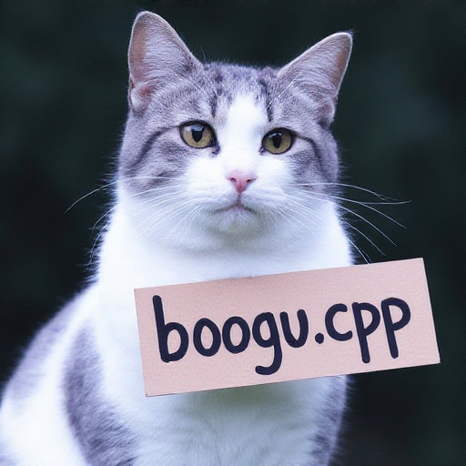
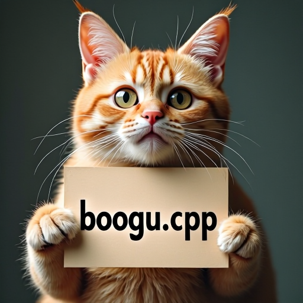

# Boogu Image

Boogu Image uses a Boogu diffusion transformer, the FLUX VAE, and Qwen3-VL as the LLM text and vision encoder.

## Model files

| Component | Weights and downloads | CLI option | Requirement |
| --- | --- | --- | --- |
| Boogu Image | [Safetensors](https://huggingface.co/Comfy-Org/Boogu-Image/tree/main/diffusion_models) | `--diffusion-model` | Required |
| vae | [Safetensors](https://huggingface.co/black-forest-labs/FLUX.1-dev/blob/main/ae.safetensors) | `--vae` | Use matching VAE |
| Qwen3-VL 8B | [GGUF](https://huggingface.co/unsloth/Qwen3-VL-8B-Instruct-GGUF/tree/main)<br>For image editing with GGUF text encoders, also download the matching mmproj file and pass it with `--llm_vision`. | `--llm` | Use matching text encoder |

## Usage

CLI examples use the [shared path and shell conventions](README.md#example-conventions).

### Web UI

Follow the [Web UI guide](../../examples/server/README.md#web-ui) to start the
server, then select the recipe matching your weights. Fill the component slots
below and click **Load models**.
Use the files and compatibility requirements in [Model files](#model-files).

| Recipe | Component slots |
| --- | --- |
| Boogu Image Base (`boogu-image`) | `diffusion_model`, `llm`, `vae`, `tae` |
| Boogu Image Edit (`boogu-image-edit`) | `diffusion_model`, `llm`, `llm_vision`, `vae`, `tae` |

Slot IDs correspond to CLI component options: `diffusion_model` uses
`--diffusion-model`, `llm` uses `--llm`, and `model` uses `-m` / `--model`.
Select optional components when required by your checkpoint or task.

### CLI

#### Boogu Image Base

**Windows (PowerShell)**

```powershell
.\bin\Release\sd-cli.exe `
  --diffusion-model ..\models\diffusion_models\boogu_image_base_bf16.safetensors `
  --llm ..\models\text_encoders\Qwen3VL-8B-Instruct-Q4_K_M.gguf `
  --vae ..\models\vae\ae.sft `
  -p "a lovely cat" `
  --offload-to-cpu `
  -v
```

**Linux/macOS**

```sh
./bin/sd-cli \
  --diffusion-model ../models/diffusion_models/boogu_image_base_bf16.safetensors \
  --llm ../models/text_encoders/Qwen3VL-8B-Instruct-Q4_K_M.gguf \
  --vae ../models/vae/ae.sft \
  -p "a lovely cat" \
  --offload-to-cpu \
  -v
```



#### Boogu Image Edit

**Windows (PowerShell)**

```powershell
.\bin\Release\sd-cli.exe `
  --diffusion-model ..\models\diffusion_models\boogu_image_edit_bf16.safetensors `
  --llm ..\models\text_encoders\Qwen3VL-8B-Instruct-Q4_K_M.gguf `
  --llm_vision ..\models\text_encoders\mmproj-Qwen3VL-8B-Instruct-F16.gguf `
  --vae ..\models\vae\ae.sft `
  -r ..\inputs\flux\flux1-dev-q8_0.png `
  -p "change 'flux.cpp' to 'boogu.cpp'" `
  --offload-to-cpu `
  -v
```

**Linux/macOS**

```sh
./bin/sd-cli \
  --diffusion-model ../models/diffusion_models/boogu_image_edit_bf16.safetensors \
  --llm ../models/text_encoders/Qwen3VL-8B-Instruct-Q4_K_M.gguf \
  --llm_vision ../models/text_encoders/mmproj-Qwen3VL-8B-Instruct-F16.gguf \
  --vae ../models/vae/ae.sft \
  -r ../inputs/flux/flux1-dev-q8_0.png \
  -p "change 'flux.cpp' to 'boogu.cpp'" \
  --offload-to-cpu \
  -v
```


