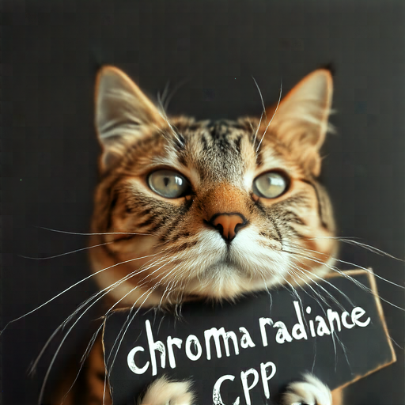

# Chroma1-Radiance

Chroma1-Radiance generates images directly in pixel space using T5-XXL. No VAE is required.

## Model files

| Component | Weights and downloads | CLI option | Requirement |
| --- | --- | --- | --- |
| Chroma1-Radiance | [Safetensors](https://huggingface.co/lodestones/Chroma1-Radiance/tree/main)<br>[GGUF](https://huggingface.co/silveroxides/Chroma1-Radiance-GGUF/tree/main) | `--diffusion-model` | Required |
| t5xxl | [Safetensors](https://huggingface.co/comfyanonymous/flux_text_encoders/blob/main/t5xxl_fp16.safetensors) | `--t5xxl` | Required |

## Usage

CLI examples use the [shared path and shell conventions](README.md#example-conventions).

### Web UI

Follow the [Web UI guide](../../examples/server/README.md#web-ui) to start the
server, then select the recipe matching your weights. Fill the component slots
below and click **Load models**.
Use the files and compatibility requirements in [Model files](#model-files).

| Recipe | Component slots |
| --- | --- |
| Chroma Radiance (`chroma-radiance`) | `diffusion_model`, `t5xxl` |

Slot IDs correspond to CLI component options: `diffusion_model` uses
`--diffusion-model`, `llm` uses `--llm`, and `model` uses `-m` / `--model`.
Select optional components when required by your checkpoint or task.

### CLI

**Windows (PowerShell)**

```powershell
.\bin\Release\sd-cli.exe `
  --diffusion-model ..\models\diffusion_models\Chroma1-Radiance-v0.4-Q8_0.gguf `
  --t5xxl ..\models\text_encoders\clip\t5xxl_fp16.safetensors `
  -p "a lovely cat holding a sign says 'chroma  radiance cpp'" `
  --cfg-scale 4.0 `
  --sampling-method euler `
  -v
```

**Linux/macOS**

```sh
./bin/sd-cli \
  --diffusion-model ../models/diffusion_models/Chroma1-Radiance-v0.4-Q8_0.gguf \
  --t5xxl ../models/text_encoders/clip/t5xxl_fp16.safetensors \
  -p "a lovely cat holding a sign says 'chroma  radiance cpp'" \
  --cfg-scale 4.0 \
  --sampling-method euler \
  -v
```


