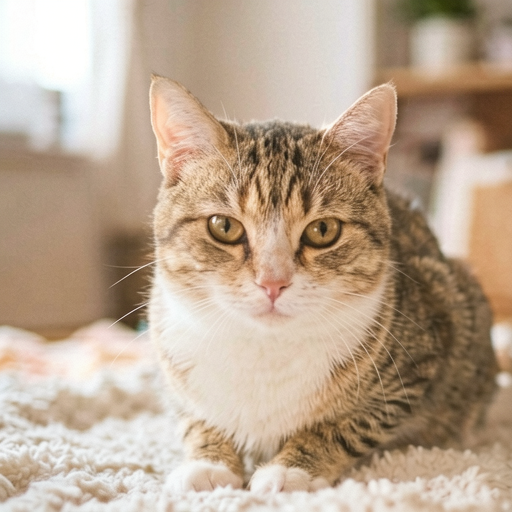

# ERNIE-Image

ERNIE-Image and ERNIE-Image-Turbo generate images from text using the FLUX.2 VAE
and a Ministral 3 3B text encoder.

You can run ERNIE-Image with stable-diffusion.cpp on GPUs with 4GB of VRAM — or even less.

## Model files

| Component | Weights and downloads | CLI option | Requirement |
| --- | --- | --- | --- |
| ERNIE-Image-Turbo | [Safetensors](https://huggingface.co/Comfy-Org/ERNIE-Image/tree/main/diffusion_models)<br>[GGUF](https://huggingface.co/unsloth/ERNIE-Image-Turbo-GGUF/tree/main) | `--diffusion-model` | Choose Turbo or Base |
| ERNIE-Image | [Safetensors](https://huggingface.co/Comfy-Org/ERNIE-Image/tree/main/diffusion_models)<br>[GGUF](https://huggingface.co/unsloth/ERNIE-Image-GGUF/tree/main) | `--diffusion-model` | Choose Turbo or Base |
| FLUX.2 VAE | [Safetensors](https://huggingface.co/Comfy-Org/ERNIE-Image/tree/main/vae) | `--vae` | Required for these examples |
| Ministral 3 3B text encoder | [Safetensors](https://huggingface.co/Comfy-Org/ERNIE-Image/tree/main/text_encoders)<br>[GGUF](https://huggingface.co/unsloth/Ministral-3-3B-Instruct-2512-GGUF/tree/main) | `--llm` | Required |

## Usage

### Web UI

Follow the [Web UI guide](../../examples/server/README.md#web-ui) to start the
server, then select the recipe matching your weights. Fill the component slots
below and click **Load models**.
Use the files and compatibility requirements in [Model files](#model-files).

| Recipe | Component slots |
| --- | --- |
| ERNIE Image Turbo (`ernie-image-turbo`) | `diffusion_model`, `llm`, `vae`, `tae` |
| ERNIE Image (`ernie-image`) | `diffusion_model`, `llm`, `vae`, `tae` |

Slot IDs correspond to CLI component options: `diffusion_model` uses
`--diffusion-model`, `llm` uses `--llm`, and `model` uses `-m` / `--model`.
Select optional components when required by your checkpoint or task.

### DGL

| Example | Description |
| --- | --- |
| [ERNIE-Image Turbo](../dgl/ernie_image/ernie-image-turbo-txt2img.dgl) | Text-to-image generation. |
| [ERNIE-Image](../dgl/ernie_image/ernie-image-txt2img.dgl) | Text-to-image generation. |

#### Run a script

Edit paths, prompts and settings in the script's `var` block, then run from
the build directory. Paths inside the script resolve from the working directory.

**Windows (PowerShell)**

```powershell
.\bin\Release\sd-cli.exe -M dgl --script ..\docs\dgl\ernie_image\ernie-image-turbo-txt2img.dgl
```

**Linux/macOS**

```sh
./bin/sd-cli -M dgl --script ../docs/dgl/ernie_image/ernie-image-turbo-txt2img.dgl
```

Choose another script from the table to run a different task. Add `--check`
to validate syntax and types without loading weights. See the
[shared run instructions](../dgl/README.md#run-an-example) for build paths
and the server's file-access rules.

### Legacy CLI

CLI examples use the [shared path and shell conventions](README.md#example-conventions).

#### ERNIE-Image-Turbo

**Windows (PowerShell)**

```powershell
.\bin\Release\sd-cli.exe `
  --diffusion-model ..\models\diffusion_models\ernie-image-turbo.safetensors `
  --vae ..\models\vae\flux2_ae.safetensors `
  --llm ..\models\text_encoders\ministral-3-3b.safetensors `
  -p "a lovely cat" `
  --cfg-scale 1.0 `
  --steps 8 `
  --offload-to-cpu `
  -v
```

**Linux/macOS**

```sh
./bin/sd-cli \
  --diffusion-model ../models/diffusion_models/ernie-image-turbo.safetensors \
  --vae ../models/vae/flux2_ae.safetensors \
  --llm ../models/text_encoders/ministral-3-3b.safetensors \
  -p "a lovely cat" \
  --cfg-scale 1.0 \
  --steps 8 \
  --offload-to-cpu \
  -v
```



#### ERNIE-Image

**Windows (PowerShell)**

```powershell
.\bin\Release\sd-cli.exe `
  --diffusion-model ..\models\diffusion_models\ernie-image-UD-Q4_K_M.gguf `
  --vae ..\models\vae\flux2_ae.safetensors `
  --llm ..\models\text_encoders\ministral-3-3b.safetensors `
  -p "a lovely cat" `
  --cfg-scale 5.0 `
  --offload-to-cpu `
  -v
```

**Linux/macOS**

```sh
./bin/sd-cli \
  --diffusion-model ../models/diffusion_models/ernie-image-UD-Q4_K_M.gguf \
  --vae ../models/vae/flux2_ae.safetensors \
  --llm ../models/text_encoders/ministral-3-3b.safetensors \
  -p "a lovely cat" \
  --cfg-scale 5.0 \
  --offload-to-cpu \
  -v
```


