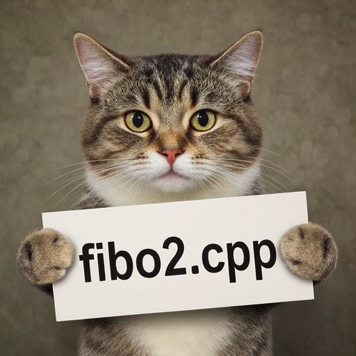
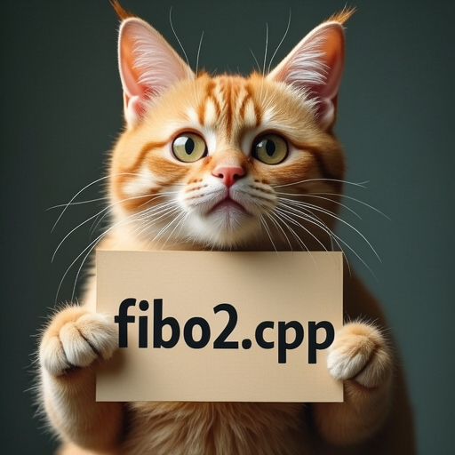

# Fibo 2.0

Fibo 2.0 uses a Fibo diffusion transformer, the standard FLUX.2 VAE, and Qwen3-VL 4B as the LLM text encoder. The Qwen tokenizer is built in.

## Model files

| Component | Weights and downloads | CLI option | Requirement |
| --- | --- | --- | --- |
| Fibo 2.0 Dev | [Safetensors](https://huggingface.co/Comfy-Org/Fibo-2.0/tree/main/diffusion_models) | `--diffusion-model` | Choose matching variant |
| Fibo 2.0 Edit Turbo | [Safetensors](https://huggingface.co/Comfy-Org/Fibo-2.0/tree/main/diffusion_models) | `--diffusion-model` | Choose matching variant |
| vae | [Safetensors](https://huggingface.co/black-forest-labs/FLUX.2-dev/tree/main) | `--vae` | Use matching VAE |
| Qwen3-VL 4B | [Safetensors](https://huggingface.co/Comfy-Org/Fibo-2.0/tree/main/text_encoders)<br>[GGUF](https://huggingface.co/Qwen/Qwen3-VL-4B-Instruct-GGUF/tree/main) | `--llm` | Use matching text encoder |

The original Diffusers weights from [briaai/Fibo-2.0-dev](https://huggingface.co/briaai/Fibo-2.0-dev) and [briaai/Fibo-2.0-edit-turbo](https://huggingface.co/briaai/Fibo-2.0-edit-turbo) are also supported. Pass the transformer's `diffusion_pytorch_model.safetensors.index.json` to `--diffusion-model` and keep its shards alongside it.

INT8 convrot weights load directly; see [INT8 convrot](../guides/int8_convrot.md) for backend requirements.

## Usage

### Web UI

Follow the [Web UI guide](../../examples/server/README.md#web-ui) to start the
server, then select the recipe matching your weights. Fill the component slots
below and click **Load models**.
Use the files and compatibility requirements in [Model files](#model-files).

| Recipe | Component slots |
| --- | --- |
| Fibo 2.0 Dev (`fibo2-dev`) | `diffusion_model`, `llm`, `llm_vision`, `vae` |
| Fibo 2.0 Edit Turbo (`fibo2-edit-turbo`) | `diffusion_model`, `llm`, `llm_vision`, `vae` |

Slot IDs correspond to CLI component options: `diffusion_model` uses
`--diffusion-model`, `llm` uses `--llm`, and `model` uses `-m` / `--model`.
Select optional components when required by your checkpoint or task.

### DGL

| Example | Description |
| --- | --- |
| [Dev: text to image](../dgl/fibo2/fibo2-dev-txt2img.dgl) | Generate an image from a prompt. |
| [Dev: image editing](../dgl/fibo2/fibo2-dev-edit.dgl) | Edit a reference image. |
| [Edit Turbo](../dgl/fibo2/fibo2-edit-turbo.dgl) | Image editing with distilled weights. |

#### Run a script

Edit paths, prompts and settings in the script's `var` block, then run from
the build directory. Paths inside the script resolve from the working directory.

**Windows (PowerShell)**

```powershell
.\bin\Release\sd-cli.exe -M dgl --script ..\docs\dgl\fibo2\fibo2-dev-txt2img.dgl
```

**Linux/macOS**

```sh
./bin/sd-cli -M dgl --script ../docs/dgl/fibo2/fibo2-dev-txt2img.dgl
```

Choose another script from the table to run a different task. Add `--check`
to validate syntax and types without loading weights. See the
[shared run instructions](../dgl/README.md#run-an-example) for build paths
and the server's file-access rules.

### Legacy CLI

CLI examples use the [shared path and shell conventions](README.md#example-conventions).

#### Fibo 2.0 Dev

Dev supports both text-to-image generation and reference-image editing.

**Windows (PowerShell)**

```powershell
.\bin\Release\sd-cli.exe `
  --diffusion-model ..\models\diffusion_models\fibo2_dev_int8_convrot.safetensors `
  --llm ..\models\text_encoders\Qwen3-VL-4B-Instruct-Q4_K_M.gguf `
  --llm_vision ..\models\text_encoders\Qwen3-VL-4B-Instruct-mmproj-BF16.gguf `
  --vae ..\models\vae\flux2_ae.safetensors `
  -p "a lovely cat holding a sign says 'fibo2.cpp'" `
  --cfg-scale 5.0 `
  --sampling-method euler `
  --offload-to-cpu `
  -v
```

**Linux/macOS**

```sh
./bin/sd-cli \
  --diffusion-model ../models/diffusion_models/fibo2_dev_int8_convrot.safetensors \
  --llm ../models/text_encoders/Qwen3-VL-4B-Instruct-Q4_K_M.gguf \
  --llm_vision ../models/text_encoders/Qwen3-VL-4B-Instruct-mmproj-BF16.gguf \
  --vae ../models/vae/flux2_ae.safetensors \
  -p "a lovely cat holding a sign says 'fibo2.cpp'" \
  --cfg-scale 5.0 \
  --sampling-method euler \
  --offload-to-cpu \
  -v
```



**Windows (PowerShell)**

```powershell
.\bin\Release\sd-cli.exe `
  --diffusion-model ..\models\diffusion_models\fibo2_dev_int8_convrot.safetensors `
  --llm ..\models\text_encoders\Qwen3-VL-4B-Instruct-Q4_K_M.gguf `
  --llm_vision ..\models\text_encoders\Qwen3-VL-4B-Instruct-mmproj-BF16.gguf `
  --vae ..\models\vae\flux2_ae.safetensors `
  -r ..\inputs\flux\flux1-dev-q8_0.png `
  -p "change 'flux.cpp' to 'fibo2.cpp'" `
  --cfg-scale 5.0 `
  --sampling-method euler `
  --offload-to-cpu `
  -v
```

**Linux/macOS**

```sh
./bin/sd-cli \
  --diffusion-model ../models/diffusion_models/fibo2_dev_int8_convrot.safetensors \
  --llm ../models/text_encoders/Qwen3-VL-4B-Instruct-Q4_K_M.gguf \
  --llm_vision ../models/text_encoders/Qwen3-VL-4B-Instruct-mmproj-BF16.gguf \
  --vae ../models/vae/flux2_ae.safetensors \
  -r ../inputs/flux/flux1-dev-q8_0.png \
  -p "change 'flux.cpp' to 'fibo2.cpp'" \
  --cfg-scale 5.0 \
  --sampling-method euler \
  --offload-to-cpu \
  -v
```



#### Fibo 2.0 Edit Turbo

Edit Turbo is distilled for reference-image editing in 4 steps with CFG 1.

**Windows (PowerShell)**

```powershell
.\bin\Release\sd-cli.exe `
  --diffusion-model ..\models\diffusion_models\fibo2_edit_turbo_int8_convrot.safetensors `
  --llm ..\models\text_encoders\Qwen3-VL-4B-Instruct-Q4_K_M.gguf `
  --llm_vision ..\models\text_encoders\Qwen3-VL-4B-Instruct-mmproj-BF16.gguf `
  --vae ..\models\vae\flux2_ae.safetensors `
  -r ..\inputs\flux\flux1-dev-q8_0.png `
  -p "change 'flux.cpp' to 'fibo2.cpp'" `
  --cfg-scale 1 `
  --steps 4 `
  --sampling-method euler `
  --offload-to-cpu `
  -v
```

**Linux/macOS**

```sh
./bin/sd-cli \
  --diffusion-model ../models/diffusion_models/fibo2_edit_turbo_int8_convrot.safetensors \
  --llm ../models/text_encoders/Qwen3-VL-4B-Instruct-Q4_K_M.gguf \
  --llm_vision ../models/text_encoders/Qwen3-VL-4B-Instruct-mmproj-BF16.gguf \
  --vae ../models/vae/flux2_ae.safetensors \
  -r ../inputs/flux/flux1-dev-q8_0.png \
  -p "change 'flux.cpp' to 'fibo2.cpp'" \
  --cfg-scale 1 \
  --steps 4 \
  --sampling-method euler \
  --offload-to-cpu \
  -v
```

The BF16 files accept the same options. Use dimensions divisible by 16. Repeat `-r` to use multiple reference images; instructions can refer to `<image_1>`, `<image_2>`, etc. See [Image Editing](../guides/edit.md) for reference-image preprocessing options. Separate GGUF text encoders need their vision projector passed with `--llm_vision` for editing.

The default reference policy scales and center-crops a single reference to
the output dimensions. Multiple references use aspect-ratio buckets near one
megapixel, aligned to 16 pixels. VAE and vision encoding share those crops;
the vision encoder uses a smaller copy with a maximum side of 768 pixels.
Use a [DGL editing workflow](../guides/edit.md#custom-reference-processing) for
custom geometry or different VAE and vision inputs.
