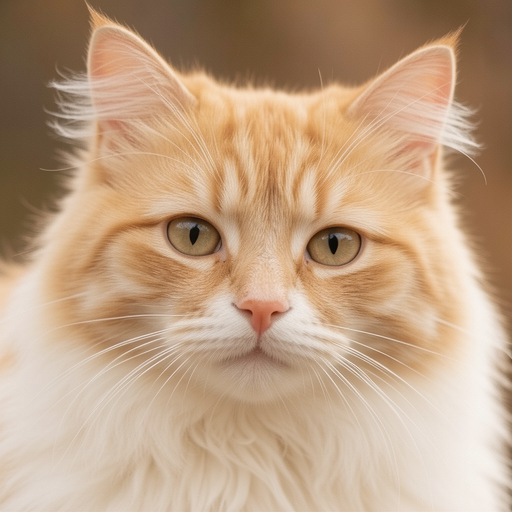

# FLUX.2

FLUX.2 supports text-to-image generation and reference-image editing. Choose
the text encoder matching the transformer variant.

## Model files

### Flux.2-dev

| Component | Weights and downloads | CLI option | Requirement |
| --- | --- | --- | --- |
| FLUX.2 dev | [GGUF](https://huggingface.co/city96/FLUX.2-dev-gguf/tree/main) | `--diffusion-model` | Required for dev |
| FLUX.2 VAE | [Safetensors](https://huggingface.co/black-forest-labs/FLUX.2-dev/tree/main) | `--vae` | Choose one compatible VAE |
| FLUX.2 small decoder | [Safetensors](https://huggingface.co/black-forest-labs/FLUX.2-small-decoder/tree/main) | `--vae` | Alternative VAE |
| Mistral Small 3.2 24B | [GGUF](https://huggingface.co/unsloth/Mistral-Small-3.2-24B-Instruct-2506-GGUF/tree/main) | `--llm` | Required for dev |

### Flux.2 klein 4B / Flux.2 klein base 4B

| Component | Weights and downloads | CLI option | Requirement |
| --- | --- | --- | --- |
| FLUX.2 Klein 4B | [Safetensors](https://huggingface.co/black-forest-labs/FLUX.2-klein-4B)<br>[GGUF](https://huggingface.co/leejet/FLUX.2-klein-4B-GGUF/tree/main) | `--diffusion-model` | Choose Klein or Klein Base |
| FLUX.2 Klein Base 4B | [Safetensors](https://huggingface.co/black-forest-labs/FLUX.2-klein-base-4B)<br>[GGUF](https://huggingface.co/leejet/FLUX.2-klein-base-4B-GGUF/tree/main) | `--diffusion-model` | Choose Klein or Klein Base |
| FLUX.2 VAE | [Safetensors](https://huggingface.co/black-forest-labs/FLUX.2-dev/tree/main) | `--vae` | Choose one compatible VAE |
| FLUX.2 small decoder | [Safetensors](https://huggingface.co/black-forest-labs/FLUX.2-small-decoder/tree/main) | `--vae` | Alternative VAE |
| Qwen3 4B | [Safetensors](https://huggingface.co/Comfy-Org/flux2-klein-4B/tree/main/split_files/text_encoders)<br>[GGUF](https://huggingface.co/unsloth/Qwen3-4B-GGUF/tree/main) | `--llm` | Required for 4B variants |

### Flux.2 klein 9B / Flux.2 klein base 9B

| Component | Weights and downloads | CLI option | Requirement |
| --- | --- | --- | --- |
| FLUX.2 Klein 9B | [Safetensors](https://huggingface.co/black-forest-labs/FLUX.2-klein-9B)<br>[GGUF](https://huggingface.co/leejet/FLUX.2-klein-9B-GGUF/tree/main) | `--diffusion-model` | Choose Klein or Klein Base |
| FLUX.2 Klein Base 9B | [Safetensors](https://huggingface.co/black-forest-labs/FLUX.2-klein-base-9B)<br>[GGUF](https://huggingface.co/leejet/FLUX.2-klein-base-9B-GGUF/tree/main) | `--diffusion-model` | Choose Klein or Klein Base |
| FLUX.2 VAE | [Safetensors](https://huggingface.co/black-forest-labs/FLUX.2-dev/tree/main) | `--vae` | Required for these examples |
| Qwen3 8B | [Safetensors](https://huggingface.co/Comfy-Org/flux2-klein-9B/tree/main/split_files/text_encoders)<br>[GGUF](https://huggingface.co/unsloth/Qwen3-8B-GGUF/tree/main) | `--llm` | Required for 9B variants |

## Usage

CLI examples use the [shared path and shell conventions](README.md#example-conventions).

### Web UI

Follow the [Web UI guide](../../examples/server/README.md#web-ui) to start the
server, then select the recipe matching your weights. Fill the component slots
below and click **Load models**.
Use the files and compatibility requirements in [Model files](#model-files).

| Recipe | Component slots |
| --- | --- |
| FLUX.2 dev (`flux2-dev`) | `diffusion_model`, `llm`, `vae`, `tae` |
| FLUX.2 Klein 4B (`flux2-klein-4b`) | `diffusion_model`, `llm`, `vae`, `tae` |
| FLUX.2 Klein Base 4B (`flux2-klein-base-4b`) | `diffusion_model`, `llm`, `vae`, `tae` |
| FLUX.2 Klein 9B (`flux2-klein-9b`) | `diffusion_model`, `llm`, `vae`, `tae` |
| FLUX.2 Klein Base 9B (`flux2-klein-base-9b`) | `diffusion_model`, `llm`, `vae`, `tae` |

Slot IDs correspond to CLI component options: `diffusion_model` uses
`--diffusion-model`, `llm` uses `--llm`, and `model` uses `-m` / `--model`.
Select optional components when required by your checkpoint or task.

### CLI

#### Flux.2-dev

**Windows (PowerShell)**

```powershell
.\bin\Release\sd-cli.exe `
  --diffusion-model ..\models\diffusion_models\flux2-dev-Q4_K_S.gguf `
  --vae ..\models\vae\flux2_ae.safetensors `
  --llm ..\models\text_encoders\Mistral-Small-3.2-24B-Instruct-2506-Q4_K_M.gguf `
  -r .\kontext_input.png `
  -p "change 'flux.cpp' to 'flux2-dev.cpp'" `
  --cfg-scale 1.0 `
  --sampling-method euler `
  --offload-to-cpu `
  -v
```

**Linux/macOS**

```sh
./bin/sd-cli \
  --diffusion-model ../models/diffusion_models/flux2-dev-Q4_K_S.gguf \
  --vae ../models/vae/flux2_ae.safetensors \
  --llm ../models/text_encoders/Mistral-Small-3.2-24B-Instruct-2506-Q4_K_M.gguf \
  -r ./kontext_input.png \
  -p "change 'flux.cpp' to 'flux2-dev.cpp'" \
  --cfg-scale 1.0 \
  --sampling-method euler \
  --offload-to-cpu \
  -v
```


#### Flux.2 klein 4B / Flux.2 klein base 4B

**Windows (PowerShell)**

```powershell
.\bin\Release\sd-cli.exe `
  --diffusion-model ..\models\diffusion_models\flux-2-klein-4b.safetensors `
  --vae ..\models\vae\flux2_ae.safetensors `
  --llm ..\models\text_encoders\qwen_3_4b.safetensors `
  -p "a lovely cat" `
  --cfg-scale 1.0 `
  --steps 4 `
  --offload-to-cpu `
  -v
```

**Linux/macOS**

```sh
./bin/sd-cli \
  --diffusion-model ../models/diffusion_models/flux-2-klein-4b.safetensors \
  --vae ../models/vae/flux2_ae.safetensors \
  --llm ../models/text_encoders/qwen_3_4b.safetensors \
  -p "a lovely cat" \
  --cfg-scale 1.0 \
  --steps 4 \
  --offload-to-cpu \
  -v
```


**Windows (PowerShell)**

```powershell
.\bin\Release\sd-cli.exe `
  --diffusion-model ..\models\diffusion_models\flux-2-klein-4b.safetensors `
  --vae ..\models\vae\flux2_ae.safetensors `
  --llm ..\models\text_encoders\qwen_3_4b.safetensors `
  -r .\kontext_input.png `
  -p "change 'flux.cpp' to 'klein.cpp'" `
  --cfg-scale 1.0 `
  --sampling-method euler `
  --steps 4 `
  --offload-to-cpu `
  -v
```

**Linux/macOS**

```sh
./bin/sd-cli \
  --diffusion-model ../models/diffusion_models/flux-2-klein-4b.safetensors \
  --vae ../models/vae/flux2_ae.safetensors \
  --llm ../models/text_encoders/qwen_3_4b.safetensors \
  -r ./kontext_input.png \
  -p "change 'flux.cpp' to 'klein.cpp'" \
  --cfg-scale 1.0 \
  --sampling-method euler \
  --steps 4 \
  --offload-to-cpu \
  -v
```


**Windows (PowerShell)**

```powershell
.\bin\Release\sd-cli.exe `
  --diffusion-model ..\models\diffusion_models\flux-2-klein-base-4b.safetensors `
  --vae ..\models\vae\flux2_ae.safetensors `
  --llm ..\models\text_encoders\qwen_3_4b.safetensors `
  -p "a lovely cat" `
  --cfg-scale 4.0 `
  --steps 20 `
  --offload-to-cpu `
  -v
```

**Linux/macOS**

```sh
./bin/sd-cli \
  --diffusion-model ../models/diffusion_models/flux-2-klein-base-4b.safetensors \
  --vae ../models/vae/flux2_ae.safetensors \
  --llm ../models/text_encoders/qwen_3_4b.safetensors \
  -p "a lovely cat" \
  --cfg-scale 4.0 \
  --steps 20 \
  --offload-to-cpu \
  -v
```


#### Flux.2 klein 9B / Flux.2 klein base 9B

**Windows (PowerShell)**

```powershell
.\bin\Release\sd-cli.exe `
  --diffusion-model ..\models\diffusion_models\flux-2-klein-9b.safetensors `
  --vae ..\models\vae\flux2_ae.safetensors `
  --llm ..\models\text_encoders\qwen_3_8b.safetensors `
  -p "a lovely cat" `
  --cfg-scale 1.0 `
  --steps 4 `
  --offload-to-cpu `
  -v
```

**Linux/macOS**

```sh
./bin/sd-cli \
  --diffusion-model ../models/diffusion_models/flux-2-klein-9b.safetensors \
  --vae ../models/vae/flux2_ae.safetensors \
  --llm ../models/text_encoders/qwen_3_8b.safetensors \
  -p "a lovely cat" \
  --cfg-scale 1.0 \
  --steps 4 \
  --offload-to-cpu \
  -v
```


**Windows (PowerShell)**

```powershell
.\bin\Release\sd-cli.exe `
  --diffusion-model ..\models\diffusion_models\flux-2-klein-9b.safetensors `
  --vae ..\models\vae\flux2_ae.safetensors `
  --llm ..\models\text_encoders\qwen_3_8b.safetensors `
  -r .\kontext_input.png `
  -p "change 'flux.cpp' to 'klein.cpp'" `
  --cfg-scale 1.0 `
  --sampling-method euler `
  --steps 4 `
  --offload-to-cpu `
  -v
```

**Linux/macOS**

```sh
./bin/sd-cli \
  --diffusion-model ../models/diffusion_models/flux-2-klein-9b.safetensors \
  --vae ../models/vae/flux2_ae.safetensors \
  --llm ../models/text_encoders/qwen_3_8b.safetensors \
  -r ./kontext_input.png \
  -p "change 'flux.cpp' to 'klein.cpp'" \
  --cfg-scale 1.0 \
  --sampling-method euler \
  --steps 4 \
  --offload-to-cpu \
  -v
```


**Windows (PowerShell)**

```powershell
.\bin\Release\sd-cli.exe `
  --diffusion-model ..\models\diffusion_models\flux-2-klein-base-9b.safetensors `
  --vae ..\models\vae\flux2_ae.safetensors `
  --llm ..\models\text_encoders\qwen_3_8b.safetensors `
  -p "a lovely cat" `
  --cfg-scale 4.0 `
  --steps 20 `
  --offload-to-cpu `
  -v
```

**Linux/macOS**

```sh
./bin/sd-cli \
  --diffusion-model ../models/diffusion_models/flux-2-klein-base-9b.safetensors \
  --vae ../models/vae/flux2_ae.safetensors \
  --llm ../models/text_encoders/qwen_3_8b.safetensors \
  -p "a lovely cat" \
  --cfg-scale 4.0 \
  --steps 20 \
  --offload-to-cpu \
  -v
```


