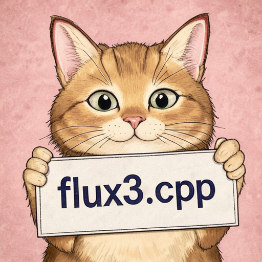
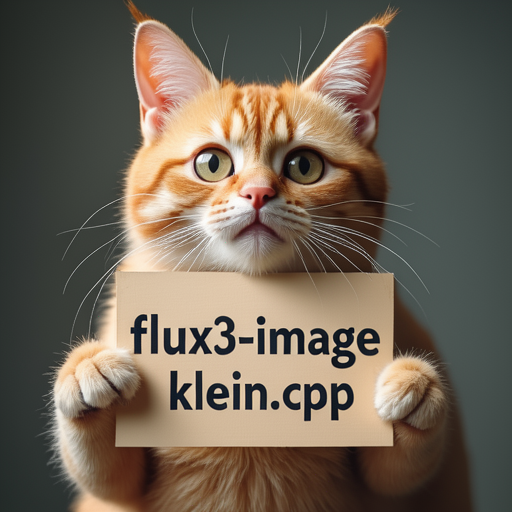

# FLUX.3 Image

FLUX.3 Image Klein uses a FLUX.3 diffusion transformer, the FLUX.2 VAE, and Qwen3-VL 4B as the LLM text encoder.

## Model files

| Component | Weights and downloads | CLI option | Requirement |
| --- | --- | --- | --- |
| FLUX.3 Image Klein | [Safetensors](https://huggingface.co/black-forest-labs/flux-3-image-klein/tree/main)<br>[GGUF](https://huggingface.co/leejet/flux-3-image-klein-GGUF/tree/main) | `--diffusion-model` | Choose matching variant |
| FLUX.3 Image Klein Base | [Safetensors](https://huggingface.co/black-forest-labs/flux-3-image-klein-base/tree/main)<br>[GGUF](https://huggingface.co/leejet/flux-3-image-klein-base-GGUF/tree/main) | `--diffusion-model` | Choose matching variant |
| vae | [Safetensors](https://huggingface.co/black-forest-labs/FLUX.2-dev/tree/main)<br>The `ae.safetensors` included with FLUX.3 can also be used. | `--vae` | Use matching VAE |
| Qwen3-VL 4B | [Safetensors](https://huggingface.co/Comfy-Org/Krea-2/tree/main/text_encoders)<br>[GGUF](https://huggingface.co/Qwen/Qwen3-VL-4B-Instruct-GGUF/tree/main) | `--llm` | Use matching text encoder |

Use the root `model.safetensors` for the diffusion model.

## Usage

CLI examples use the [shared path and shell conventions](README.md#example-conventions).

### Web UI

Follow the [Web UI guide](../../examples/server/README.md#web-ui) to start the
server, then select the recipe matching your weights. Fill the component slots
below and click **Load models**.
Use the files and compatibility requirements in [Model files](#model-files).

| Recipe | Component slots |
| --- | --- |
| FLUX.3 Image Klein (`flux3-klein`) | `diffusion_model`, `llm`, `vae`, `tae` |
| FLUX.3 Image Klein Base (`flux3-klein-base`) | `diffusion_model`, `llm`, `vae`, `tae` |

Slot IDs correspond to CLI component options: `diffusion_model` uses
`--diffusion-model`, `llm` uses `--llm`, and `model` uses `-m` / `--model`.
Select optional components when required by your checkpoint or task.

### CLI

#### FLUX.3 Image Klein

The distilled model uses 16 steps and CFG 1.0.

**Windows (PowerShell)**

```powershell
.\bin\Release\sd-cli.exe `
  --diffusion-model ..\models\diffusion_models\flux-3-image-klein.safetensors `
  --llm ..\models\text_encoders\Qwen3-VL-4B-Instruct-Q4_K_M.gguf `
  --vae ..\models\vae\flux2_ae.safetensors `
  -p "a lovely cat holding a sign says 'flux3.cpp'" `
  --cfg-scale 1.0 `
  --steps 16 `
  --sampling-method euler `
  --offload-to-cpu `
  -v
```

**Linux/macOS**

```sh
./bin/sd-cli \
  --diffusion-model ../models/diffusion_models/flux-3-image-klein.safetensors \
  --llm ../models/text_encoders/Qwen3-VL-4B-Instruct-Q4_K_M.gguf \
  --vae ../models/vae/flux2_ae.safetensors \
  -p "a lovely cat holding a sign says 'flux3.cpp'" \
  --cfg-scale 1.0 \
  --steps 16 \
  --sampling-method euler \
  --offload-to-cpu \
  -v
```



**Windows (PowerShell)**

```powershell
.\bin\Release\sd-cli.exe `
  --diffusion-model ..\models\diffusion_models\flux-3-image-klein.safetensors `
  --vae ..\models\vae\flux2_ae.safetensors `
  --llm ..\models\text_encoders\Qwen3-VL-4B-Instruct-Q4_K_M.gguf `
  -r ..\inputs\flux\flux1-dev-q8_0.png `
  -p "change 'flux.cpp' to 'flux3-image-klein.cpp'" `
  --cfg-scale 1.0 `
  --sampling-method euler `
  --steps 16 `
  --offload-to-cpu `
  -v
```

**Linux/macOS**

```sh
./bin/sd-cli \
  --diffusion-model ../models/diffusion_models/flux-3-image-klein.safetensors \
  --vae ../models/vae/flux2_ae.safetensors \
  --llm ../models/text_encoders/Qwen3-VL-4B-Instruct-Q4_K_M.gguf \
  -r ../inputs/flux/flux1-dev-q8_0.png \
  -p "change 'flux.cpp' to 'flux3-image-klein.cpp'" \
  --cfg-scale 1.0 \
  --sampling-method euler \
  --steps 16 \
  --offload-to-cpu \
  -v
```



Repeat `-r` to use multiple reference images, up to 10. See [Image Editing](../guides/edit.md) for reference-image preprocessing options.

#### FLUX.3 Image Klein Base

**Windows (PowerShell)**

```powershell
.\bin\Release\sd-cli.exe `
  --diffusion-model ..\models\diffusion_models\flux-3-image-klein-base.safetensors `
  --llm ..\models\text_encoders\Qwen3-VL-4B-Instruct-Q4_K_M.gguf `
  --vae ..\models\vae\flux2_ae.safetensors `
  -p "a lovely cat holding a sign says 'flux3.cpp'" `
  --cfg-scale 3.5 `
  --steps 20 `
  --sampling-method euler `
  --offload-to-cpu `
  -v
```

**Linux/macOS**

```sh
./bin/sd-cli \
  --diffusion-model ../models/diffusion_models/flux-3-image-klein-base.safetensors \
  --llm ../models/text_encoders/Qwen3-VL-4B-Instruct-Q4_K_M.gguf \
  --vae ../models/vae/flux2_ae.safetensors \
  -p "a lovely cat holding a sign says 'flux3.cpp'" \
  --cfg-scale 3.5 \
  --steps 20 \
  --sampling-method euler \
  --offload-to-cpu \
  -v
```


The default discrete scheduler uses the upstream time shift of 6.93 for both models. Use `--flow-shift` to override it.
