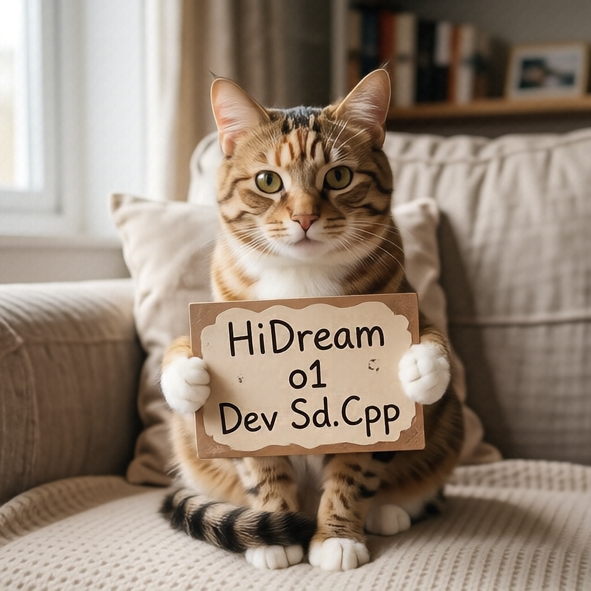

# HiDream-O1-Image

HiDream-O1-Image uses a bundled model checkpoint. The example below uses the Dev checkpoint.

## Model files

| Component | Weights and downloads | CLI option | Requirement |
| --- | --- | --- | --- |
| HiDream-O1-Image-Dev | [Safetensors](https://huggingface.co/Comfy-Org/HiDream-O1-Image/tree/main/checkpoints) | `--model` | Choose matching variant |
| HiDream-O1-Image | [Safetensors](https://huggingface.co/Comfy-Org/HiDream-O1-Image/tree/main/checkpoints) | `--model` | Choose matching variant |

## Usage

### Web UI

Follow the [Web UI guide](../../examples/server/README.md#web-ui) to start the
server, then select the recipe matching your weights. Fill the component slots
below and click **Load models**.
Use the files and compatibility requirements in [Model files](#model-files).

| Recipe | Component slots |
| --- | --- |
| HiDream O1 Image dev (`hidream-o1-dev`) | `model` |

Slot IDs correspond to CLI component options: `diffusion_model` uses
`--diffusion-model`, `llm` uses `--llm`, and `model` uses `-m` / `--model`.
Select optional components when required by your checkpoint or task.

### DGL

| Example | Description |
| --- | --- |
| [Text to image](../dgl/hidream_o1_image/hidream-o1-image-dev-txt2img.dgl) | HiDream O1 Image Dev. |

#### Run a script

Edit paths, prompts and settings in the script's `var` block, then run from
the build directory. Paths inside the script resolve from the working directory.

**Windows (PowerShell)**

```powershell
.\bin\Release\sd-cli.exe -M dgl --script ..\docs\dgl\hidream_o1_image\hidream-o1-image-dev-txt2img.dgl
```

**Linux/macOS**

```sh
./bin/sd-cli -M dgl --script ../docs/dgl/hidream_o1_image/hidream-o1-image-dev-txt2img.dgl
```

Choose another script from the table to run a different task. Add `--check`
to validate syntax and types without loading weights. See the
[shared run instructions](../dgl/README.md#run-an-example) for build paths
and the server's file-access rules.

HiDream O1 uses initial Gaussian noise with a standard deviation of 8. The DGL
example controls this with `noise_scale` before `add_noise`:

```text
noise = tensor::affine(tensor::randn_like(base, rng = rng), scale = noise_scale)
start = add_noise(predict, base, noise, sigma = sigmas[0])
```

Use the same RNG for initial noise and sampling. The noise scale is independent
of the sampler's `eta` parameter.

### Legacy CLI

CLI examples use the [shared path and shell conventions](README.md#example-conventions).

#### HiDream-O1-Image-Dev

**Windows (PowerShell)**

```powershell
.\bin\Release\sd-cli.exe `
  -m ..\models\checkpoints\hidream_o1_image_dev_bf16.safetensors `
  -p "a lovely cat holding a sign says 'hidream o1 cpp'" `
  --cfg-scale 1.0 `
  -H 1024 `
  -W 1024 `
  -v
```

**Linux/macOS**

```sh
./bin/sd-cli \
  -m ../models/checkpoints/hidream_o1_image_dev_bf16.safetensors \
  -p "a lovely cat holding a sign says 'hidream o1 cpp'" \
  --cfg-scale 1.0 \
  -H 1024 \
  -W 1024 \
  -v
```



## Options

The initial noise scale defaults to 8. Use `--eta` (`sample.eta` in the C API)
to override it. The same scale applies to the initial and hires sampling stages.
