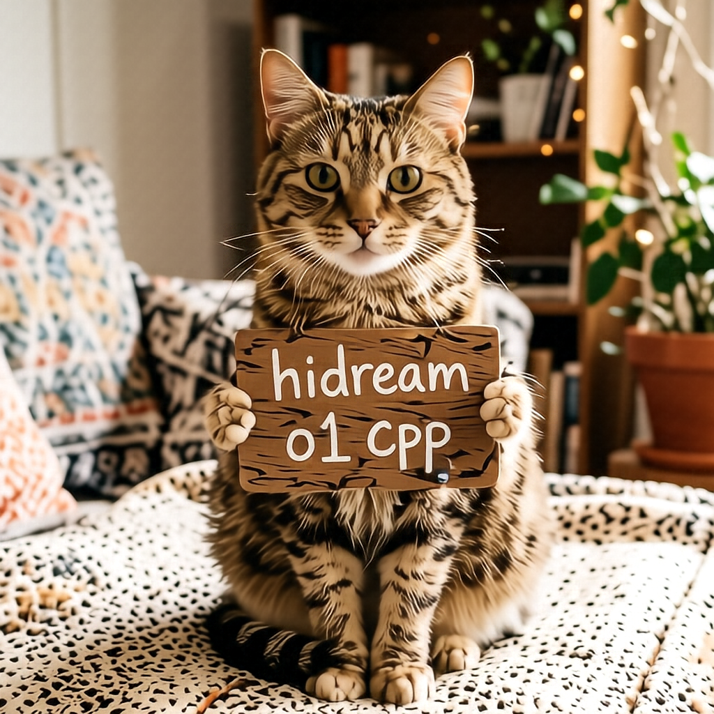

# HiDream-O1-Image

HiDream-O1-Image uses a bundled model checkpoint. The example below uses the Dev checkpoint.

## Model files

| Component | Weights and downloads | CLI option | Requirement |
| --- | --- | --- | --- |
| HiDream-O1-Image-Dev | [Safetensors](https://huggingface.co/Comfy-Org/HiDream-O1-Image/tree/main/checkpoints) | `--model` | Choose matching variant |
| HiDream-O1-Image | [Safetensors](https://huggingface.co/Comfy-Org/HiDream-O1-Image/tree/main/checkpoints) | `--model` | Choose matching variant |

## Usage

CLI examples use the [shared path and shell conventions](README.md#example-conventions).

### Web UI

Follow the [Web UI guide](../../examples/server/README.md#web-ui) to start the
server, then select the recipe matching your weights. Fill the component slots
below and click **Load models**.
Use the files and compatibility requirements in [Model files](#model-files).

| Recipe | Component slots |
| --- | --- |
| HiDream O1 Image dev (`hidream-o1-dev`) | `model` |

Slot IDs correspond to CLI component options: `diffusion_model` uses
`--diffusion-model`, `llm` uses `--llm`, and `model` uses `-m` / `--model`.
Select optional components when required by your checkpoint or task.

### CLI

#### HiDream-O1-Image-Dev

**Windows (PowerShell)**

```powershell
.\bin\Release\sd-cli.exe `
  -m ..\models\checkpoints\hidream_o1_image_dev_bf16.safetensors `
  -p "a lovely cat holding a sign says 'hidream o1 cpp'" `
  --cfg-scale 1.0 `
  -H 1024 `
  -W 1024 `
  -v
```

**Linux/macOS**

```sh
./bin/sd-cli \
  -m ../models/checkpoints/hidream_o1_image_dev_bf16.safetensors \
  -p "a lovely cat holding a sign says 'hidream o1 cpp'" \
  --cfg-scale 1.0 \
  -H 1024 \
  -W 1024 \
  -v
```


