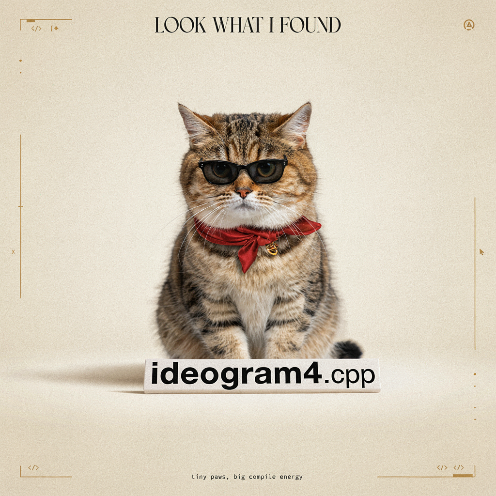

# Ideogram4

Ideogram4 generates images from text. Classifier-free guidance uses a separate matching unconditional transformer.

## Model files

| Component | Weights and downloads | CLI option | Requirement |
| --- | --- | --- | --- |
| Ideogram4 | [Safetensors](https://huggingface.co/ideogram-ai/ideogram-4-fp8/tree/main/transformer) | `--diffusion-model` | Required |
| Ideogram4 uncond | [Safetensors](https://huggingface.co/ideogram-ai/ideogram-4-fp8/tree/main/unconditional_transformer) | `--uncond-diffusion-model` | Required |
| vae | [Safetensors](https://huggingface.co/black-forest-labs/FLUX.2-dev/tree/main) | `--vae` | Use matching VAE |
| Qwen3-VL-8B-Instruct | [GGUF](https://huggingface.co/unsloth/Qwen3-VL-8B-Instruct-GGUF/tree/main) | `--llm` | Use matching text encoder |

### Use original FP8 weights

The original Ideogram4 FP8 safetensors can be loaded directly. FP8 tensors stay
at one byte per element in RAM and VRAM. Backends that cannot multiply FP8
weights directly cast only the active layer to a temporary BF16 tensor during
execution; the loader does not expand the entire checkpoint to BF16.

With `SD_USE_UPSTREAM_GGML=ON`, FP8 tensors are converted to F16 at load time
instead (two bytes per element in RAM and VRAM).

Use `ideogram4_fp8.safetensors` and `ideogram4_uncond_fp8.safetensors` directly
with `--diffusion-model` and `--uncond-diffusion-model`, respectively.

### Optional conversion

Run executable conversion examples from the build directory using the
[shared path and shell conventions](README.md#example-conventions).

#### Optional conversion for quantization

The following conversion is only needed when creating a quantized GGUF model.

fp8 scale -> bf16

**Windows (PowerShell)**

```powershell
python .convert_fp8_scale_to_bf16.py --input .ideogram4_fp8.safetensors --output ideogram4_bf16.safetensors
python .convert_fp8_scale_to_bf16.py --input .ideogram4_uncond_fp8.safetensors --output ideogram4_uncond_bf16.safetensors
```

**Linux/macOS**

```sh
python .convert_fp8_scale_to_bf16.py --input .ideogram4_fp8.safetensors --output ideogram4_bf16.safetensors
python .convert_fp8_scale_to_bf16.py --input .ideogram4_uncond_fp8.safetensors --output ideogram4_uncond_bf16.safetensors
```

bf16 -> q8

**Windows (PowerShell)**

```powershell
.\bin\Release\sd-cli.exe `
  -M convert `
  -m ..\models\ideogram4_bf16.safetensors `
  --tensor-type-rules "^layers.*adaln_modulation.*weight=q8_0,layers.*attention.o.*weight=q8_0,layers.*attention.qkv.*weight=q8_0,layers.*feed_forward.*weight=q8_0" `
  -o ideogram4-Q8_0.gguf `
  -v

.\bin\Release\sd-cli.exe `
  -M convert `
  -m ..\models\ideogram4_uncond_bf16.safetensors `
  --tensor-type-rules "^layers.*adaln_modulation.*weight=q8_0,layers.*attention.o.*weight=q8_0,layers.*attention.qkv.*weight=q8_0,layers.*feed_forward.*weight=q8_0" `
  -o ideogram4_uncond-Q8_0.gguf `
  -v
```

**Linux/macOS**

```sh
./bin/sd-cli \
  -M convert \
  -m ../models/ideogram4_bf16.safetensors \
  --tensor-type-rules "^layers.*adaln_modulation.*weight=q8_0,layers.*attention.o.*weight=q8_0,layers.*attention.qkv.*weight=q8_0,layers.*feed_forward.*weight=q8_0" \
  -o ideogram4-Q8_0.gguf \
  -v

./bin/sd-cli \
  -M convert \
  -m ../models/ideogram4_uncond_bf16.safetensors \
  --tensor-type-rules "^layers.*adaln_modulation.*weight=q8_0,layers.*attention.o.*weight=q8_0,layers.*attention.qkv.*weight=q8_0,layers.*feed_forward.*weight=q8_0" \
  -o ideogram4_uncond-Q8_0.gguf \
  -v
```

If you want lower VRAM usage, you can change the quantization from q8_0 to a lower-level quantization, such as q4_0.

## Usage

CLI examples use the [shared path and shell conventions](README.md#example-conventions).

### Web UI

Follow the [Web UI guide](../../examples/server/README.md#web-ui) to start the
server, then select the recipe matching your weights. Fill the component slots
below and click **Load models**.
Use the files and compatibility requirements in [Model files](#model-files).

| Recipe | Component slots |
| --- | --- |
| Ideogram 4 (`ideogram4`) | `diffusion_model`, `uncond_diffusion_model`, `llm`, `vae`, `tae` |

Slot IDs correspond to CLI component options: `diffusion_model` uses
`--diffusion-model`, `llm` uses `--llm`, and `model` uses `-m` / `--model`.
Select optional components when required by your checkpoint or task.

### CLI

**Windows (PowerShell)**

```powershell
.\bin\Release\sd-cli.exe `
  --diffusion-model ..\models\diffusion_models\ideogram4-Q8_0.gguf `
  --uncond-diffusion-model ..\models\diffusion_models\ideogram4_uncond-Q8_0.gguf `
  --llm ..\models\text_encoders\Qwen3VL-8B-Instruct-Q4_K_M.gguf `
  --vae ..\models\vae\flux2_ae.safetensors `
  -p "{`"high_level_description`":`"A square 1024 x 1024 luxury fashion magazine cover featuring exactly one short chubby fluffy cat as the main model. The cat sits on a soft ivory studio floor, facing the viewer with a stylish calm expression, wearing tiny black sunglasses, a red silk scarf, and a small gold collar charm. In front of the cat on the floor is a wide horizontal luxury nameplate that clearly reads ideogram4.cpp. The whole design feels premium, fashionable, clean, and editorial.`",`"style_description`":{`"aesthetics`":`"luxury fashion magazine cover, high-end pet couture campaign, minimalist editorial design, elegant studio photography, soft paper texture, refined typography, fashionable and polished`",`"lighting`":`"Soft diffused studio lighting, gentle spotlight on the cat, subtle floor shadow, warm ivory highlights, clean separation between subject and background`",`"photo`":`"high-resolution fashion editorial photography look, front-facing cat portrait, crisp fur details, glossy sunglasses, clear readable nameplate text, shallow depth of field`",`"medium`":`"mixed media fashion photography and premium editorial graphic design`",`"color_palette`":[`"#F4EFE7`",`"#111111`",`"#D8B56D`",`"#B73A3A`",`"#FFFFFF`",`"#8A7A6A`"]},`"compositional_deconstruction`":{`"canvas`":`"Square 1024 x 1024 canvas with a normal upright orientation. Do not rotate the poster or any text. Use a clean fashion magazine cover layout.`",`"background`":`"Warm ivory studio backdrop with subtle paper grain, a soft spotlight gradient, faint floor shadow, and a few minimal gold editorial lines. The background is spacious, premium, and uncluttered.`",`"layout`":`"Top center has a small elegant headline. Center area features one cat as the main fashion model. Lower foreground has a wide horizontal luxury nameplate placed on the floor in front of the cat. Bottom center has a small footer. All text is horizontal, upright, and readable left to right.`",`"elements`":[{`"type`":`"text`",`"desc`":`"Top center headline reading LOOK WHAT I FOUND in a refined high-fashion serif font. The headline is horizontal, centered, elegant, and secondary to the nameplate text.`"},{`"type`":`"obj`",`"desc`":`"Exactly one short chubby fluffy cat sitting in the center like a luxury fashion model. The cat has a large round head, compact body, short legs, soft detailed fur, expressive eyes, and a calm confident pose. The cat is cute and rounded, not tall, not stretched, not duplicated.`"},{`"type`":`"obj`",`"desc`":`"Tiny glossy black sunglasses worn naturally by the cat, slightly oversized but still showing the cat face clearly. The sunglasses add a chic fashion-editorial attitude.`"},{`"type`":`"obj`",`"desc`":`"A red silk scarf tied neatly around the cat neck, with soft folds and a couture feeling. The scarf must not cover the cat face or the nameplate.`"},{`"type`":`"obj`",`"desc`":`"A small gold collar charm or fashion accessory under the scarf, subtle and premium, adding a luxury campaign detail.`"},{`"type`":`"obj`",`"desc`":`"In the lower foreground, place a wide horizontal luxury nameplate on the floor in front of the cat. The nameplate is low, flat, landscape-oriented, much wider than tall, like a fashion show seat card or premium display plaque. It is centered, front-facing, level, and fully visible. It must not become vertical, tall, standing, rotated, or side-facing.`"},{`"type`":`"text`",`"desc`":`"Print the exact text ideogram4.cpp only on the wide horizontal nameplate. Use clean bold black lettering, perfectly spelled, lowercase, with the number 4 and .cpp extension. The text must fit completely inside the nameplate, stay horizontal, and be readable from left to right.`"},{`"type`":`"obj`",`"desc`":`"Add sparse premium editorial accents around the edges: thin gold lines, small code brackets, tiny cursor marks, subtle dots, and minimal geometric details. No extra cats, no stickers, no animal faces, no busy decorations.`"},{`"type`":`"text`",`"desc`":`"Bottom center footer reading tiny paws, big compile energy in a small refined monospace or editorial font. The footer is horizontal, centered, understated, and much smaller than the nameplate text.`"}]}}" `
  -H 1024 `
  -W 1024 `
  --offload-to-cpu `
  -v
```

**Linux/macOS**

```sh
./bin/sd-cli \
  --diffusion-model ../models/diffusion_models/ideogram4-Q8_0.gguf \
  --uncond-diffusion-model ../models/diffusion_models/ideogram4_uncond-Q8_0.gguf \
  --llm ../models/text_encoders/Qwen3VL-8B-Instruct-Q4_K_M.gguf \
  --vae ../models/vae/flux2_ae.safetensors \
  -p "{\"high_level_description\":\"A square 1024 x 1024 luxury fashion magazine cover featuring exactly one short chubby fluffy cat as the main model. The cat sits on a soft ivory studio floor, facing the viewer with a stylish calm expression, wearing tiny black sunglasses, a red silk scarf, and a small gold collar charm. In front of the cat on the floor is a wide horizontal luxury nameplate that clearly reads ideogram4.cpp. The whole design feels premium, fashionable, clean, and editorial.\",\"style_description\":{\"aesthetics\":\"luxury fashion magazine cover, high-end pet couture campaign, minimalist editorial design, elegant studio photography, soft paper texture, refined typography, fashionable and polished\",\"lighting\":\"Soft diffused studio lighting, gentle spotlight on the cat, subtle floor shadow, warm ivory highlights, clean separation between subject and background\",\"photo\":\"high-resolution fashion editorial photography look, front-facing cat portrait, crisp fur details, glossy sunglasses, clear readable nameplate text, shallow depth of field\",\"medium\":\"mixed media fashion photography and premium editorial graphic design\",\"color_palette\":[\"#F4EFE7\",\"#111111\",\"#D8B56D\",\"#B73A3A\",\"#FFFFFF\",\"#8A7A6A\"]},\"compositional_deconstruction\":{\"canvas\":\"Square 1024 x 1024 canvas with a normal upright orientation. Do not rotate the poster or any text. Use a clean fashion magazine cover layout.\",\"background\":\"Warm ivory studio backdrop with subtle paper grain, a soft spotlight gradient, faint floor shadow, and a few minimal gold editorial lines. The background is spacious, premium, and uncluttered.\",\"layout\":\"Top center has a small elegant headline. Center area features one cat as the main fashion model. Lower foreground has a wide horizontal luxury nameplate placed on the floor in front of the cat. Bottom center has a small footer. All text is horizontal, upright, and readable left to right.\",\"elements\":[{\"type\":\"text\",\"desc\":\"Top center headline reading LOOK WHAT I FOUND in a refined high-fashion serif font. The headline is horizontal, centered, elegant, and secondary to the nameplate text.\"},{\"type\":\"obj\",\"desc\":\"Exactly one short chubby fluffy cat sitting in the center like a luxury fashion model. The cat has a large round head, compact body, short legs, soft detailed fur, expressive eyes, and a calm confident pose. The cat is cute and rounded, not tall, not stretched, not duplicated.\"},{\"type\":\"obj\",\"desc\":\"Tiny glossy black sunglasses worn naturally by the cat, slightly oversized but still showing the cat face clearly. The sunglasses add a chic fashion-editorial attitude.\"},{\"type\":\"obj\",\"desc\":\"A red silk scarf tied neatly around the cat neck, with soft folds and a couture feeling. The scarf must not cover the cat face or the nameplate.\"},{\"type\":\"obj\",\"desc\":\"A small gold collar charm or fashion accessory under the scarf, subtle and premium, adding a luxury campaign detail.\"},{\"type\":\"obj\",\"desc\":\"In the lower foreground, place a wide horizontal luxury nameplate on the floor in front of the cat. The nameplate is low, flat, landscape-oriented, much wider than tall, like a fashion show seat card or premium display plaque. It is centered, front-facing, level, and fully visible. It must not become vertical, tall, standing, rotated, or side-facing.\"},{\"type\":\"text\",\"desc\":\"Print the exact text ideogram4.cpp only on the wide horizontal nameplate. Use clean bold black lettering, perfectly spelled, lowercase, with the number 4 and .cpp extension. The text must fit completely inside the nameplate, stay horizontal, and be readable from left to right.\"},{\"type\":\"obj\",\"desc\":\"Add sparse premium editorial accents around the edges: thin gold lines, small code brackets, tiny cursor marks, subtle dots, and minimal geometric details. No extra cats, no stickers, no animal faces, no busy decorations.\"},{\"type\":\"text\",\"desc\":\"Bottom center footer reading tiny paws, big compile energy in a small refined monospace or editorial font. The footer is horizontal, centered, understated, and much smaller than the nameplate text.\"}]}}" \
  -H 1024 \
  -W 1024 \
  --offload-to-cpu \
  -v
```


