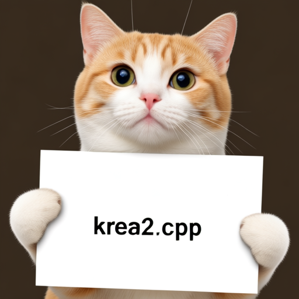

# Krea2

Krea2 uses a Krea2 diffusion transformer, the Wan2.1 VAE, and Qwen3-VL 4B as the LLM text encoder.

## Model files

| Component | Weights and downloads | CLI option | Requirement |
| --- | --- | --- | --- |
| Krea2 Raw | [Safetensors](https://huggingface.co/krea/Krea-2-Raw/tree/main)<br>[GGUF](https://huggingface.co/realrebelai/KREA-2_GGUFs/tree/main/BASE) | `--diffusion-model` | Choose matching variant |
| Krea2 Turbo | [Safetensors](https://huggingface.co/krea/Krea-2-Turbo/tree/main)<br>[GGUF](https://huggingface.co/realrebelai/KREA-2_GGUFs/tree/main/TURBO) | `--diffusion-model` | Choose matching variant |
| vae | [Safetensors](https://huggingface.co/Comfy-Org/Wan_2.1_ComfyUI_repackaged/blob/main/split_files/vae/wan_2.1_vae.safetensors) | `--vae` | Use matching VAE |
| Qwen3-VL 4B | [Safetensors](https://huggingface.co/Comfy-Org/Krea-2/tree/main/text_encoders)<br>[GGUF](https://huggingface.co/Qwen/Qwen3-VL-4B-Instruct-GGUF/tree/main) | `--llm` | Use matching text encoder |

## Usage

CLI examples use the [shared path and shell conventions](README.md#example-conventions).

### Web UI

Follow the [Web UI guide](../../examples/server/README.md#web-ui) to start the
server, then select the recipe matching your weights. Fill the component slots
below and click **Load models**.
Use the files and compatibility requirements in [Model files](#model-files).

| Recipe | Component slots |
| --- | --- |
| Krea 2 Raw (`krea2-raw`) | `diffusion_model`, `llm`, `vae`, `tae` |
| Krea 2 Turbo (`krea2-turbo`) | `diffusion_model`, `llm`, `vae`, `tae` |

Slot IDs correspond to CLI component options: `diffusion_model` uses
`--diffusion-model`, `llm` uses `--llm`, and `model` uses `-m` / `--model`.
Select optional components when required by your checkpoint or task.

### CLI

#### Krea2

**Windows (PowerShell)**

```powershell
.\bin\Release\sd-cli.exe `
  --diffusion-model ..\models\diffusion_models\Krea-2-Raw-Q8_0.gguf `
  --llm ..\models\text_encoders\Qwen3-VL-4B-Instruct-Q4_K_M.gguf `
  --vae ..\models\vae\wan_2.1_vae.safetensors `
  -p "a lovely cat holding a sign says 'krea2.cpp'" `
  --offload-to-cpu `
  -v
```

**Linux/macOS**

```sh
./bin/sd-cli \
  --diffusion-model ../models/diffusion_models/Krea-2-Raw-Q8_0.gguf \
  --llm ../models/text_encoders/Qwen3-VL-4B-Instruct-Q4_K_M.gguf \
  --vae ../models/vae/wan_2.1_vae.safetensors \
  -p "a lovely cat holding a sign says 'krea2.cpp'" \
  --offload-to-cpu \
  -v
```


