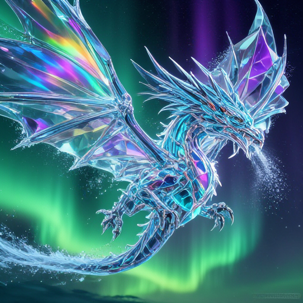
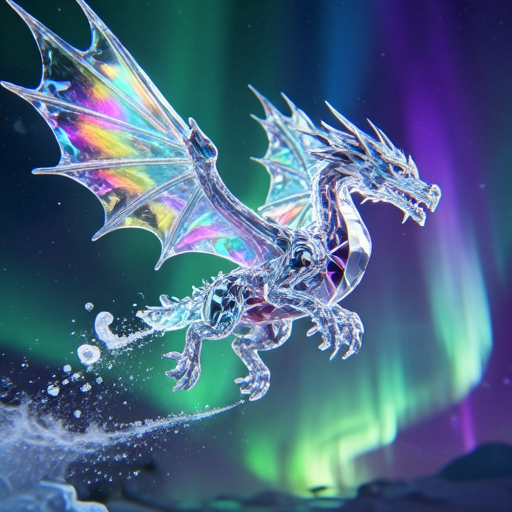

# Lens

Lens uses a Lens diffusion transformer, the FLUX.2 VAE, and GPT-OSS-20B as the LLM text encoder.

## Model files

| Component | Weights and downloads | CLI option | Requirement |
| --- | --- | --- | --- |
| Lens | [Safetensors](https://huggingface.co/Comfy-Org/Lens/tree/main/diffusion_models) | `--diffusion-model` | Choose matching variant |
| Lens Turbo | [Safetensors](https://huggingface.co/Comfy-Org/Lens/tree/main/diffusion_models) | `--diffusion-model` | Choose matching variant |
| vae | [Safetensors](https://huggingface.co/black-forest-labs/FLUX.2-dev/tree/main) | `--vae` | Use matching VAE |
| GPT-OSS-20B | [GGUF](https://huggingface.co/unsloth/gpt-oss-20b-GGUF/tree/main) | `--llm` | Use matching text encoder |
| GPT-OSS-20B tokenizer.json | [Download](https://huggingface.co/openai/gpt-oss-20b/tree/main) | `--tokenizer` | Required; match text encoder |

Lens and Lens Turbo require an external GPT-OSS `tokenizer.json` matching the text encoder checkpoint. Save it as `tokenizer_gpt_oss.json` and pass it with `--tokenizer`; the tokenizer is not embedded in sd.cpp. See [JSON tokenizers](../guides/tokenizers.md) for CLI and C API usage.

## Usage

CLI examples use the [shared path and shell conventions](README.md#example-conventions).

### Web UI

Follow the [Web UI guide](../../examples/server/README.md#web-ui) to start the
server, then select the recipe matching your weights. Fill the component slots
below and click **Load models**.
Use the files and compatibility requirements in [Model files](#model-files).

| Recipe | Component slots |
| --- | --- |
| LENS (`lens`) | `diffusion_model`, `llm`, `tokenizer`, `vae`, `tae` |
| LENS Turbo (`lens-turbo`) | `diffusion_model`, `llm`, `tokenizer`, `vae`, `tae` |

Slot IDs correspond to CLI component options: `diffusion_model` uses
`--diffusion-model`, `llm` uses `--llm`, and `model` uses `-m` / `--model`.
Select optional components when required by your checkpoint or task.

### CLI

#### Lens

**Windows (PowerShell)**

```powershell
.\bin\Release\sd-cli.exe `
  --diffusion-model ..\models\diffusion_models\lens_bf16.safetensors `
  --llm ..\models\text_encoders\gpt-oss-20b-UD-Q8_K_XL.gguf `
  --tokenizer ..\models\tokenizers\tokenizer_gpt_oss.json `
  --vae ..\models\vae\flux2_ae.safetensors `
  -p "A crystal dragon soaring through an aurora borealis sky, its entire body made of transparent faceted crystal refracting the green and purple aurora light into rainbow spectra, ice particles trailing from its wings, high fantasy digital art" `
  --cfg-scale 5.0 `
  -v
```

**Linux/macOS**

```sh
./bin/sd-cli \
  --diffusion-model ../models/diffusion_models/lens_bf16.safetensors \
  --llm ../models/text_encoders/gpt-oss-20b-UD-Q8_K_XL.gguf \
  --tokenizer ../models/tokenizers/tokenizer_gpt_oss.json \
  --vae ../models/vae/flux2_ae.safetensors \
  -p "A crystal dragon soaring through an aurora borealis sky, its entire body made of transparent faceted crystal refracting the green and purple aurora light into rainbow spectra, ice particles trailing from its wings, high fantasy digital art" \
  --cfg-scale 5.0 \
  -v
```



#### Lens Turbo

**Windows (PowerShell)**

```powershell
.\bin\Release\sd-cli.exe `
  --diffusion-model ..\models\diffusion_models\lens_turbo_bf16.safetensors `
  --llm ..\models\text_encoders\gpt-oss-20b-UD-Q8_K_XL.gguf `
  --tokenizer ..\models\tokenizers\tokenizer_gpt_oss.json `
  --vae ..\models\vae\flux2_ae.safetensors `
  -p "A crystal dragon soaring through an aurora borealis sky, its entire body made of transparent faceted crystal refracting the green and purple aurora light into rainbow spectra, ice particles trailing from its wings, high fantasy digital art" `
  --cfg-scale 1.0 `
  --steps 4 `
  -v
```

**Linux/macOS**

```sh
./bin/sd-cli \
  --diffusion-model ../models/diffusion_models/lens_turbo_bf16.safetensors \
  --llm ../models/text_encoders/gpt-oss-20b-UD-Q8_K_XL.gguf \
  --tokenizer ../models/tokenizers/tokenizer_gpt_oss.json \
  --vae ../models/vae/flux2_ae.safetensors \
  -p "A crystal dragon soaring through an aurora borealis sky, its entire body made of transparent faceted crystal refracting the green and purple aurora light into rainbow spectra, ice particles trailing from its wings, high fantasy digital art" \
  --cfg-scale 1.0 \
  --steps 4 \
  -v
```


