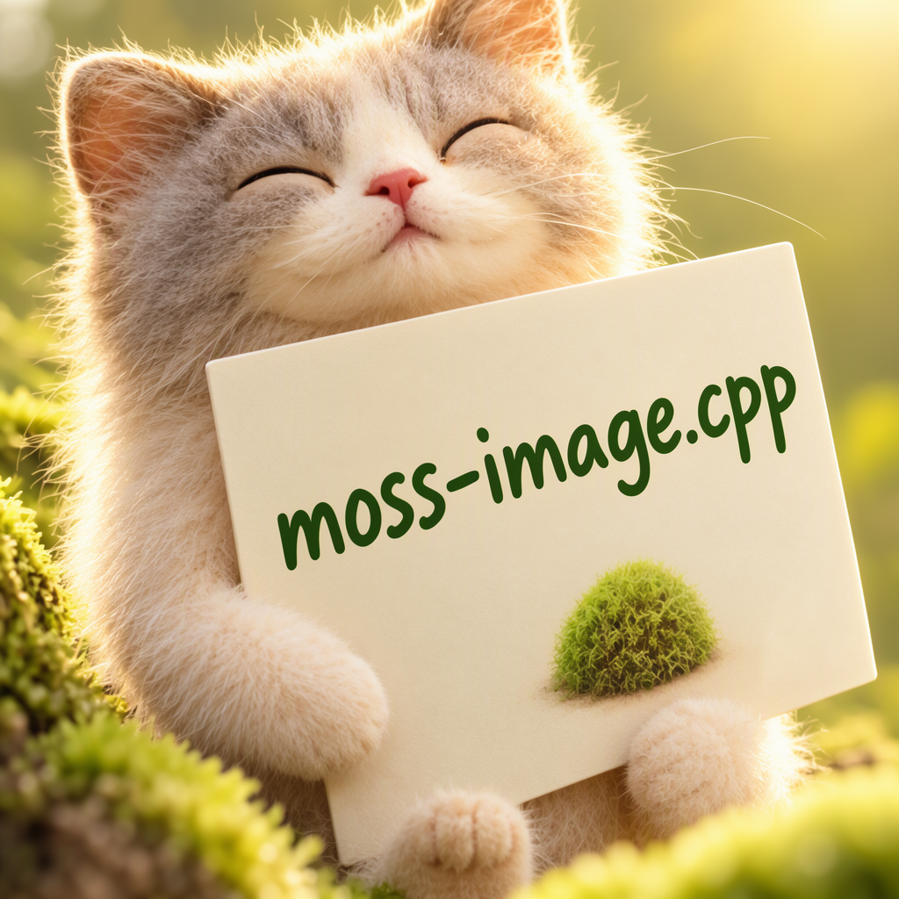

# MOSS-Image

MOSS-Image uses a 5B diffusion transformer, the FLUX.2 VAE, and Qwen3.5 9B as the LLM text encoder. Both Base and SFT are supported. Prompt enhancement is not included.

## Model files

| Component | Weights and downloads | CLI option | Requirement |
| --- | --- | --- | --- |
| MOSS-Image Base or SFT | [Safetensors](https://huggingface.co/Comfy-Org/MOSS-Image/tree/main/diffusion_models)<br>gguf:<br>Base: [Download](https://huggingface.co/leejet/MOSS-Image-Base-GGUF/tree/main)<br>SFT: [Download](https://huggingface.co/leejet/MOSS-Image-SFT-GGUF/tree/main) | `--diffusion-model` | Required |
| vae | [Safetensors](https://huggingface.co/Comfy-Org/MOSS-Image/tree/main/vae) | `--vae` | Use matching VAE |
| Qwen3.5 9B | [GGUF](https://huggingface.co/unsloth/Qwen3.5-9B-GGUF/tree/main) | `--llm` | Use matching text encoder |
| `tokenizer.json` | [Download](https://huggingface.co/OpenMOSS-Team/MOSS-Image-Base/tree/main/tokenizer) | `--tokenizer` | Required; match text encoder |

Pass the external `tokenizer.json` with `--tokenizer`; Qwen3.5 uses a different vocabulary from the embedded Qwen tokenizer.

## Usage

CLI examples use the [shared path and shell conventions](README.md#example-conventions).

### Web UI

Follow the [Web UI guide](../../examples/server/README.md#web-ui) to start the
server, then select the recipe matching your weights. Fill the component slots
below and click **Load models**.
Use the files and compatibility requirements in [Model files](#model-files).

| Recipe | Component slots |
| --- | --- |
| MOSS Image Base (`moss-image-base`) | `diffusion_model`, `llm`, `tokenizer`, `vae`, `tae` |
| MOSS Image SFT (`moss-image-sft`) | `diffusion_model`, `llm`, `tokenizer`, `vae`, `tae` |

Slot IDs correspond to CLI component options: `diffusion_model` uses
`--diffusion-model`, `llm` uses `--llm`, and `model` uses `-m` / `--model`.
Select optional components when required by your checkpoint or task.

### CLI

#### MOSS-Image Base

**Windows (PowerShell)**

```powershell
.\bin\Release\sd-cli.exe `
  --diffusion-model ..\models\diffusion_models\moss_image_base_int8_convrot_attn.safetensors `
  --llm ..\models\text_encoders\Qwen3.5-9B-Q4_K_M.gguf `
  --vae ..\models\vae\flux2_ae.safetensors `
  --tokenizer ..\models\tokenizers\tokenizer_qwen3.5.json `
  -p "a lovely cat holding a sign says 'moss-image.cpp'" `
  --cfg-scale 3.0 `
  -H 1024 `
  -W 1024 `
  --offload-to-cpu `
  -v
```

**Linux/macOS**

```sh
./bin/sd-cli \
  --diffusion-model ../models/diffusion_models/moss_image_base_int8_convrot_attn.safetensors \
  --llm ../models/text_encoders/Qwen3.5-9B-Q4_K_M.gguf \
  --vae ../models/vae/flux2_ae.safetensors \
  --tokenizer ../models/tokenizers/tokenizer_qwen3.5.json \
  -p "a lovely cat holding a sign says 'moss-image.cpp'" \
  --cfg-scale 3.0 \
  -H 1024 \
  -W 1024 \
  --offload-to-cpu \
  -v
```

#### MOSS-Image SFT

**Windows (PowerShell)**

```powershell
.\bin\Release\sd-cli.exe `
  --diffusion-model ..\models\diffusion_models\moss_image_sft_int8_convrot_attn.safetensors `
  --llm ..\models\text_encoders\Qwen3.5-9B-Q4_K_M.gguf `
  --vae ..\models\vae\flux2_ae.safetensors `
  --tokenizer ..\models\tokenizers\tokenizer_qwen3.5.json `
  -p "a lovely cat holding a sign says 'moss-image.cpp'" `
  --cfg-scale 3.0 `
  -H 1024 `
  -W 1024 `
  --offload-to-cpu `
  -v
```

**Linux/macOS**

```sh
./bin/sd-cli \
  --diffusion-model ../models/diffusion_models/moss_image_sft_int8_convrot_attn.safetensors \
  --llm ../models/text_encoders/Qwen3.5-9B-Q4_K_M.gguf \
  --vae ../models/vae/flux2_ae.safetensors \
  --tokenizer ../models/tokenizers/tokenizer_qwen3.5.json \
  -p "a lovely cat holding a sign says 'moss-image.cpp'" \
  --cfg-scale 3.0 \
  -H 1024 \
  -W 1024 \
  --offload-to-cpu \
  -v
```



Use dimensions divisible by 16. The default discrete scheduler uses the upstream time shift of 5. Use `--flow-shift` to override it. The negative CFG branch skips DiT layer 22 (zero-based), matching the upstream pipeline.
