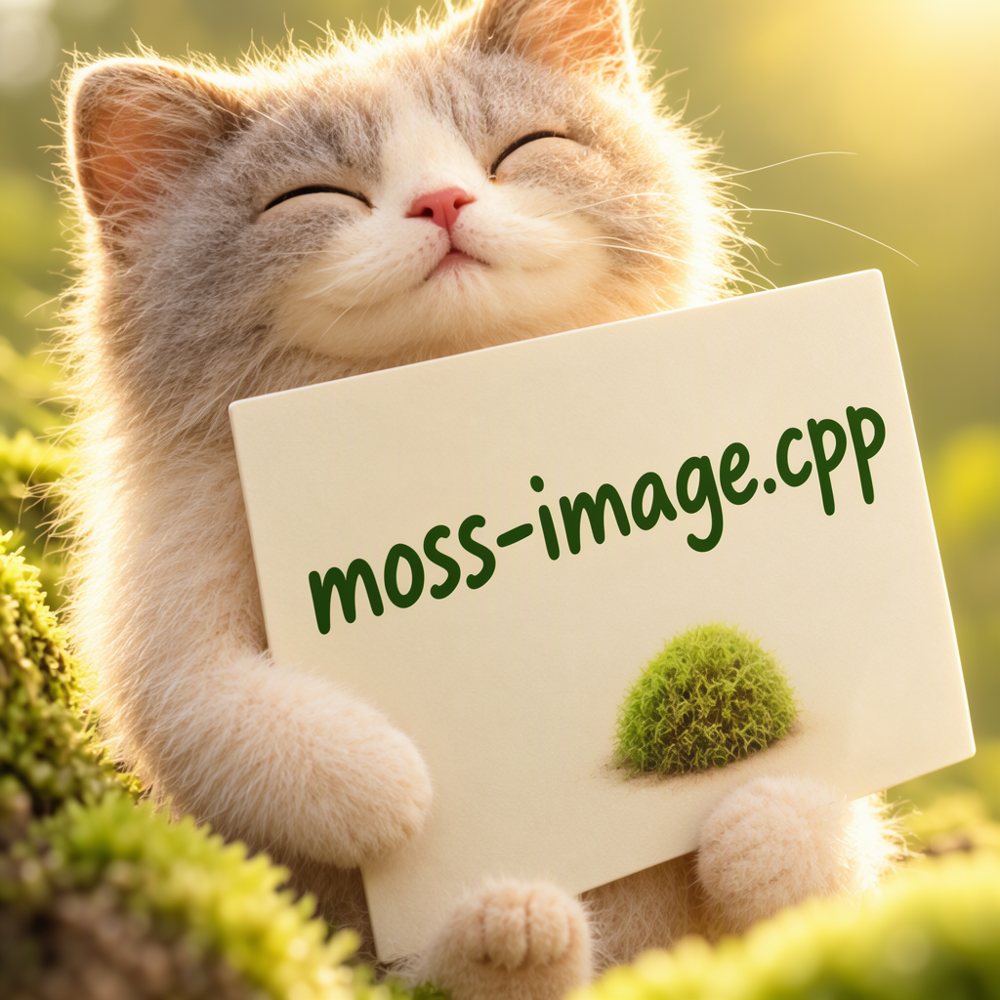

# MOSS-Image

MOSS-Image uses a 5B diffusion transformer, the FLUX.2 VAE, and Qwen3.5 9B as the LLM text encoder. Both Base and SFT are supported. Prompt enhancement is not included.
Image editing requires a matching LoRA.

## Model files

| Component | Weights and downloads | CLI option | Requirement |
| --- | --- | --- | --- |
| MOSS-Image Base or SFT | [Safetensors](https://huggingface.co/Comfy-Org/MOSS-Image/tree/main/diffusion_models)<br>gguf:<br>Base: [Download](https://huggingface.co/leejet/MOSS-Image-Base-GGUF/tree/main)<br>SFT: [Download](https://huggingface.co/leejet/MOSS-Image-SFT-GGUF/tree/main) | `--diffusion-model` | Required |
| vae | [Safetensors](https://huggingface.co/Comfy-Org/MOSS-Image/tree/main/vae) | `--vae` | Use matching VAE |
| Qwen3.5 9B | [GGUF](https://huggingface.co/unsloth/Qwen3.5-9B-GGUF/tree/main) | `--llm` | Use matching text encoder |
| `tokenizer.json` | [Download](https://huggingface.co/OpenMOSS-Team/MOSS-Image-Base/tree/main/tokenizer) | `--tokenizer` | Required; match text encoder |
| Qwen3.5 9B vision projector | [GGUF](https://huggingface.co/unsloth/Qwen3.5-9B-GGUF/blob/main/mmproj-BF16.gguf) | `--llm_vision` | Required for vision inputs when the encoder uses separate vision weights |
| MOSS-Image-Edit-HQ LoRA | [`armV5-moss-edit-lora.safetensors`](https://huggingface.co/akhaliq/MOSS-Image-Edit-HQ/blob/main/armV5-moss-edit-lora.safetensors) | `--lora-model-dir` | HQ editing with SFT |
| chinoll Moss-Image-Edit LoRA | [`adapter_model.safetensors`](https://huggingface.co/chinoll/Moss-Image-Edit/blob/main/adapter_model.safetensors) | — | Editing with Base or SFT in DGL |

Pass the external `tokenizer.json` with `--tokenizer`; Qwen3.5 uses a different vocabulary from the embedded Qwen tokenizer.

[Inline prompt images](../guides/prompt_images.md) require Qwen3.5 vision
weights. HQ editing also uses them when available. Pass a separate projector
with `--llm_vision` in the CLI or `vision_path` on `load_text_encoder` in DGL.

## Usage

### Web UI

Follow the [Web UI guide](../../examples/server/README.md#web-ui) to start the
server, then select the recipe matching your weights. Fill the component slots
below and click **Load models**.
Use the files and compatibility requirements in [Model files](#model-files).

| Recipe | Component slots |
| --- | --- |
| MOSS Image Base (`moss-image-base`) | `diffusion_model`, `llm`, `tokenizer`, `vae`, `tae` |
| MOSS Image SFT (`moss-image-sft`) | `diffusion_model`, `llm`, `tokenizer`, `vae`, `tae` |

Slot IDs correspond to CLI component options: `diffusion_model` uses
`--diffusion-model`, `llm` uses `--llm`, and `model` uses `-m` / `--model`.
Select optional components when required by your checkpoint or task.

### DGL

| Example | Description |
| --- | --- |
| [Base: text to image](../dgl/moss_image/moss-image-base-txt2img.dgl) | MOSS-Image Base. |
| [SFT: text to image](../dgl/moss_image/moss-image-sft-txt2img.dgl) | MOSS-Image SFT. |
| [Inline images](../dgl/moss_image/moss-image-sft-inline-images.dgl) | Insert named images into the prompt. |
| [Image editing (HQ)](../dgl/moss_image/moss-image-edit.dgl) | SFT with the armV5 LoRA and a Qwen3.5 vision projector. |
| [Image editing (chinoll)](../dgl/moss_image/moss-image-edit-chinoll.dgl) | Base or SFT with the chinoll LoRA. |

#### Run a script

Edit paths, prompts and settings in the script's `var` block, then run from
the build directory. Paths inside the script resolve from the working directory.

**Windows (PowerShell)**

```powershell
.\bin\Release\sd-cli.exe -M dgl --script ..\docs\dgl\moss_image\moss-image-base-txt2img.dgl
```

**Linux/macOS**

```sh
./bin/sd-cli -M dgl --script ../docs/dgl/moss_image/moss-image-base-txt2img.dgl
```

Choose another script from the table to run a different task. Add `--check`
to validate syntax and types without loading weights. See the
[shared run instructions](../dgl/README.md#run-an-example) for build paths
and the server's file-access rules.

### Legacy CLI

CLI examples use the [shared path and shell conventions](README.md#example-conventions).

#### MOSS-Image Base

**Windows (PowerShell)**

```powershell
.\bin\Release\sd-cli.exe `
  --diffusion-model ..\models\diffusion_models\moss_image_base_int8_convrot_attn.safetensors `
  --llm ..\models\text_encoders\Qwen3.5-9B-Q4_K_M.gguf `
  --vae ..\models\vae\flux2_ae.safetensors `
  --tokenizer ..\models\tokenizers\tokenizer_qwen3.5.json `
  -p "a lovely cat holding a sign says 'moss-image.cpp'" `
  --cfg-scale 3.0 `
  -H 1024 `
  -W 1024 `
  --offload-to-cpu `
  -v
```

**Linux/macOS**

```sh
./bin/sd-cli \
  --diffusion-model ../models/diffusion_models/moss_image_base_int8_convrot_attn.safetensors \
  --llm ../models/text_encoders/Qwen3.5-9B-Q4_K_M.gguf \
  --vae ../models/vae/flux2_ae.safetensors \
  --tokenizer ../models/tokenizers/tokenizer_qwen3.5.json \
  -p "a lovely cat holding a sign says 'moss-image.cpp'" \
  --cfg-scale 3.0 \
  -H 1024 \
  -W 1024 \
  --offload-to-cpu \
  -v
```

#### MOSS-Image SFT

**Windows (PowerShell)**

```powershell
.\bin\Release\sd-cli.exe `
  --diffusion-model ..\models\diffusion_models\moss_image_sft_int8_convrot_attn.safetensors `
  --llm ..\models\text_encoders\Qwen3.5-9B-Q4_K_M.gguf `
  --vae ..\models\vae\flux2_ae.safetensors `
  --tokenizer ..\models\tokenizers\tokenizer_qwen3.5.json `
  -p "a lovely cat holding a sign says 'moss-image.cpp'" `
  --cfg-scale 3.0 `
  -H 1024 `
  -W 1024 `
  --offload-to-cpu `
  -v
```

**Linux/macOS**

```sh
./bin/sd-cli \
  --diffusion-model ../models/diffusion_models/moss_image_sft_int8_convrot_attn.safetensors \
  --llm ../models/text_encoders/Qwen3.5-9B-Q4_K_M.gguf \
  --vae ../models/vae/flux2_ae.safetensors \
  --tokenizer ../models/tokenizers/tokenizer_qwen3.5.json \
  -p "a lovely cat holding a sign says 'moss-image.cpp'" \
  --cfg-scale 3.0 \
  -H 1024 \
  -W 1024 \
  --offload-to-cpu \
  -v
```



#### MOSS-Image Edit

The CLI uses the HQ workflow with SFT. Save the LoRA as
`models/loras/moss/armV5-moss-edit-lora.safetensors` or adjust the LoRA tag below.
Pass `-r` for each reference image.

**Windows (PowerShell)**

```powershell
.\bin\Release\sd-cli.exe `
  --diffusion-model ..\models\diffusion_models\moss_image_sft_int8_convrot_attn.safetensors `
  --llm ..\models\text_encoders\Qwen3.5-9B-Q4_K_M.gguf `
  --llm_vision ..\models\text_encoders\Qwen3.5-9B-mmproj-BF16.gguf `
  --vae ..\models\vae\flux2_ae.safetensors `
  --tokenizer ..\models\tokenizers\tokenizer_qwen3.5.json `
  --lora-model-dir ..\models\loras `
  -r ..\assets\flux\flux1-dev-q8_0.png `
  -p "change 'flux.cpp' to 'moss.cpp'<lora:moss/armV5-moss-edit-lora:1.0>" `
  --cfg-scale 3.0 `
  -v
```

**Linux/macOS**

```sh
./bin/sd-cli \
  --diffusion-model ../models/diffusion_models/moss_image_sft_int8_convrot_attn.safetensors \
  --llm ../models/text_encoders/Qwen3.5-9B-Q4_K_M.gguf \
  --llm_vision ../models/text_encoders/Qwen3.5-9B-mmproj-BF16.gguf \
  --vae ../models/vae/flux2_ae.safetensors \
  --tokenizer ../models/tokenizers/tokenizer_qwen3.5.json \
  --lora-model-dir ../models/loras \
  -r ../assets/flux/flux1-dev-q8_0.png \
  -p "change 'flux.cpp' to 'moss.cpp'<lora:moss/armV5-moss-edit-lora:1.0>" \
  --cfg-scale 3.0 \
  -v
```

## Notes and limitations

Use output dimensions divisible by 16. The editing examples cap the reference
long edge at 1024 pixels. The discrete scheduler defaults to a flow shift of 5.
Use `--flow-shift` to override it. Prompt weights use `(phrase:1.2)` syntax.

For text-to-image and HQ editing, the CLI and C API set `skip_layers = [22]` on
the negative predictor. The corresponding DGL examples set the same zero-based
layer index.
