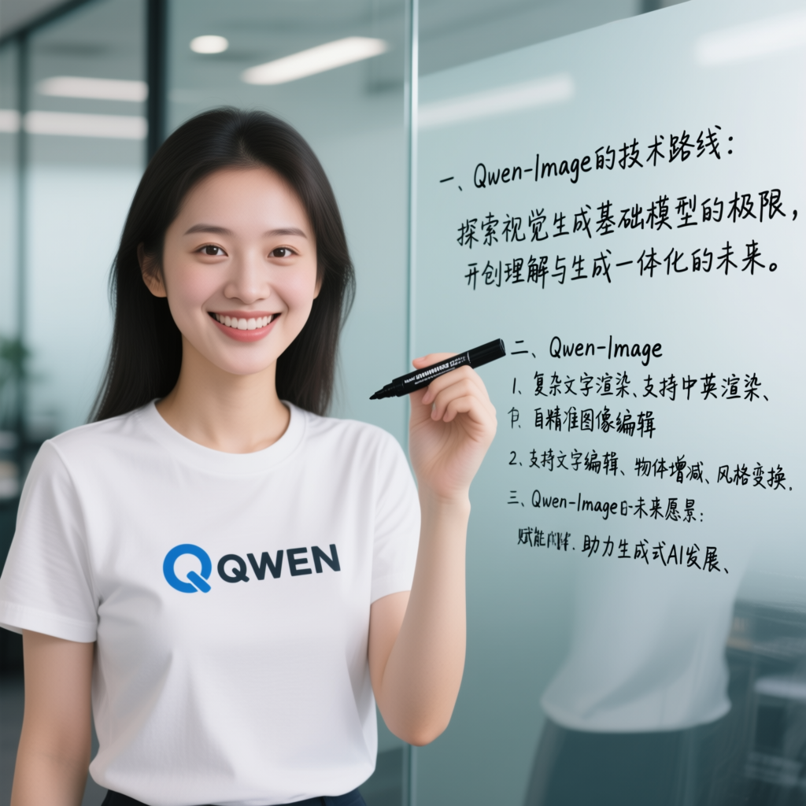

# Qwen Image

Qwen Image generates images from text using Qwen2.5-VL and the Qwen Image VAE.

## Model files

| Component | Weights and downloads | CLI option | Requirement |
| --- | --- | --- | --- |
| Qwen Image | [Safetensors](https://huggingface.co/Comfy-Org/Qwen-Image_ComfyUI/tree/main/split_files/diffusion_models)<br>[GGUF](https://huggingface.co/QuantStack/Qwen-Image-GGUF/tree/main) | `--diffusion-model` | Required |
| vae | [Safetensors](https://huggingface.co/Comfy-Org/Qwen-Image_ComfyUI/tree/main/split_files/vae) | `--vae` | Use matching VAE |
| qwen_2.5_vl 7b | [Safetensors](https://huggingface.co/Comfy-Org/Qwen-Image_ComfyUI/tree/main/split_files/text_encoders)<br>[GGUF](https://huggingface.co/mradermacher/Qwen2.5-VL-7B-Instruct-GGUF/tree/main) | `--llm` | Use matching text encoder |

## Usage

CLI examples use the [shared path and shell conventions](README.md#example-conventions).

### Web UI

Follow the [Web UI guide](../../examples/server/README.md#web-ui) to start the
server, then select the recipe matching your weights. Fill the component slots
below and click **Load models**.
Use the files and compatibility requirements in [Model files](#model-files).

| Recipe | Component slots |
| --- | --- |
| Qwen Image (`qwen-image`) | `diffusion_model`, `llm`, `vae`, `tae` |

Slot IDs correspond to CLI component options: `diffusion_model` uses
`--diffusion-model`, `llm` uses `--llm`, and `model` uses `-m` / `--model`.
Select optional components when required by your checkpoint or task.

### CLI

**Windows (PowerShell)**

```powershell
.\bin\Release\sd-cli.exe `
  --diffusion-model ..\models\diffusion_models\qwen-image-Q8_0.gguf `
  --vae ..\models\vae\qwen_image_vae.safetensors `
  --llm ..\models\text_encoders\Qwen2.5-VL-7B-Instruct-Q8_0.gguf `
  -p "一个穿着`"QWEN`"标志的T恤的中国美女正拿着黑色的马克笔面相镜头微笑。她身后的玻璃板上手写体写着 `“一、Qwen-Image的技术路线： 探索视觉生成基础模型的极限，开创理解与生成一体化的未来。二、Qwen-Image的模型特色：1、复杂文字渲染。支持中英渲染、自动布局； 2、精准图像编辑。支持文字编辑、物体增减、风格变换。三、Qwen-Image的未来愿景：赋能专业内容创作、助力生成式AI发展。`”" `
  --cfg-scale 2.5 `
  --sampling-method euler `
  --flow-shift 3 `
  -H 1024 `
  -W 1024 `
  --offload-to-cpu `
  -v
```

**Linux/macOS**

```sh
./bin/sd-cli \
  --diffusion-model ../models/diffusion_models/qwen-image-Q8_0.gguf \
  --vae ../models/vae/qwen_image_vae.safetensors \
  --llm ../models/text_encoders/Qwen2.5-VL-7B-Instruct-Q8_0.gguf \
  -p "一个穿着\"QWEN\"标志的T恤的中国美女正拿着黑色的马克笔面相镜头微笑。她身后的玻璃板上手写体写着 “一、Qwen-Image的技术路线： 探索视觉生成基础模型的极限，开创理解与生成一体化的未来。二、Qwen-Image的模型特色：1、复杂文字渲染。支持中英渲染、自动布局； 2、精准图像编辑。支持文字编辑、物体增减、风格变换。三、Qwen-Image的未来愿景：赋能专业内容创作、助力生成式AI发展。”" \
  --cfg-scale 2.5 \
  --sampling-method euler \
  --flow-shift 3 \
  -H 1024 \
  -W 1024 \
  --offload-to-cpu \
  -v
```


