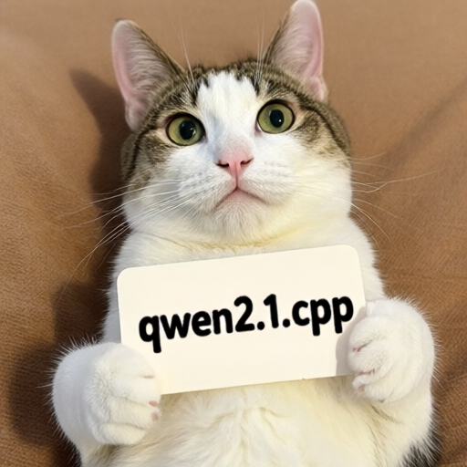
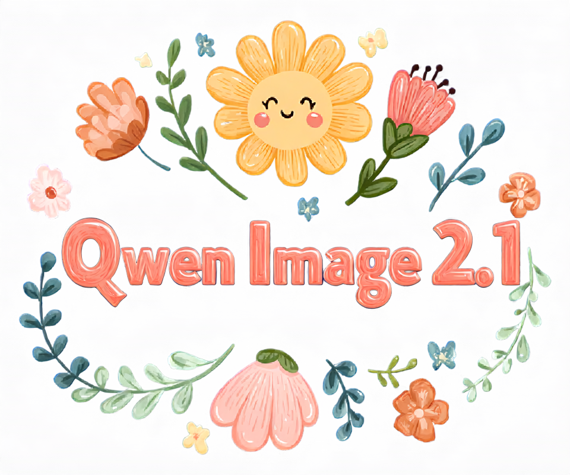

# Qwen Image 2.1

Qwen Image 2.1 supports text-to-image generation and image editing, using Qwen3-VL-8B as the text encoder and its own VAE.

## Model files

| Component | Weights and downloads | CLI option | Requirement |
| --- | --- | --- | --- |
| Qwen Image 2.1 | [Safetensors](https://huggingface.co/Comfy-Org/Qwen-Image-2.1/tree/main/diffusion_models)<br>[GGUF](https://huggingface.co/leejet/Qwen-Image-2.1-GGUF/tree/main) | `--diffusion-model` | Required |
| vae | [Safetensors](https://huggingface.co/Comfy-Org/Qwen-Image-2.1/tree/main/vae) | `--vae` | Use matching VAE |
| Qwen3-VL-8B-Instruct | safetensors (BF16 or INT8 convrot): [Safetensors](https://huggingface.co/Comfy-Org/Qwen-Image-2.1/tree/main/text_encoders)<br>[GGUF](https://huggingface.co/Qwen/Qwen3-VL-8B-Instruct-GGUF/tree/main)<br>For image editing with a GGUF text encoder, also download `mmproj-Qwen3VL-8B-Instruct-F16.gguf` from the same repository and pass it with `--llm_vision`. | `--llm` | Use matching text encoder |

Use `qwen_image_2.1_vae_bf16.safetensors` with this model. The earlier Qwen Image and Wan 2.2 VAE weights are not interchangeable with the Qwen Image 2.1 VAE weights.

For faster encoding, decoding, or previews, see [TAEQI2.1](taesd.md#qwen-image-21-taeqi21).

## Usage

CLI examples use the [shared path and shell conventions](README.md#example-conventions).

### Web UI

Follow the [Web UI guide](../../examples/server/README.md#web-ui) to start the
server, then select the recipe matching your weights. Fill the component slots
below and click **Load models**.
Use the files and compatibility requirements in [Model files](#model-files).

| Recipe | Component slots |
| --- | --- |
| Qwen Image 2.1 (`qwen-image-21`) | `diffusion_model`, `llm`, `llm_vision`, `vae`, `tae` |
| Qwen Image 2.1 Turbo (`qwen-image-21-turbo`) | `diffusion_model`, `llm`, `llm_vision`, `vae`, `tae` |

Slot IDs correspond to CLI component options: `diffusion_model` uses
`--diffusion-model`, `llm` uses `--llm`, and `model` uses `-m` / `--model`.
Select optional components when required by your checkpoint or task.

### CLI

Use image dimensions divisible by 32. The resolution-dependent flow schedule is selected automatically.

#### Text to image

**Windows (PowerShell)**

```powershell
.\bin\Release\sd-cli.exe `
  --diffusion-model ..\models\diffusion_models\qwen_image_2.1_int8_convrot.safetensors `
  --vae ..\models\vae\qwen_image_2.1_vae_bf16.safetensors `
  --llm ..\models\text_encoders\Qwen3VL-8B-Instruct-Q4_K_M.gguf `
  -p "a lovely cat holding a sign says 'qwen2.1.cpp'" `
  --cfg-scale 6.0 `
  --sampling-method euler `
  --offload-to-cpu `
  -v `
  -o qwen_image_2.1.png
```

**Linux/macOS**

```sh
./bin/sd-cli \
  --diffusion-model ../models/diffusion_models/qwen_image_2.1_int8_convrot.safetensors \
  --vae ../models/vae/qwen_image_2.1_vae_bf16.safetensors \
  --llm ../models/text_encoders/Qwen3VL-8B-Instruct-Q4_K_M.gguf \
  -p "a lovely cat holding a sign says 'qwen2.1.cpp'" \
  --cfg-scale 6.0 \
  --sampling-method euler \
  --offload-to-cpu \
  -v \
  -o qwen_image_2.1.png
```



To use GGUF diffusion weights, set `--diffusion-model` to the path of a file such as `qwen_image_2.1-Q4_K.gguf`.

#### Turbo

For [Qwen Image 2.1 Turbo](https://huggingface.co/Qwen/Qwen-Image-2.1-Turbo), use the Turbo diffusion weights and select its fixed 8-step sigma schedule with `--sigmas qwen-image-2.1-turbo`. For example, add these sampling options to the command above:

**Windows (PowerShell) arguments**

```text
--sigmas qwen-image-2.1-turbo `
  --steps 8 `
  --cfg-scale 1.0 `
  --sampling-method euler
```

**Linux/macOS arguments**

```text
--sigmas qwen-image-2.1-turbo \
  --steps 8 \
  --cfg-scale 1.0 \
  --sampling-method euler
```

The preset is equivalent to `--sigmas 1.0,0.978453,0.95418,0.926626,0.89508,0.845148,0.704534,0.414568,0.0`. It only supplies the sigma values; CFG scale and sampling method remain independently configurable. As with an explicit sigma list, the sigma count determines the actual number of sampling steps. The same preset name is also accepted by `--hires-sigmas` for the highres fix second pass.

#### Image editing

Pass the reference image with `-r` and describe the edit in `-p`. Vision weights are required; the example below loads them separately with `--llm_vision`.

**Windows (PowerShell)**

```powershell
.\bin\Release\sd-cli.exe `
  --diffusion-model ..\models\diffusion_models\qwen_image_2.1_int8_convrot.safetensors `
  --vae ..\models\vae\qwen_image_2.1_vae_bf16.safetensors `
  --llm ..\models\text_encoders\Qwen3VL-8B-Instruct-Q4_K_M.gguf `
  --llm_vision ..\models\text_encoders\Qwen3VL-8B-Instruct-mmproj-BF16.gguf `
  -r ..\inputs\qwen\qwen_image_2.1.png `
  -p "change 'qwen2.1.cpp' to 'sd.cpp'" `
  --cfg-scale 6.0 `
  --sampling-method euler `
  --offload-to-cpu `
  -v `
  -o qwen_image_2.1_edit.png
```

**Linux/macOS**

```sh
./bin/sd-cli \
  --diffusion-model ../models/diffusion_models/qwen_image_2.1_int8_convrot.safetensors \
  --vae ../models/vae/qwen_image_2.1_vae_bf16.safetensors \
  --llm ../models/text_encoders/Qwen3VL-8B-Instruct-Q4_K_M.gguf \
  --llm_vision ../models/text_encoders/Qwen3VL-8B-Instruct-mmproj-BF16.gguf \
  -r ../inputs/qwen/qwen_image_2.1.png \
  -p "change 'qwen2.1.cpp' to 'sd.cpp'" \
  --cfg-scale 6.0 \
  --sampling-method euler \
  --offload-to-cpu \
  -v \
  -o qwen_image_2.1_edit.png
```

For multiple reference images, repeat `-r` in the desired order, for example `-r first.png -r second.png`.

#### Alpha channel

This model supports alpha channel output. As the model determines whether to output a regular image or with transparency through the prompt, according to [official recommendation](https://github.com/QwenLM/Qwen-Image-2.1#transparent-image-generation-rgba), use the following prompt format for better results:

> `This is an RGBA image with transparency. <your description>. The image has alpha channel and the background is transparent.`

Since transparency is decided by the prompt rather than by the input or an explicit switch, the same format applies equally to editing, whether or not the reference image itself has an alpha channel. Note that alpha is kept only in `.png` and `.webp` outputs; saving as `.jpg` drops the transparency.

Here are some examples ran with Q6_K quantization:
| Input | Prompt | Output |
| --- | --- | --- |
|  | This is an RGBA image with transparency. Replace the text "BLOOM" with "Qwen Image 2.1", keeping the same font of the original text. The image has alpha channel and the background is transparent. |  |
|  | This is an RGBA image with transparency. Remove the background of the image, keeping only the text and cat. The image has alpha channel and the background is transparent. |  |

#### Other features

Other features of the model could be found on the [model card from QwenLM/Qwen-Image-2.1 repo](https://github.com/QwenLM/Qwen-Image-2.1), including 2 finetuned prompt rewriting Qwen3.5-9B model.

## Options

### Prefix cache

Qwen Image 2.1 caches the text and reference-image condition between denoising
steps. Positive and negative conditions use separate caches, released when
sampling ends.

Set `qwen_image_2_1_prefix_cache_type` through `--model-args`:

- `auto` (default): selects FP16 when the Flash Attention path supports it,
  otherwise FP32. Sage Attention and custom attention scaling use FP32 in this
  automatic mode.
- `f32`: always uses FP32 cache storage.
- `f16`: always uses FP16 cache storage, including with ordinary attention.
- `bf16`, `q4_1`, `q5_0`, `q5_1`, `q8_0`, `q4_K`, `q6_K`, `iq4_nl`, and `iq4_xs`:
  explicitly select another supported storage type. Quantized storage is lossy;
  `auto` never selects it. Unsupported or incompatible types are ignored with a
  warning, keeping the previous setting or the default.

For example, add `--model-args qwen_image_2_1_prefix_cache_type=q8_0` for 8-bit
cache storage. Smaller storage types reduce persistent cache memory but can
change numerical results and add conversion work. Attention working buffers
still require floating-point storage.

For the default 32-layer model and 4096 condition tokens, approximate memory per
condition is as follows, excluding weights, working buffers, and overhead:

| Cache type | Memory |
| --- | ---: |
| `f32` | 4 GiB |
| `f16` | 2 GiB |
| `q8_0` | 1.0625 GiB |
| `q4_0` | 0.5625 GiB |

If cached execution runs out of memory, the runtime releases the caches and
retries the full sequence without caching for the rest of that sampling run.
Some conditioning extensions also use the full-sequence path.

Disable caching with `--model-args qwen_image_2_1_prefix_cache=false`. Numerical
results can differ slightly because caching changes computation sizes. See the
[prefix cache developer notes](../development/qwen_image_prefix_cache.md) for
storage compatibility and implementation details.
