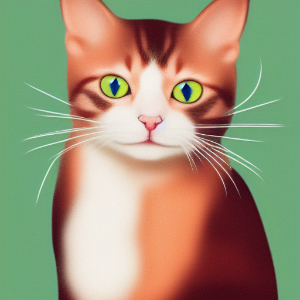
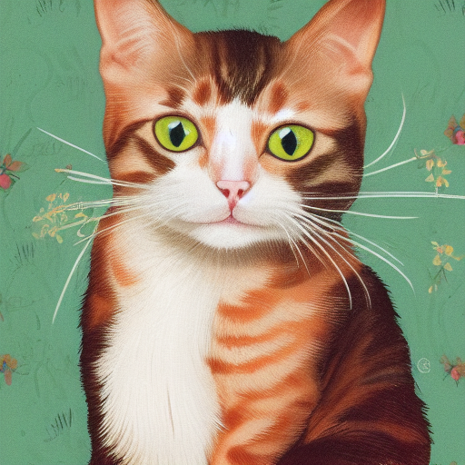
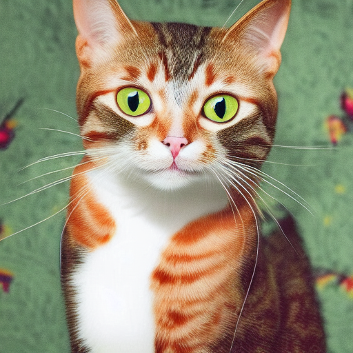
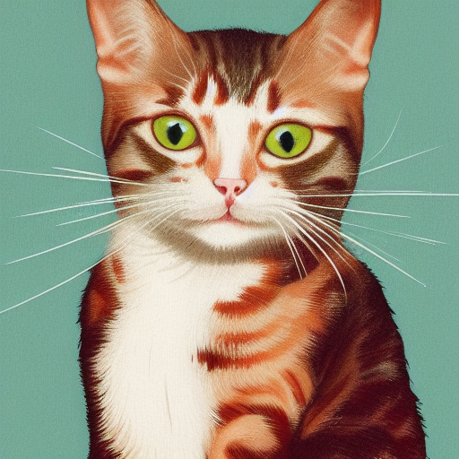
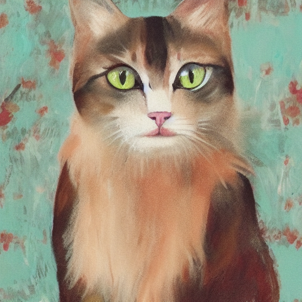
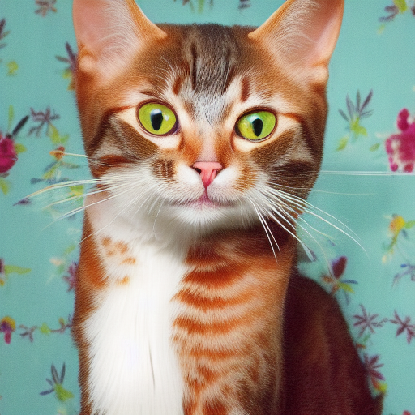

# Stable Diffusion 1.x, 2.x, and SDXL

Stable Diffusion 1.x, 2.x, and SDXL support text-to-image and image-to-image
generation from single-file checkpoints.

## Model files

| Component | Weights and downloads | CLI option | Requirement |
| --- | --- | --- | --- |
| SD 1.4 checkpoint | [CompVis SD 1.4](https://huggingface.co/CompVis/stable-diffusion-v-1-4-original) | `-m` / `--model` | Choose a matching SD checkpoint |
| SD 1.5 checkpoint | [Stable Diffusion 1.5](https://huggingface.co/stable-diffusion-v1-5/stable-diffusion-v1-5) | `-m` / `--model` | Choose a matching SD checkpoint |
| SD 2.1 checkpoint | [Stable Diffusion 2.1](https://huggingface.co/Manojb/stable-diffusion-2-1-base) | `-m` / `--model` | Choose a matching SD checkpoint |
| SDXL checkpoint | `sd_xl_base_1.0.safetensors` from [SDXL](https://huggingface.co/stabilityai/stable-diffusion-xl-base-1.0) | `-m` / `--model` | For SDXL examples |
| SDXL VAE | [`sdxl_vae-fp16-fix.safetensors`](https://huggingface.co/madebyollin/sdxl-vae-fp16-fix) | `--vae` | Use an override when required by the checkpoint |

## Usage

CLI examples use the [shared path and shell conventions](README.md#example-conventions).

### Web UI

Follow the [Web UI guide](../../examples/server/README.md#web-ui) to start the
server, then select the recipe matching your weights. Fill the component slots
below and click **Load models**.
Use the files and compatibility requirements in [Model files](#model-files).

| Recipe | Component slots |
| --- | --- |
| SD 1.x (`sd1-checkpoint`) | `model`, `vae`, `tae` |
| SD 2.1 512 (`sd2-512-checkpoint`) | `model`, `vae`, `tae` |
| SD 2.1 768 (`sd2-768-checkpoint`) | `model`, `vae`, `tae` |
| SDXL (`sdxl-checkpoint`) | `model`, `vae`, `tae` |
| SD Turbo (`sd-turbo`) | `model`, `vae`, `tae` |
| SDXL Turbo (`sdxl-turbo`) | `model`, `vae`, `tae` |

Slot IDs correspond to CLI component options: `diffusion_model` uses
`--diffusion-model`, `llm` uses `--llm`, and `model` uses `-m` / `--model`.
Select optional components when required by your checkpoint or task.

### CLI

#### SD 1.4

**Windows (PowerShell)**

```powershell
.\bin\Release\sd-cli.exe -m ..\models\checkpoints\sd-v1-4.ckpt -p "a lovely cat"
```

**Linux/macOS**

```sh
./bin/sd-cli -m ../models/checkpoints/sd-v1-4.ckpt -p "a lovely cat"
```

#### SD 1.5

**Windows (PowerShell)**

```powershell
.\bin\Release\sd-cli.exe -m ..\models\checkpoints\v1-5-pruned-emaonly.safetensors -p "a lovely cat"
```

**Linux/macOS**

```sh
./bin/sd-cli -m ../models/checkpoints/v1-5-pruned-emaonly.safetensors -p "a lovely cat"
```

#### SDXL

**Windows (PowerShell)**

```powershell
.\bin\Release\sd-cli.exe `
  -m ..\models\checkpoints\sd_xl_base_1.0.safetensors `
  --vae ..\models\vae\sdxl_vae-fp16-fix.safetensors `
  -p "a lovely cat" `
  -H 1024 `
  -W 1024 `
  -v
```

**Linux/macOS**

```sh
./bin/sd-cli \
  -m ../models/checkpoints/sd_xl_base_1.0.safetensors \
  --vae ../models/vae/sdxl_vae-fp16-fix.safetensors \
  -p "a lovely cat" \
  -H 1024 \
  -W 1024 \
  -v
```

#### img2img example

Use the image generated above as `./output.png`.

**Windows (PowerShell)**

```powershell
.\bin\Release\sd-cli.exe `
  -m ..\models\checkpoints\sd-v1-4.ckpt `
  -p "cat with blue eyes" `
  -i .\output.png `
  --strength 0.4 `
  -o .\img2img_output.png
```

**Linux/macOS**

```sh
./bin/sd-cli \
  -m ../models/checkpoints/sd-v1-4.ckpt \
  -p "cat with blue eyes" \
  -i ./output.png \
  --strength 0.4 \
  -o ./img2img_output.png
```

<p align="center">
  
</p>

#### Precision comparison

Using formats of different precisions will yield results of varying quality.

| f32  | f16  |q8_0  |q5_0  |q5_1  |q4_0  |q4_1  |
| ----  |----  |----  |----  |----  |----  |----  |
|  | | | | | | |

## Notes and limitations

See [SD3 / SD3.5](sd3.md) for Stable Diffusion 3, and [FLUX.1](flux.md) for FLUX.
The [SD3 model repository](https://huggingface.co/stabilityai/stable-diffusion-3-medium) uses a different component setup.
For distilled and tiny variants, see [distilled SD models](distilled_sd.md).
