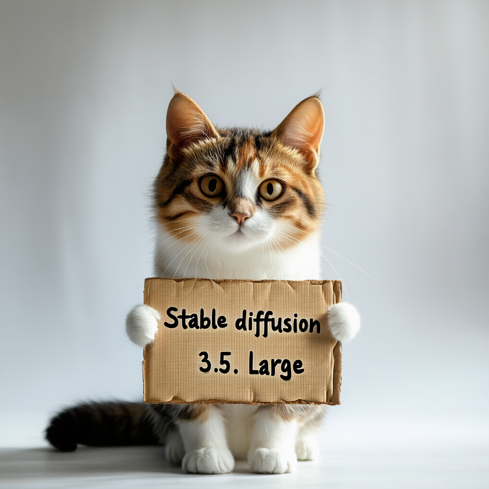

# Stable Diffusion 3 / 3.5

Stable Diffusion 3 and 3.5 generate images from text. The example below uses SD3.5 Large with separate text encoders.

## Model files

| Component | Weights and downloads | CLI option | Requirement |
| --- | --- | --- | --- |
| sd3.5_large | sd3.5_large from [Download](https://huggingface.co/stabilityai/stable-diffusion-3.5-large/blob/main/sd3.5_large.safetensors) | `--model` | Required |
| clip_g | clip_g from [Download](https://huggingface.co/Comfy-Org/stable-diffusion-3.5-fp8/blob/main/text_encoders/clip_g.safetensors) | `--clip_g` | Required |
| clip_l | clip_l from [Download](https://huggingface.co/Comfy-Org/stable-diffusion-3.5-fp8/blob/main/text_encoders/clip_l.safetensors) | `--clip_l` | Required |
| t5xxl | t5xxl from [Download](https://huggingface.co/Comfy-Org/stable-diffusion-3.5-fp8/blob/main/text_encoders/t5xxl_fp16.safetensors) | `--t5xxl` | Required |

## Usage

CLI examples use the [shared path and shell conventions](README.md#example-conventions).

### Web UI

Follow the [Web UI guide](../../examples/server/README.md#web-ui) to start the
server, then select the recipe matching your weights. Fill the component slots
below and click **Load models**.
Use the files and compatibility requirements in [Model files](#model-files).

| Recipe | Component slots |
| --- | --- |
| SD 3 Medium (`sd3-medium`) | `model`, `vae`, `tae` |
| SD 3.5 Medium (`sd35-medium`) | `model`, `clip_l`, `clip_g`, `t5xxl`, `vae`, `tae` |
| SD 3.5 Large (`sd35-large`) | `model`, `clip_l`, `clip_g`, `t5xxl`, `vae`, `tae` |

Slot IDs correspond to CLI component options: `diffusion_model` uses
`--diffusion-model`, `llm` uses `--llm`, and `model` uses `-m` / `--model`.
Select optional components when required by your checkpoint or task.

### CLI

#### SD3.5 Large

For example:

**Windows (PowerShell)**

```powershell
.\bin\Release\sd-cli.exe `
  -m ..\models\checkpoints\sd3.5_large.safetensors `
  --clip_l ..\models\text_encoders\clip_l.safetensors `
  --clip_g ..\models\text_encoders\clip_g.safetensors `
  --t5xxl ..\models\text_encoders\t5xxl_fp16.safetensors `
  -p "a lovely cat holding a sign says \`"Stable diffusion 3.5 Large\`"" `
  --cfg-scale 4.5 `
  --sampling-method euler `
  -H 1024 `
  -W 1024 `
  --clip-on-cpu `
  -v
```

**Linux/macOS**

```sh
./bin/sd-cli \
  -m ../models/checkpoints/sd3.5_large.safetensors \
  --clip_l ../models/text_encoders/clip_l.safetensors \
  --clip_g ../models/text_encoders/clip_g.safetensors \
  --t5xxl ../models/text_encoders/t5xxl_fp16.safetensors \
  -p "a lovely cat holding a sign says \\\"Stable diffusion 3.5 Large\\\"" \
  --cfg-scale 4.5 \
  --sampling-method euler \
  -H 1024 \
  -W 1024 \
  --clip-on-cpu \
  -v
```


