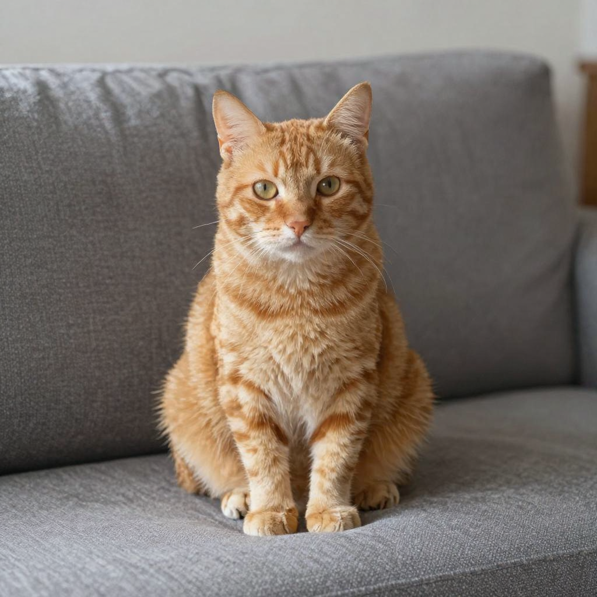

# SeFi-Image

SeFi-Image uses a Flux2-style dual-time transformer (semantic + texture streams), the standard Flux2 VAE, and Qwen3-VL as the LLM text encoder. Tech report: [arXiv:2606.22568](https://arxiv.org/abs/2606.22568).

## Model files

| Component | Weights and downloads | CLI option | Requirement |
| --- | --- | --- | --- |
| SeFi transformer | [SeFi-Image repositories](https://huggingface.co/SeFi-Image) | `--diffusion-model` | Choose matching scale and family; prepare as described below |
| Qwen3-VL text encoder | 2B for SeFi 1B/2B; 4B for SeFi 5B | `--llm` | Required; convert as described below |
| FLUX.2 VAE | [FLUX.2 dev](https://huggingface.co/black-forest-labs/FLUX.2-dev) | `--vae` | Required; `flux2_ae.safetensors` |

The SeFi-Image family ships in three scales (1B / 2B / 5B) and three families (Base / RL / turbo), all gated on Hugging Face under https://huggingface.co/SeFi-Image.

- 1B and 2B variants pair with Qwen3-VL-2B-Instruct.
- 5B variants pair with Qwen3-VL-4B-Instruct.
- All variants use the standard Flux2 VAE (`flux2_ae.safetensors` from https://huggingface.co/black-forest-labs/FLUX.2-dev).

Prepare the transformer and text encoder from the source repository root, using the conversion scripts:

**Windows (PowerShell)**

```powershell
python scripts\convert_sefi.py "<hf_repo_dir>" "<out_dir>/sefi_<scale>_<family>.safetensors"
python scripts\convert_qwen3_vl.py "<hf_repo_dir>/Qwen3-VL-XB-Instruct" "<out_dir>/qwen3_vl_<X>b.safetensors"
```

**Linux/macOS**

```sh
python3 scripts/convert_sefi.py "<hf_repo_dir>" "<out_dir>/sefi_<scale>_<family>.safetensors"
python3 scripts/convert_qwen3_vl.py "<hf_repo_dir>/Qwen3-VL-XB-Instruct" "<out_dir>/qwen3_vl_<X>b.safetensors"
```

## Usage

CLI examples use the [shared path and shell conventions](README.md#example-conventions).

### Web UI

Follow the [Web UI guide](../../examples/server/README.md#web-ui) to start the
server, then select the recipe matching your weights. Fill the component slots
below and click **Load models**.
Use the files and compatibility requirements in [Model files](#model-files).

| Recipe | Component slots |
| --- | --- |
| SeFi Image 5B RL (`sefi-image`) | `diffusion_model`, `llm`, `vae`, `tae` |

Slot IDs correspond to CLI component options: `diffusion_model` uses
`--diffusion-model`, `llm` uses `--llm`, and `model` uses `-m` / `--model`.
Select optional components when required by your checkpoint or task.

### CLI

#### 1B / 2B turbo

**Windows (PowerShell)**

```powershell
.\bin\Release\sd-cli.exe `
  --diffusion-model ..\models\diffusion_models\sefi_1b_turbo.safetensors `
  --vae ..\models\vae\flux2_ae.safetensors `
  --llm ..\models\text_encoders\qwen3_vl_2b.safetensors `
  -p "a photograph of an orange tabby cat sitting on a couch" `
  --cfg-scale 1.0 `
  --steps 4 `
  -W 1024 `
  -H 1024 `
  --offload-to-cpu `
  -s 42 `
  -o out.png
```

**Linux/macOS**

```sh
./bin/sd-cli \
  --diffusion-model ../models/diffusion_models/sefi_1b_turbo.safetensors \
  --vae ../models/vae/flux2_ae.safetensors \
  --llm ../models/text_encoders/qwen3_vl_2b.safetensors \
  -p "a photograph of an orange tabby cat sitting on a couch" \
  --cfg-scale 1.0 \
  --steps 4 \
  -W 1024 \
  -H 1024 \
  --offload-to-cpu \
  -s 42 \
  -o out.png
```

#### 1B / 2B base

**Windows (PowerShell)**

```powershell
.\bin\Release\sd-cli.exe `
  --diffusion-model ..\models\diffusion_models\sefi_1b_base.safetensors `
  --vae ..\models\vae\flux2_ae.safetensors `
  --llm ..\models\text_encoders\qwen3_vl_2b.safetensors `
  -p "a photograph of an orange tabby cat sitting on a couch" `
  --cfg-scale 4.0 `
  --steps 50 `
  -W 1024 `
  -H 1024 `
  --offload-to-cpu `
  -s 42 `
  -o out.png
```

**Linux/macOS**

```sh
./bin/sd-cli \
  --diffusion-model ../models/diffusion_models/sefi_1b_base.safetensors \
  --vae ../models/vae/flux2_ae.safetensors \
  --llm ../models/text_encoders/qwen3_vl_2b.safetensors \
  -p "a photograph of an orange tabby cat sitting on a couch" \
  --cfg-scale 4.0 \
  --steps 50 \
  -W 1024 \
  -H 1024 \
  --offload-to-cpu \
  -s 42 \
  -o out.png
```

#### 5B (needs streaming on 12 GiB VRAM)

**Windows (PowerShell)**

```powershell
.\bin\Release\sd-cli.exe `
  --diffusion-model ..\models\diffusion_models\sefi_5b_turbo.safetensors `
  --vae ..\models\vae\flux2_ae.safetensors `
  --llm ..\models\text_encoders\qwen3_vl_4b.safetensors `
  -p "a photograph of an orange tabby cat sitting on a couch" `
  --cfg-scale 1.0 `
  --steps 4 `
  -W 1024 `
  -H 1024 `
  --max-vram 8 `
  --offload-to-cpu `
  -s 42 `
  -o out.png
```

**Linux/macOS**

```sh
./bin/sd-cli \
  --diffusion-model ../models/diffusion_models/sefi_5b_turbo.safetensors \
  --vae ../models/vae/flux2_ae.safetensors \
  --llm ../models/text_encoders/qwen3_vl_4b.safetensors \
  -p "a photograph of an orange tabby cat sitting on a couch" \
  --cfg-scale 1.0 \
  --steps 4 \
  -W 1024 \
  -H 1024 \
  --max-vram 8 \
  --offload-to-cpu \
  -s 42 \
  -o out.png
```



## Options

### Variant defaults

| Family | timestep_shift_alpha | steps | cfg-scale |
|---|---|---|---|
| Base | 0.3 | 50 | 4.0 |
| RL | 0.3 | 50 | 4.0 |
| turbo | 1.0 | 4 | 1.0 |

The dispatcher picks `alpha` from the filename (`turbo` substring => 1.0, otherwise 0.3). Override via `--extra-sample-args sefi_alpha=<value>` or `sefi_delta_t=<value>`.
