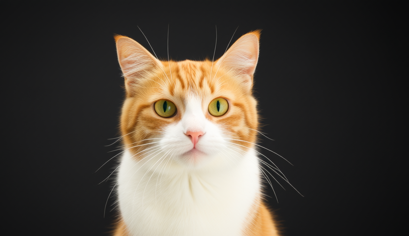

# Wan

Wan 2.1 and 2.2 support video generation with task-specific checkpoints for text,
images, audio, and VACE conditioning.

## Model files

| Component | Weights and downloads | CLI option | Requirement |
| --- | --- | --- | --- |
| Wan2.1 T2V 1.3B | [safetensors](https://huggingface.co/Comfy-Org/Wan_2.1_ComfyUI_repackaged/tree/main/split_files/diffusion_models) | `--diffusion-model` | Match the task and variant |
| Wan2.1 T2V 14B | [safetensors](https://huggingface.co/Comfy-Org/Wan_2.1_ComfyUI_repackaged/tree/main/split_files/diffusion_models)<br>[gguf](https://huggingface.co/city96/Wan2.1-T2V-14B-gguf/tree/main) | `--diffusion-model` | Match the task and variant |
| Wan2.1 I2V 14B 480P | [safetensors](https://huggingface.co/Comfy-Org/Wan_2.1_ComfyUI_repackaged/tree/main/split_files/diffusion_models)<br>[gguf](https://huggingface.co/city96/Wan2.1-I2V-14B-480P-gguf/tree/main) | `--diffusion-model` | Match the task and variant |
| Wan2.1 I2V 14B 720P | [safetensors](https://huggingface.co/Comfy-Org/Wan_2.1_ComfyUI_repackaged/tree/main/split_files/diffusion_models)<br>[gguf](https://huggingface.co/city96/Wan2.1-I2V-14B-720P-gguf/tree/main) | `--diffusion-model` | Match the task and variant |
| Wan2.1 FLF2V 14B 720P | [safetensors](https://huggingface.co/Comfy-Org/Wan_2.1_ComfyUI_repackaged/tree/main/split_files/diffusion_models)<br>[gguf](https://huggingface.co/city96/Wan2.1-FLF2V-14B-720P-gguf/tree/main) | `--diffusion-model` | Match the task and variant |
| Wan2.1 VACE 1.3B | [safetensors](https://huggingface.co/Comfy-Org/Wan_2.1_ComfyUI_repackaged/tree/main/split_files/diffusion_models)<br>[gguf](https://huggingface.co/calcuis/wan-1.3b-gguf/tree/main) | `--diffusion-model` | Match the task and variant |
| Wan2.1 VACE 14B | [safetensors](https://huggingface.co/Comfy-Org/Wan_2.1_ComfyUI_repackaged/tree/main/split_files/diffusion_models)<br>[gguf](https://huggingface.co/QuantStack/Wan2.1_14B_VACE-GGUF/tree/main) | `--diffusion-model` | Match the task and variant |
| Wan2.2 TI2V 5B | [safetensors](https://huggingface.co/Comfy-Org/Wan_2.2_ComfyUI_Repackaged/tree/main/split_files/diffusion_models)<br>[gguf](https://huggingface.co/QuantStack/Wan2.2-TI2V-5B-GGUF/tree/main) | `--diffusion-model` | Match the task and variant |
| Wan2.2 T2V A14B | [safetensors](https://huggingface.co/Comfy-Org/Wan_2.2_ComfyUI_Repackaged/tree/main/split_files/diffusion_models)<br>[gguf](https://huggingface.co/QuantStack/Wan2.2-T2V-A14B-GGUF/tree/main) | `--diffusion-model` | Match the task and variant |
| Wan2.2 I2V A14B | [safetensors](https://huggingface.co/Comfy-Org/Wan_2.2_ComfyUI_Repackaged/tree/main/split_files/diffusion_models)<br>[gguf](https://huggingface.co/QuantStack/Wan2.2-I2V-A14B-GGUF/tree/main) | `--diffusion-model` | Match the task and variant |
| Wan2.2 S2V 14B | [safetensors](https://huggingface.co/Comfy-Org/Wan_2.2_ComfyUI_Repackaged/tree/main/split_files/diffusion_models)<br>[gguf](https://huggingface.co/QuantStack/Wan2.2-S2V-14B-GGUF/tree/main)<br>[int8_convrot safetensors](https://huggingface.co/noctrex/Wan2.2-S2V-14B-int8_convrot) | `--diffusion-model` | Match the task and variant |
| Wan2.2 VACE-Fun A14B | [safetensors](https://huggingface.co/alibaba-pai/Wan2.2-VACE-Fun-A14B)<br>[gguf](https://huggingface.co/QuantStack/Wan2.2-VACE-Fun-A14B-GGUF/tree/main) | `--diffusion-model` | Match the task and variant |
| wan_2.1_vae (for all the wan model except Wan2.2 TI2V 5B) | [safetensors](https://huggingface.co/Comfy-Org/Wan_2.1_ComfyUI_repackaged/blob/main/split_files/vae/wan_2.1_vae.safetensors) | `--vae` | Match the model family |
| wan_2.2_vae (for Wan2.2 TI2V 5B only) | [safetensors](https://huggingface.co/Comfy-Org/Wan_2.2_ComfyUI_Repackaged/blob/main/split_files/vae/wan2.2_vae.safetensors) | `--vae` | Match the model family |
| umt5_xxl | [safetensors](https://huggingface.co/Comfy-Org/Wan_2.1_ComfyUI_repackaged/blob/main/split_files/text_encoders/umt5_xxl_fp16.safetensors)<br>[gguf](https://huggingface.co/city96/umt5-xxl-encoder-gguf/tree/main) | `--t5xxl` | Required for the indicated task |
| clip_vison_h (for Wan2.1 I2V/FLF2V only) | [safetensors](https://huggingface.co/Comfy-Org/Wan_2.1_ComfyUI_repackaged/blob/main/split_files/clip_vision/clip_vision_h.safetensors) | `--clip_vision` | Required for the indicated task |
| audio_encoder (for Wan2.2 S2V only) | [safetensors](https://huggingface.co/Comfy-Org/Wan_2.2_ComfyUI_Repackaged/blob/main/split_files/audio_encoders/wav2vec2_large_english_fp16.safetensors) | `--audio-encoder` | Required for the indicated task |

Use the Wan 2.2 VAE only for TI2V 5B; other variants use the matching Wan 2.1
VAE shown above. Wan 2.2 A14B T2V/I2V use separate high-noise and low-noise
transformers; load both, using `--high-noise-diffusion-model` for the high-noise
file. For lower VAE memory use, see [tiny autoencoders](taesd.md).

## Usage

CLI examples use the [shared path and shell conventions](README.md#example-conventions).

### Web UI

Follow the [Web UI guide](../../examples/server/README.md#web-ui) to start the
server, then select the recipe matching your weights. Fill the component slots
below and click **Load models**.
Use the files and compatibility requirements in [Model files](#model-files).

| Recipe | Component slots |
| --- | --- |
| Wan 2.1 T2V (`wan21-t2v`) | `diffusion_model`, `t5xxl`, `vae`, `tae` |
| Wan 2.1 I2V (`wan21-i2v`) | `diffusion_model`, `t5xxl`, `vae`, `tae`, `clip_vision` |
| Wan 2.1 FLF2V 14B (`wan21-flf2v`) | `diffusion_model`, `t5xxl`, `clip_vision`, `vae`, `tae` |
| Wan 2.1 VACE 1.3B / 14B (`wan21-vace`) | `diffusion_model`, `t5xxl`, `vae`, `tae` |
| Wan 2.2 T2V A14B (`wan22-t2v`) | `diffusion_model`, `high_noise_diffusion_model`, `t5xxl`, `vae`, `tae` |
| Wan 2.2 I2V A14B (`wan22-i2v`) | `diffusion_model`, `high_noise_diffusion_model`, `t5xxl`, `vae`, `tae` |
| Wan 2.2 S2V 14B (`wan22-s2v`) | `diffusion_model`, `t5xxl`, `audio_encoder`, `vae`, `tae` |
| Wan 2.2 TI2V 5B (`wan22-ti2v-5b`) | `diffusion_model`, `t5xxl`, `vae`, `tae` |

Slot IDs correspond to CLI component options: `diffusion_model` uses
`--diffusion-model`, `llm` uses `--llm`, and `model` uses `-m` / `--model`.
Select optional components when required by your checkpoint or task.

### CLI

#### Wan2.1 T2V 1.3B

**Windows (PowerShell)**

```powershell
.\bin\Release\sd-cli.exe `
  -M vid_gen `
  --diffusion-model ..\models\diffusion_models\wan2.1_t2v_1.3B_fp16.safetensors `
  --vae ..\models\vae\wan_2.1_vae.safetensors `
  --t5xxl ..\models\text_encoders\umt5-xxl-encoder-Q8_0.gguf `
  -p "a lovely cat" `
  -n "色调艳丽，过曝，静态，细节模糊不清，字幕，风格，作品，画作，画面，静止，整体发灰，最差质量，低质量，JPEG压缩残留，丑陋的，残缺的，多余的手指，画得不好的手部，画得不好的脸部， 畸形的，毁容的，形态畸形的肢体，手指融合，静止不动的画面，杂乱的背景，三条腿，背景人很多，倒着走" `
  --cfg-scale 6.0 `
  --sampling-method euler `
  --flow-shift 3.0 `
  -W 832 `
  -H 480 `
  --video-frames 33 `
  -v
```

**Linux/macOS**

```sh
./bin/sd-cli \
  -M vid_gen \
  --diffusion-model ../models/diffusion_models/wan2.1_t2v_1.3B_fp16.safetensors \
  --vae ../models/vae/wan_2.1_vae.safetensors \
  --t5xxl ../models/text_encoders/umt5-xxl-encoder-Q8_0.gguf \
  -p "a lovely cat" \
  -n "色调艳丽，过曝，静态，细节模糊不清，字幕，风格，作品，画作，画面，静止，整体发灰，最差质量，低质量，JPEG压缩残留，丑陋的，残缺的，多余的手指，画得不好的手部，画得不好的脸部， 畸形的，毁容的，形态畸形的肢体，手指融合，静止不动的画面，杂乱的背景，三条腿，背景人很多，倒着走" \
  --cfg-scale 6.0 \
  --sampling-method euler \
  --flow-shift 3.0 \
  -W 832 \
  -H 480 \
  --video-frames 33 \
  -v
```

<video src=../../assets/wan/Wan2.1_1.3B_t2v.mp4 controls="controls" muted="muted" type="video/mp4"></video>

#### Wan2.1 T2V 14B

**Windows (PowerShell)**

```powershell
.\bin\Release\sd-cli.exe `
  -M vid_gen `
  --diffusion-model ..\models\diffusion_models\wan2.1-t2v-14b-Q8_0.gguf `
  --vae ..\models\vae\wan_2.1_vae.safetensors `
  --t5xxl ..\models\text_encoders\umt5-xxl-encoder-Q8_0.gguf `
  -p "a lovely cat" `
  -n "色调艳丽，过曝，静态，细节模糊不清，字幕，风格，作品，画作，画面，静止，整体发灰，最差质量，低质量，JPEG压缩残留，丑陋的，残缺的，多余的手指，画得不好的手部，画得不好的脸部，畸形的，毁容的，形态畸形的肢体，手指融合，静止不动的画面，杂乱的背景，三条腿，背景人很多，倒着走" `
  --cfg-scale 6.0 `
  --sampling-method euler `
  --flow-shift 3.0 `
  -W 832 `
  -H 480 `
  --video-frames 33 `
  --offload-to-cpu `
  -v
```

**Linux/macOS**

```sh
./bin/sd-cli \
  -M vid_gen \
  --diffusion-model ../models/diffusion_models/wan2.1-t2v-14b-Q8_0.gguf \
  --vae ../models/vae/wan_2.1_vae.safetensors \
  --t5xxl ../models/text_encoders/umt5-xxl-encoder-Q8_0.gguf \
  -p "a lovely cat" \
  -n "色调艳丽，过曝，静态，细节模糊不清，字幕，风格，作品，画作，画面，静止，整体发灰，最差质量，低质量，JPEG压缩残留，丑陋的，残缺的，多余的手指，画得不好的手部，画得不好的脸部，畸形的，毁容的，形态畸形的肢体，手指融合，静止不动的画面，杂乱的背景，三条腿，背景人很多，倒着走" \
  --cfg-scale 6.0 \
  --sampling-method euler \
  --flow-shift 3.0 \
  -W 832 \
  -H 480 \
  --video-frames 33 \
  --offload-to-cpu \
  -v
```

<video src=../../assets/wan/Wan2.1_14B_t2v.mp4 controls="controls" muted="muted" type="video/mp4"></video>

#### Wan2.1 I2V 14B

**Windows (PowerShell)**

```powershell
.\bin\Release\sd-cli.exe `
  -M vid_gen `
  --diffusion-model ..\models\diffusion_models\wan2.1-i2v-14b-480p-Q8_0.gguf `
  --vae ..\models\vae\wan_2.1_vae.safetensors `
  --t5xxl ..\models\text_encoders\umt5-xxl-encoder-Q8_0.gguf `
  --clip_vision ..\models\clip_vision\clip_vision_h.safetensors `
  -p "a lovely cat" `
  -n "色调艳丽，过曝，静态，细节模糊不清，字幕，风格，作品，画作，画面，静止，整体发灰，最差质量，低质量，JPEG压缩残留，丑陋的，残缺的，多余的手指，画得不好的手部，画得不好的脸部，畸形的，毁容的，形态畸形的肢体，手指融合，静止不动的画面，杂乱的背景，三条腿，背景人很多，倒着走" `
  -i ..\inputs\cat_with_sd_cpp_42.png `
  --cfg-scale 6.0 `
  --sampling-method euler `
  --flow-shift 3.0 `
  -W 480 `
  -H 832 `
  --video-frames 33 `
  --offload-to-cpu `
  -v
```

**Linux/macOS**

```sh
./bin/sd-cli \
  -M vid_gen \
  --diffusion-model ../models/diffusion_models/wan2.1-i2v-14b-480p-Q8_0.gguf \
  --vae ../models/vae/wan_2.1_vae.safetensors \
  --t5xxl ../models/text_encoders/umt5-xxl-encoder-Q8_0.gguf \
  --clip_vision ../models/clip_vision/clip_vision_h.safetensors \
  -p "a lovely cat" \
  -n "色调艳丽，过曝，静态，细节模糊不清，字幕，风格，作品，画作，画面，静止，整体发灰，最差质量，低质量，JPEG压缩残留，丑陋的，残缺的，多余的手指，画得不好的手部，画得不好的脸部，畸形的，毁容的，形态畸形的肢体，手指融合，静止不动的画面，杂乱的背景，三条腿，背景人很多，倒着走" \
  -i ../inputs/cat_with_sd_cpp_42.png \
  --cfg-scale 6.0 \
  --sampling-method euler \
  --flow-shift 3.0 \
  -W 480 \
  -H 832 \
  --video-frames 33 \
  --offload-to-cpu \
  -v
```

<video src=../../assets/wan/Wan2.1_14B_i2v.mp4 controls="controls" muted="muted" type="video/mp4"></video>

#### Wan2.2 T2V A14B

**Windows (PowerShell)**

```powershell
.\bin\Release\sd-cli.exe `
  -M vid_gen `
  --diffusion-model ..\models\diffusion_models\Wan2.2-T2V-A14B-LowNoise-Q8_0.gguf `
  --high-noise-diffusion-model ..\models\diffusion_models\Wan2.2-T2V-A14B-HighNoise-Q8_0.gguf `
  --vae ..\models\vae\wan_2.1_vae.safetensors `
  --t5xxl ..\models\text_encoders\umt5-xxl-encoder-Q8_0.gguf `
  -p "a lovely cat" `
  -n "色调艳丽，过曝，静态，细节模糊不清，字幕，风格，作品，画作，画面，静止，整体发灰，最差质量，低质量，JPEG压缩残留，丑陋的，残缺的，多余的手指，画得不好的手部，画得不好的脸部，畸形的，毁容的，形态畸形的肢体，手指融合，静止不动的画面，杂乱的背景，三条腿，背景人很多，倒着走" `
  --cfg-scale 3.5 `
  --sampling-method euler `
  --steps 10 `
  --high-noise-cfg-scale 3.5 `
  --high-noise-sampling-method euler `
  --high-noise-steps 8 `
  --flow-shift 3.0 `
  -W 832 `
  -H 480 `
  --video-frames 33 `
  --offload-to-cpu `
  -v
```

**Linux/macOS**

```sh
./bin/sd-cli \
  -M vid_gen \
  --diffusion-model ../models/diffusion_models/Wan2.2-T2V-A14B-LowNoise-Q8_0.gguf \
  --high-noise-diffusion-model ../models/diffusion_models/Wan2.2-T2V-A14B-HighNoise-Q8_0.gguf \
  --vae ../models/vae/wan_2.1_vae.safetensors \
  --t5xxl ../models/text_encoders/umt5-xxl-encoder-Q8_0.gguf \
  -p "a lovely cat" \
  -n "色调艳丽，过曝，静态，细节模糊不清，字幕，风格，作品，画作，画面，静止，整体发灰，最差质量，低质量，JPEG压缩残留，丑陋的，残缺的，多余的手指，画得不好的手部，画得不好的脸部，畸形的，毁容的，形态畸形的肢体，手指融合，静止不动的画面，杂乱的背景，三条腿，背景人很多，倒着走" \
  --cfg-scale 3.5 \
  --sampling-method euler \
  --steps 10 \
  --high-noise-cfg-scale 3.5 \
  --high-noise-sampling-method euler \
  --high-noise-steps 8 \
  --flow-shift 3.0 \
  -W 832 \
  -H 480 \
  --video-frames 33 \
  --offload-to-cpu \
  -v
```

<video src=../../assets/wan/Wan2.2_14B_t2v.mp4 controls="controls" muted="muted" type="video/mp4"></video>

#### Wan2.2 I2V A14B

**Windows (PowerShell)**

```powershell
.\bin\Release\sd-cli.exe `
  -M vid_gen `
  --diffusion-model ..\models\diffusion_models\Wan2.2-I2V-A14B-LowNoise-Q8_0.gguf `
  --high-noise-diffusion-model ..\models\diffusion_models\Wan2.2-I2V-A14B-HighNoise-Q8_0.gguf `
  --vae ..\models\vae\wan_2.1_vae.safetensors `
  --t5xxl ..\models\text_encoders\umt5-xxl-encoder-Q8_0.gguf `
  -p "a lovely cat" `
  -n "色调艳丽，过曝，静态，细节模糊不清，字幕，风格，作品，画作，画面，静止，整体发灰，最差质量，低质量，JPEG压缩残留，丑陋的，残缺的，多余的手指，画得不好的手部，画得不好的脸部，畸形的，毁容的，形态畸形的肢体，手指融合，静止不动的画面，杂乱的背景，三条腿，背景人很多，倒着走" `
  -i ..\inputs\cat_with_sd_cpp_42.png `
  --cfg-scale 3.5 `
  --sampling-method euler `
  --steps 10 `
  --high-noise-cfg-scale 3.5 `
  --high-noise-sampling-method euler `
  --high-noise-steps 8 `
  --flow-shift 3.0 `
  -W 832 `
  -H 480 `
  --video-frames 33 `
  --offload-to-cpu `
  --offload-to-cpu `
  -v
```

**Linux/macOS**

```sh
./bin/sd-cli \
  -M vid_gen \
  --diffusion-model ../models/diffusion_models/Wan2.2-I2V-A14B-LowNoise-Q8_0.gguf \
  --high-noise-diffusion-model ../models/diffusion_models/Wan2.2-I2V-A14B-HighNoise-Q8_0.gguf \
  --vae ../models/vae/wan_2.1_vae.safetensors \
  --t5xxl ../models/text_encoders/umt5-xxl-encoder-Q8_0.gguf \
  -p "a lovely cat" \
  -n "色调艳丽，过曝，静态，细节模糊不清，字幕，风格，作品，画作，画面，静止，整体发灰，最差质量，低质量，JPEG压缩残留，丑陋的，残缺的，多余的手指，画得不好的手部，画得不好的脸部，畸形的，毁容的，形态畸形的肢体，手指融合，静止不动的画面，杂乱的背景，三条腿，背景人很多，倒着走" \
  -i ../inputs/cat_with_sd_cpp_42.png \
  --cfg-scale 3.5 \
  --sampling-method euler \
  --steps 10 \
  --high-noise-cfg-scale 3.5 \
  --high-noise-sampling-method euler \
  --high-noise-steps 8 \
  --flow-shift 3.0 \
  -W 832 \
  -H 480 \
  --video-frames 33 \
  --offload-to-cpu \
  --offload-to-cpu \
  -v
```

<video src=../../assets/wan/Wan2.2_14B_i2v.mp4 controls="controls" muted="muted" type="video/mp4"></video>

#### Wan2.2 S2V 14B

Audio-driven video (speech-to-video). The reference image (`-i`) is the speaker
portrait, `--audio` is the driving audio track and `--audio-encoder` is the
wav2vec2 audio encoder. Wan2.2 S2V requires the wan_2.1 vae (16 channel), not
the wan2.2 vae.

**Windows (PowerShell)**

```powershell
.\bin\Release\sd-cli.exe `
  -M vid_gen `
  --diffusion-model ..\models\diffusion_models\wan2.2_s2v-14B-Q8_0.gguf `
  --audio-encoder ..\models\text_encoders\audio_encoders\wav2vec2_large_english_fp16.safetensors `
  --vae ..\models\vae\wan_2.1_vae.safetensors `
  --t5xxl ..\models\text_encoders\umt5-xxl-encoder-Q8_0.gguf `
  -p "a person is talking" `
  -n "色调艳丽，过曝，静态，细节模糊不清，字幕，风格，作品，画作，画面，静止，整体发灰，最差质量，低质量，JPEG压缩残留，丑陋的，残缺的，多余的手指，画得不好的手部，画得不好的脸部，畸形的，毁容的，形态畸形的肢体，手指融合，静止不动的画面，杂乱的背景，三条腿，背景人很多，倒着走" `
  -i ..\inputs\cat_with_sd_cpp_42.png `
  --audio .\input\speech.wav `
  --cfg-scale 6.0 `
  --steps 20 `
  --sampling-method euler `
  --flow-shift 3.0 `
  -W 832 `
  -H 480 `
  --video-frames 81 `
  --offload-to-cpu `
  --vae-tiling `
  -v
```

**Linux/macOS**

```sh
./bin/sd-cli \
  -M vid_gen \
  --diffusion-model ../models/diffusion_models/wan2.2_s2v-14B-Q8_0.gguf \
  --audio-encoder ../models/text_encoders/audio_encoders/wav2vec2_large_english_fp16.safetensors \
  --vae ../models/vae/wan_2.1_vae.safetensors \
  --t5xxl ../models/text_encoders/umt5-xxl-encoder-Q8_0.gguf \
  -p "a person is talking" \
  -n "色调艳丽，过曝，静态，细节模糊不清，字幕，风格，作品，画作，画面，静止，整体发灰，最差质量，低质量，JPEG压缩残留，丑陋的，残缺的，多余的手指，画得不好的手部，画得不好的脸部，畸形的，毁容的，形态畸形的肢体，手指融合，静止不动的画面，杂乱的背景，三条腿，背景人很多，倒着走" \
  -i ../inputs/cat_with_sd_cpp_42.png \
  --audio ./input/speech.wav \
  --cfg-scale 6.0 \
  --steps 20 \
  --sampling-method euler \
  --flow-shift 3.0 \
  -W 832 \
  -H 480 \
  --video-frames 81 \
  --offload-to-cpu \
  --vae-tiling \
  -v
```

Notes:

- Recommended settings: `--sampling-method euler --steps 20 --cfg-scale 6.0`.
  `dpm++2m` produces heavy artifacts on S2V. 4 steps with the lightning LoRA
  (below) is the fast option.
- Resolutions: width and height must be multiples of 16; the examples use
  multiples of 64. 832x480 is a fast starting point; generation cost scales
  with pixel area.
- `--audio` accepts a WAV file; it is downmixed to mono and resampled to 16 kHz
  internally. Audio longer than the video is truncated, video longer than the
  audio is padded with silence. Pick `--video-frames` to match the audio:
  roughly `audio_seconds * 16` frames, capped at one chunk (77-81 frames,
  ~5 s at the model's 16 fps). 33, 77 and 81 map to clean latent frame counts.
- S2V always uses 16 fps. Other requested frame rates are automatically
  changed to 16 with a warning, including the CLI and server video output.
  `generate_video()` returns the actual frame rate through `fps_out`; C API
  callers should use that value when encoding the output video.
- One generation covers the first S2V chunk window (`--video-frames` frames).
  Long-video chunked extend mode is not implemented yet.
- Speed: the lightx2v lightning LoRA works with S2V at 4 steps and
  `--cfg-scale 1.0`. Use the **low_noise** variant;
  the high_noise variant produces artifacts on S2V:

**Windows (PowerShell) arguments**

```text
--lora-model-dir ..\models\loras `
  -p "...<lora:lightx2v-Wan2.2-T2V-A14B-4steps-lora-rank64-Seko-V2.0-low_noise:1.0>" `
  --cfg-scale 1.0 `
  --steps 4
```

**Linux/macOS arguments**

```text
--lora-model-dir ../models/loras \
  -p "...<lora:lightx2v-Wan2.2-T2V-A14B-4steps-lora-rank64-Seko-V2.0-low_noise:1.0>" \
  --cfg-scale 1.0 \
  --steps 4
```

  Expect some quality/dynamics loss compared to the full 20-step run.

#### Wan2.2 T2V A14B T2I

**Windows (PowerShell)**

```powershell
.\bin\Release\sd-cli.exe `
  -M vid_gen `
  --diffusion-model ..\models\diffusion_models\Wan2.2-T2V-A14B-LowNoise-Q8_0.gguf `
  --high-noise-diffusion-model ..\models\diffusion_models\Wan2.2-T2V-A14B-HighNoise-Q8_0.gguf `
  --vae ..\models\vae\wan_2.1_vae.safetensors `
  --t5xxl ..\models\text_encoders\umt5-xxl-encoder-Q8_0.gguf `
  -p "a lovely cat" `
  -n "色调艳丽，过曝，静态，细节模糊不清，字幕，风格，作品，画作，画面，静止，整体发灰，最差质量，低质量，JPEG压缩残留，丑陋的，残缺的，多余的手指，画得不好的手部，画得不好的脸部，畸形的，毁容的，形态畸形的肢体，手指融合，静止不动的画面，杂乱的背景，三条腿，背景人很多，倒着走" `
  --cfg-scale 3.5 `
  --sampling-method euler `
  --steps 10 `
  --high-noise-cfg-scale 3.5 `
  --high-noise-sampling-method euler `
  --high-noise-steps 8 `
  --flow-shift 3.0 `
  -W 832 `
  -H 480 `
  --offload-to-cpu `
  -v
```

**Linux/macOS**

```sh
./bin/sd-cli \
  -M vid_gen \
  --diffusion-model ../models/diffusion_models/Wan2.2-T2V-A14B-LowNoise-Q8_0.gguf \
  --high-noise-diffusion-model ../models/diffusion_models/Wan2.2-T2V-A14B-HighNoise-Q8_0.gguf \
  --vae ../models/vae/wan_2.1_vae.safetensors \
  --t5xxl ../models/text_encoders/umt5-xxl-encoder-Q8_0.gguf \
  -p "a lovely cat" \
  -n "色调艳丽，过曝，静态，细节模糊不清，字幕，风格，作品，画作，画面，静止，整体发灰，最差质量，低质量，JPEG压缩残留，丑陋的，残缺的，多余的手指，画得不好的手部，画得不好的脸部，畸形的，毁容的，形态畸形的肢体，手指融合，静止不动的画面，杂乱的背景，三条腿，背景人很多，倒着走" \
  --cfg-scale 3.5 \
  --sampling-method euler \
  --steps 10 \
  --high-noise-cfg-scale 3.5 \
  --high-noise-sampling-method euler \
  --high-noise-steps 8 \
  --flow-shift 3.0 \
  -W 832 \
  -H 480 \
  --offload-to-cpu \
  -v
```



#### Wan2.2 T2V 14B with Lora

**Windows (PowerShell)**

```powershell
.\bin\Release\sd-cli.exe `
  -M vid_gen `
  --diffusion-model ..\models\diffusion_models\Wan2.2-T2V-A14B-LowNoise-Q8_0.gguf `
  --high-noise-diffusion-model ..\models\diffusion_models\Wan2.2-T2V-A14B-HighNoise-Q8_0.gguf `
  --vae ..\models\vae\wan_2.1_vae.safetensors `
  --t5xxl ..\models\text_encoders\umt5-xxl-encoder-Q8_0.gguf `
  --lora-model-dir ..\models\loras `
  -p "a lovely cat<lora:wan2.2_t2v_lightx2v_4steps_lora_v1.1_low_noise:1><lora:|high_noise|wan2.2_t2v_lightx2v_4steps_lora_v1.1_high_noise:1>" `
  -n "色调艳丽，过曝，静态，细节模糊不清，字幕，风格，作品，画作，画面，静止，整体发灰，最差质量，低质量，JPEG压缩残留，丑陋的，残缺的，多余的手指，画得不好的手部，画得不好的脸部，畸形的，毁容的，形态畸形的肢体，手指融合，静止不动的画面，杂乱的背景，三条腿，背景人很多，倒着走" `
  --cfg-scale 3.5 `
  --sampling-method euler `
  --steps 4 `
  --high-noise-cfg-scale 3.5 `
  --high-noise-sampling-method euler `
  --high-noise-steps 4 `
  --flow-shift 3.0 `
  -W 832 `
  -H 480 `
  --video-frames 33 `
  --offload-to-cpu `
  -v
```

**Linux/macOS**

```sh
./bin/sd-cli \
  -M vid_gen \
  --diffusion-model ../models/diffusion_models/Wan2.2-T2V-A14B-LowNoise-Q8_0.gguf \
  --high-noise-diffusion-model ../models/diffusion_models/Wan2.2-T2V-A14B-HighNoise-Q8_0.gguf \
  --vae ../models/vae/wan_2.1_vae.safetensors \
  --t5xxl ../models/text_encoders/umt5-xxl-encoder-Q8_0.gguf \
  --lora-model-dir ../models/loras \
  -p "a lovely cat<lora:wan2.2_t2v_lightx2v_4steps_lora_v1.1_low_noise:1><lora:|high_noise|wan2.2_t2v_lightx2v_4steps_lora_v1.1_high_noise:1>" \
  -n "色调艳丽，过曝，静态，细节模糊不清，字幕，风格，作品，画作，画面，静止，整体发灰，最差质量，低质量，JPEG压缩残留，丑陋的，残缺的，多余的手指，画得不好的手部，画得不好的脸部，畸形的，毁容的，形态畸形的肢体，手指融合，静止不动的画面，杂乱的背景，三条腿，背景人很多，倒着走" \
  --cfg-scale 3.5 \
  --sampling-method euler \
  --steps 4 \
  --high-noise-cfg-scale 3.5 \
  --high-noise-sampling-method euler \
  --high-noise-steps 4 \
  --flow-shift 3.0 \
  -W 832 \
  -H 480 \
  --video-frames 33 \
  --offload-to-cpu \
  -v
```

<video src=../../assets/wan/Wan2.2_14B_t2v_lora.mp4 controls="controls" muted="muted" type="video/mp4"></video>

#### Wan2.2 TI2V 5B

##### T2V

**Windows (PowerShell)**

```powershell
.\bin\Release\sd-cli.exe `
  -M vid_gen `
  --diffusion-model ..\models\diffusion_models\wan2.2_ti2v_5B_fp16.safetensors `
  --vae ..\models\vae\wan2.2_vae.safetensors `
  --t5xxl ..\models\text_encoders\umt5-xxl-encoder-Q8_0.gguf `
  -p "a lovely cat" `
  -n "色调艳丽，过曝，静态，细节模糊不清，字幕，风格，作品，画作，画面，静止，整体发灰，最差质量，低质量，JPEG压缩残留，丑陋的，残缺的，多余的手指，画得不好的手部，画得不好的脸部，畸形的，毁容的，形态畸形的肢体，手指融合，静止不动的画面，杂乱的背景，三条腿，背景人很多，倒着走" `
  --cfg-scale 6.0 `
  --sampling-method euler `
  --flow-shift 3.0 `
  -W 480 `
  -H 832 `
  --video-frames 33 `
  --offload-to-cpu `
  -v
```

**Linux/macOS**

```sh
./bin/sd-cli \
  -M vid_gen \
  --diffusion-model ../models/diffusion_models/wan2.2_ti2v_5B_fp16.safetensors \
  --vae ../models/vae/wan2.2_vae.safetensors \
  --t5xxl ../models/text_encoders/umt5-xxl-encoder-Q8_0.gguf \
  -p "a lovely cat" \
  -n "色调艳丽，过曝，静态，细节模糊不清，字幕，风格，作品，画作，画面，静止，整体发灰，最差质量，低质量，JPEG压缩残留，丑陋的，残缺的，多余的手指，画得不好的手部，画得不好的脸部，畸形的，毁容的，形态畸形的肢体，手指融合，静止不动的画面，杂乱的背景，三条腿，背景人很多，倒着走" \
  --cfg-scale 6.0 \
  --sampling-method euler \
  --flow-shift 3.0 \
  -W 480 \
  -H 832 \
  --video-frames 33 \
  --offload-to-cpu \
  -v
```

<video src=../../assets/wan/Wan2.2_5B_t2v.mp4 controls="controls" muted="muted" type="video/mp4"></video>

##### I2V

**Windows (PowerShell)**

```powershell
.\bin\Release\sd-cli.exe `
  -M vid_gen `
  --diffusion-model ..\models\diffusion_models\wan2.2_ti2v_5B_fp16.safetensors `
  --vae ..\models\vae\wan2.2_vae.safetensors `
  --t5xxl ..\models\text_encoders\umt5-xxl-encoder-Q8_0.gguf `
  -p "a lovely cat" `
  -n "色调艳丽，过曝，静态，细节模糊不清，字幕，风格，作品，画作，画面，静止，整体发灰，最差质量，低质量，JPEG压缩残留，丑陋的，残缺的，多余的手指，画得不好的手部，画得不好的脸部，畸形的，毁容的，形态畸形的肢体，手指融合，静止不动的画面，杂乱的背景，三条腿，背景人很多，倒着走" `
  -i ..\inputs\cat_with_sd_cpp_42.png `
  --cfg-scale 6.0 `
  --sampling-method euler `
  --flow-shift 3.0 `
  -W 480 `
  -H 832 `
  --video-frames 33 `
  --offload-to-cpu `
  -v
```

**Linux/macOS**

```sh
./bin/sd-cli \
  -M vid_gen \
  --diffusion-model ../models/diffusion_models/wan2.2_ti2v_5B_fp16.safetensors \
  --vae ../models/vae/wan2.2_vae.safetensors \
  --t5xxl ../models/text_encoders/umt5-xxl-encoder-Q8_0.gguf \
  -p "a lovely cat" \
  -n "色调艳丽，过曝，静态，细节模糊不清，字幕，风格，作品，画作，画面，静止，整体发灰，最差质量，低质量，JPEG压缩残留，丑陋的，残缺的，多余的手指，画得不好的手部，画得不好的脸部，畸形的，毁容的，形态畸形的肢体，手指融合，静止不动的画面，杂乱的背景，三条腿，背景人很多，倒着走" \
  -i ../inputs/cat_with_sd_cpp_42.png \
  --cfg-scale 6.0 \
  --sampling-method euler \
  --flow-shift 3.0 \
  -W 480 \
  -H 832 \
  --video-frames 33 \
  --offload-to-cpu \
  -v
```

<video src=../../assets/wan/Wan2.2_5B_i2v.mp4 controls="controls" muted="muted" type="video/mp4"></video>

TI2V 5B can decode multiple latent frames together when temporal tiling is enabled. For example, `--temporal-tiling --vae-tiling --vae-tile-size 256x256 --extra-tiling-args "temporal_tile_frames=4,temporal_decode_frames=2"` keeps up to four latent frames in each temporal tile and decodes up to two at once, with spatial tiles of 256×256 pixels. `temporal_decode_frames` defaults to `1`, preserving frame-by-frame decoding; other model versions ignore it. Increasing it requires more memory. Adjust the spatial tile size to fit the available memory.

#### Wan2.1 FLF2V 14B

**Windows (PowerShell)**

```powershell
.\bin\Release\sd-cli.exe `
  -M vid_gen `
  --diffusion-model ..\models\diffusion_models\wan2.1-flf2v-14b-720p-Q8_0.gguf `
  --vae ..\models\vae\wan_2.1_vae.safetensors `
  --t5xxl ..\models\text_encoders\umt5-xxl-encoder-Q8_0.gguf `
  --clip_vision ..\models\clip_vision\clip_vision_h.safetensors `
  -p "glass flower blossom" `
  -n "色调艳丽，过曝，静态，细节模糊不清，字幕，风格，作品，画作，画面，静止，整体发灰，最差质量，低质量，JPEG压缩残留，丑陋的，残缺的，多余的手指，画得不好的手部，画得不好的脸部，畸形的，毁容的，形态畸形的肢体，手指融合，静止不动的画面，杂乱的背景，三条腿，背景人很多，倒着走" `
  --init-img ..\inputs\start_image.png `
  --end-img ..\inputs\end_image.png `
  --cfg-scale 6.0 `
  --sampling-method euler `
  --flow-shift 3.0 `
  -W 480 `
  -H 832 `
  --video-frames 33 `
  --offload-to-cpu `
  -v
```

**Linux/macOS**

```sh
./bin/sd-cli \
  -M vid_gen \
  --diffusion-model ../models/diffusion_models/wan2.1-flf2v-14b-720p-Q8_0.gguf \
  --vae ../models/vae/wan_2.1_vae.safetensors \
  --t5xxl ../models/text_encoders/umt5-xxl-encoder-Q8_0.gguf \
  --clip_vision ../models/clip_vision/clip_vision_h.safetensors \
  -p "glass flower blossom" \
  -n "色调艳丽，过曝，静态，细节模糊不清，字幕，风格，作品，画作，画面，静止，整体发灰，最差质量，低质量，JPEG压缩残留，丑陋的，残缺的，多余的手指，画得不好的手部，画得不好的脸部，畸形的，毁容的，形态畸形的肢体，手指融合，静止不动的画面，杂乱的背景，三条腿，背景人很多，倒着走" \
  --init-img ../inputs/start_image.png \
  --end-img ../inputs/end_image.png \
  --cfg-scale 6.0 \
  --sampling-method euler \
  --flow-shift 3.0 \
  -W 480 \
  -H 832 \
  --video-frames 33 \
  --offload-to-cpu \
  -v
```

<video src=../../assets/wan/Wan2.1_14B_flf2v.mp4 controls="controls" muted="muted" type="video/mp4"></video>

#### Wan2.2 FLF2V 14B

**Windows (PowerShell)**

```powershell
.\bin\Release\sd-cli.exe `
  -M vid_gen `
  --diffusion-model ..\models\diffusion_models\Wan2.2-I2V-A14B-LowNoise-Q8_0.gguf `
  --high-noise-diffusion-model ..\models\diffusion_models\Wan2.2-I2V-A14B-HighNoise-Q8_0.gguf `
  --vae ..\models\vae\wan_2.1_vae.safetensors `
  --t5xxl ..\models\text_encoders\umt5-xxl-encoder-Q8_0.gguf `
  -p "glass flower blossom" `
  -n "色调艳丽，过曝，静态，细节模糊不清，字幕，风格，作品，画作，画面，静止，整体发灰，最差质量，低质量，JPEG压缩残留，丑陋的，残缺的，多余的手指，画得不好的手部，画得不好的脸部，畸形的，毁容的，形态畸形的肢体，手指融合，静止不动的画面，杂乱的背景，三条腿，背景人很多，倒着走" `
  --init-img ..\inputs\start_image.png `
  --end-img ..\inputs\end_image.png `
  --cfg-scale 3.5 `
  --sampling-method euler `
  --steps 10 `
  --high-noise-cfg-scale 3.5 `
  --high-noise-sampling-method euler `
  --high-noise-steps 8 `
  --flow-shift 3.0 `
  -W 480 `
  -H 832 `
  --video-frames 33 `
  --offload-to-cpu `
  -v
```

**Linux/macOS**

```sh
./bin/sd-cli \
  -M vid_gen \
  --diffusion-model ../models/diffusion_models/Wan2.2-I2V-A14B-LowNoise-Q8_0.gguf \
  --high-noise-diffusion-model ../models/diffusion_models/Wan2.2-I2V-A14B-HighNoise-Q8_0.gguf \
  --vae ../models/vae/wan_2.1_vae.safetensors \
  --t5xxl ../models/text_encoders/umt5-xxl-encoder-Q8_0.gguf \
  -p "glass flower blossom" \
  -n "色调艳丽，过曝，静态，细节模糊不清，字幕，风格，作品，画作，画面，静止，整体发灰，最差质量，低质量，JPEG压缩残留，丑陋的，残缺的，多余的手指，画得不好的手部，画得不好的脸部，畸形的，毁容的，形态畸形的肢体，手指融合，静止不动的画面，杂乱的背景，三条腿，背景人很多，倒着走" \
  --init-img ../inputs/start_image.png \
  --end-img ../inputs/end_image.png \
  --cfg-scale 3.5 \
  --sampling-method euler \
  --steps 10 \
  --high-noise-cfg-scale 3.5 \
  --high-noise-sampling-method euler \
  --high-noise-steps 8 \
  --flow-shift 3.0 \
  -W 480 \
  -H 832 \
  --video-frames 33 \
  --offload-to-cpu \
  -v
```

<video src=../../assets/wan/Wan2.2_14B_flf2v.mp4 controls="controls" muted="muted" type="video/mp4"></video>

#### Wan2.1 VACE 1.3B

##### T2V

**Windows (PowerShell)**

```powershell
.\bin\Release\sd-cli.exe `
  -M vid_gen `
  --diffusion-model ..\models\diffusion_models\wan2.1-vace-1.3b-q8_0.gguf `
  --vae ..\models\vae\wan_2.1_vae.safetensors `
  --t5xxl ..\models\text_encoders\umt5-xxl-encoder-Q8_0.gguf `
  -p "a lovely cat" `
  -n "色调艳丽，过曝，静态，细节模糊不清，字幕，风格，作品，画作，画面，静止，整体发灰，最差质量，低质量，JPEG压缩残留，丑陋的，残缺的，多余的手指，画得不好的手部，画得不好的脸部， 畸形的，毁容的，形态畸形的肢体，手指融合，静止不动的画面，杂乱的背景，三条腿，背景人很多，倒着走" `
  --cfg-scale 6.0 `
  --sampling-method euler `
  -W 832 `
  -H 480 `
  --video-frames 1 `
  --offload-to-cpu `
  -v
```

**Linux/macOS**

```sh
./bin/sd-cli \
  -M vid_gen \
  --diffusion-model ../models/diffusion_models/wan2.1-vace-1.3b-q8_0.gguf \
  --vae ../models/vae/wan_2.1_vae.safetensors \
  --t5xxl ../models/text_encoders/umt5-xxl-encoder-Q8_0.gguf \
  -p "a lovely cat" \
  -n "色调艳丽，过曝，静态，细节模糊不清，字幕，风格，作品，画作，画面，静止，整体发灰，最差质量，低质量，JPEG压缩残留，丑陋的，残缺的，多余的手指，画得不好的手部，画得不好的脸部， 畸形的，毁容的，形态畸形的肢体，手指融合，静止不动的画面，杂乱的背景，三条腿，背景人很多，倒着走" \
  --cfg-scale 6.0 \
  --sampling-method euler \
  -W 832 \
  -H 480 \
  --video-frames 1 \
  --offload-to-cpu \
  -v
```

<video src=../../assets/wan/Wan2.1_1.3B_vace_t2v.mp4 controls="controls" muted="muted" type="video/mp4"></video>

##### R2V

**Windows (PowerShell)**

```powershell
.\bin\Release\sd-cli.exe `
  -M vid_gen `
  --diffusion-model ..\models\diffusion_models\wan2.1-vace-1.3b-q8_0.gguf `
  --vae ..\models\vae\wan_2.1_vae.safetensors `
  --t5xxl ..\models\text_encoders\umt5-xxl-encoder-Q8_0.gguf `
  -p "a lovely cat" `
  -n "色调艳丽，过曝，静态，细节模糊不清，字幕，风格，作品，画作，画面，静止，整体发灰，最差质量，低质量，JPEG压缩残留，丑陋的，残缺的，多余的手指，画得不好的手部，画得不好的脸部， 畸形的，毁容的，形态畸形的肢体，手指融合，静止不动的画面，杂乱的背景，三条腿，背景人很多，倒着走" `
  -i ..\inputs\cat_with_sd_cpp_42.png `
  --cfg-scale 6.0 `
  --sampling-method euler `
  -W 832 `
  -H 480 `
  --video-frames 33 `
  --offload-to-cpu `
  -v
```

**Linux/macOS**

```sh
./bin/sd-cli \
  -M vid_gen \
  --diffusion-model ../models/diffusion_models/wan2.1-vace-1.3b-q8_0.gguf \
  --vae ../models/vae/wan_2.1_vae.safetensors \
  --t5xxl ../models/text_encoders/umt5-xxl-encoder-Q8_0.gguf \
  -p "a lovely cat" \
  -n "色调艳丽，过曝，静态，细节模糊不清，字幕，风格，作品，画作，画面，静止，整体发灰，最差质量，低质量，JPEG压缩残留，丑陋的，残缺的，多余的手指，画得不好的手部，画得不好的脸部， 畸形的，毁容的，形态畸形的肢体，手指融合，静止不动的画面，杂乱的背景，三条腿，背景人很多，倒着走" \
  -i ../inputs/cat_with_sd_cpp_42.png \
  --cfg-scale 6.0 \
  --sampling-method euler \
  -W 832 \
  -H 480 \
  --video-frames 33 \
  --offload-to-cpu \
  -v
```

<video src=../../assets/wan/Wan2.1_1.3B_vace_r2v.mp4 controls="controls" muted="muted" type="video/mp4"></video>

##### V2V

**Windows (PowerShell)**

```powershell
mkdir post+depth
ffmpeg -i ....ComfyUIinputpost+depth.mp4 -qscale:v 1 -vf fps=8 post+depthframe_%04d.jpg
.\bin\Release\sd-cli.exe `
  -M vid_gen `
  --diffusion-model ..\models\diffusion_models\wan2.1-vace-1.3b-q8_0.gguf `
  --vae ..\models\vae\wan_2.1_vae.safetensors `
  --t5xxl ..\models\text_encoders\umt5-xxl-encoder-Q8_0.gguf `
  -p "The girl is dancing in a sea of flowers, slowly moving her hands. There is a close - up shot of her upper body. The character is surrounded by other transparent glass flowers in the style of Nicoletta Ceccoli, creating a beautiful, surreal, and emotionally expressive movie scene with a white. transparent feel and a dreamyl atmosphere." `
  -n "色调艳丽，过曝，静态，细节模糊不清，字幕，风格，作品，画作，画面，静止，整体发灰，最差质量，低质量，JPEG压缩残留，丑陋的，残缺的，多余的手指，画得不好的手部，画得不好的脸部， 畸形的，毁容的，形态畸形的肢体，手指融合，静止不动的画面，杂乱的背景，三条腿，背景人很多，倒着走" `
  -i ..\inputs\dance_girl.jpg `
  --cfg-scale 6.0 `
  --sampling-method euler `
  -W 480 `
  -H 832 `
  --video-frames 33 `
  --control-video ./post+depth `
  --offload-to-cpu `
  -v
```

**Linux/macOS**

```sh
mkdir post+depth
ffmpeg -i ....ComfyUIinputpost+depth.mp4 -qscale:v 1 -vf fps=8 post+depthframe_%04d.jpg
./bin/sd-cli \
  -M vid_gen \
  --diffusion-model ../models/diffusion_models/wan2.1-vace-1.3b-q8_0.gguf \
  --vae ../models/vae/wan_2.1_vae.safetensors \
  --t5xxl ../models/text_encoders/umt5-xxl-encoder-Q8_0.gguf \
  -p "The girl is dancing in a sea of flowers, slowly moving her hands. There is a close - up shot of her upper body. The character is surrounded by other transparent glass flowers in the style of Nicoletta Ceccoli, creating a beautiful, surreal, and emotionally expressive movie scene with a white. transparent feel and a dreamyl atmosphere." \
  -n "色调艳丽，过曝，静态，细节模糊不清，字幕，风格，作品，画作，画面，静止，整体发灰，最差质量，低质量，JPEG压缩残留，丑陋的，残缺的，多余的手指，画得不好的手部，画得不好的脸部， 畸形的，毁容的，形态畸形的肢体，手指融合，静止不动的画面，杂乱的背景，三条腿，背景人很多，倒着走" \
  -i ../inputs/dance_girl.jpg \
  --cfg-scale 6.0 \
  --sampling-method euler \
  -W 480 \
  -H 832 \
  --video-frames 33 \
  --control-video ./post+depth \
  --offload-to-cpu \
  -v
```

<video src=../../assets/wan/Wan2.1_1.3B_vace_v2v.mp4 controls="controls" muted="muted" type="video/mp4"></video>

#### Wan2.1 VACE 14B

##### T2V

**Windows (PowerShell)**

```powershell
.\bin\Release\sd-cli.exe `
  -M vid_gen `
  --diffusion-model ..\models\diffusion_models\Wan2.1_14B_VACE-Q8_0.gguf `
  --vae ..\models\vae\wan_2.1_vae.safetensors `
  --t5xxl ..\models\text_encoders\umt5-xxl-encoder-Q8_0.gguf `
  -p "a lovely cat" `
  -n "色调艳丽，过曝，静态，细节模糊不清，字幕，风格，作品，画作，画面，静止，整体发灰，最差质量，低质量，JPEG压缩残留，丑陋的，残缺的，多余的手指，画得不好的手部，画得不好的脸部， 畸形的，毁容的，形态畸形的肢体，手指融合，静止不动的画面，杂乱的背景，三条腿，背景人很多，倒着走" `
  --cfg-scale 6.0 `
  --sampling-method euler `
  -W 832 `
  -H 480 `
  --video-frames 33 `
  --offload-to-cpu `
  -v
```

**Linux/macOS**

```sh
./bin/sd-cli \
  -M vid_gen \
  --diffusion-model ../models/diffusion_models/Wan2.1_14B_VACE-Q8_0.gguf \
  --vae ../models/vae/wan_2.1_vae.safetensors \
  --t5xxl ../models/text_encoders/umt5-xxl-encoder-Q8_0.gguf \
  -p "a lovely cat" \
  -n "色调艳丽，过曝，静态，细节模糊不清，字幕，风格，作品，画作，画面，静止，整体发灰，最差质量，低质量，JPEG压缩残留，丑陋的，残缺的，多余的手指，画得不好的手部，画得不好的脸部， 畸形的，毁容的，形态畸形的肢体，手指融合，静止不动的画面，杂乱的背景，三条腿，背景人很多，倒着走" \
  --cfg-scale 6.0 \
  --sampling-method euler \
  -W 832 \
  -H 480 \
  --video-frames 33 \
  --offload-to-cpu \
  -v
```

<video src=../../assets/wan/Wan2.1_14B_vace_t2v.mp4 controls="controls" muted="muted" type="video/mp4"></video>

##### R2V

**Windows (PowerShell)**

```powershell
.\bin\Release\sd-cli.exe `
  -M vid_gen `
  --diffusion-model ..\models\diffusion_models\Wan2.1_14B_VACE-Q8_0.gguf `
  --vae ..\models\vae\wan_2.1_vae.safetensors `
  --t5xxl ..\models\text_encoders\umt5-xxl-encoder-Q8_0.gguf `
  -p "a lovely cat" `
  -n "色调艳丽，过曝，静态，细节模糊不清，字幕，风格，作品，画作，画面，静止，整体发灰，最差质量，低质量，JPEG压缩残留，丑陋的，残缺的，多余的手指，画得不好的手部，画得不好的脸部， 畸形的，毁容的，形态畸形的肢体，手指融合，静止不动的画面，杂乱的背景，三条腿，背景人很多，倒着走" `
  -i ..\inputs\cat_with_sd_cpp_42.png `
  --cfg-scale 6.0 `
  --sampling-method euler `
  -W 832 `
  -H 480 `
  --video-frames 33 `
  --offload-to-cpu `
  -v
```

**Linux/macOS**

```sh
./bin/sd-cli \
  -M vid_gen \
  --diffusion-model ../models/diffusion_models/Wan2.1_14B_VACE-Q8_0.gguf \
  --vae ../models/vae/wan_2.1_vae.safetensors \
  --t5xxl ../models/text_encoders/umt5-xxl-encoder-Q8_0.gguf \
  -p "a lovely cat" \
  -n "色调艳丽，过曝，静态，细节模糊不清，字幕，风格，作品，画作，画面，静止，整体发灰，最差质量，低质量，JPEG压缩残留，丑陋的，残缺的，多余的手指，画得不好的手部，画得不好的脸部， 畸形的，毁容的，形态畸形的肢体，手指融合，静止不动的画面，杂乱的背景，三条腿，背景人很多，倒着走" \
  -i ../inputs/cat_with_sd_cpp_42.png \
  --cfg-scale 6.0 \
  --sampling-method euler \
  -W 832 \
  -H 480 \
  --video-frames 33 \
  --offload-to-cpu \
  -v
```

<video src=../../assets/wan/Wan2.1_14B_vace_r2v.mp4 controls="controls" muted="muted" type="video/mp4"></video>

##### V2V

**Windows (PowerShell)**

```powershell
.\bin\Release\sd-cli.exe `
  -M vid_gen `
  --diffusion-model ..\models\diffusion_models\Wan2.1_14B_VACE-Q8_0.gguf `
  --vae ..\models\vae\wan_2.1_vae.safetensors `
  --t5xxl ..\models\text_encoders\umt5-xxl-encoder-Q8_0.gguf `
  -p "The girl is dancing in a sea of flowers, slowly moving her hands. There is a close - up shot of her upper body. The character is surrounded by other transparent glass flowers in the style of Nicoletta Ceccoli, creating a beautiful, surreal, and emotionally expressive movie scene with a white. transparent feel and a dreamyl atmosphere." `
  -n "色调艳丽，过曝，静态，细节模糊不清，字幕，风格，作品，画作，画面，静止，整体发灰，最差质量，低质量，JPEG压缩残留，丑陋的，残缺的，多余的手指，画得不好的手部，画得不好的脸部， 畸形的，毁容的，形态畸形的肢体，手指融合，静止不动的画面，杂乱的背景，三条腿，背景人很多，倒着走" `
  -i ..\inputs\dance_girl.jpg `
  --cfg-scale 6.0 `
  --sampling-method euler `
  -W 480 `
  -H 832 `
  --video-frames 33 `
  --control-video ./post+depth `
  --offload-to-cpu `
  -v
```

**Linux/macOS**

```sh
./bin/sd-cli \
  -M vid_gen \
  --diffusion-model ../models/diffusion_models/Wan2.1_14B_VACE-Q8_0.gguf \
  --vae ../models/vae/wan_2.1_vae.safetensors \
  --t5xxl ../models/text_encoders/umt5-xxl-encoder-Q8_0.gguf \
  -p "The girl is dancing in a sea of flowers, slowly moving her hands. There is a close - up shot of her upper body. The character is surrounded by other transparent glass flowers in the style of Nicoletta Ceccoli, creating a beautiful, surreal, and emotionally expressive movie scene with a white. transparent feel and a dreamyl atmosphere." \
  -n "色调艳丽，过曝，静态，细节模糊不清，字幕，风格，作品，画作，画面，静止，整体发灰，最差质量，低质量，JPEG压缩残留，丑陋的，残缺的，多余的手指，画得不好的手部，画得不好的脸部， 畸形的，毁容的，形态畸形的肢体，手指融合，静止不动的画面，杂乱的背景，三条腿，背景人很多，倒着走" \
  -i ../inputs/dance_girl.jpg \
  --cfg-scale 6.0 \
  --sampling-method euler \
  -W 480 \
  -H 832 \
  --video-frames 33 \
  --control-video ./post+depth \
  --offload-to-cpu \
  -v
```

<video src=../../assets/wan/Wan2.1_14B_vace_v2v.mp4 controls="controls" muted="muted" type="video/mp4"></video>

#### Wan2.2 VACE-Fun A14B

VACE-Fun runs as a MoE pair: `--diffusion-model` takes the low-noise expert and
`--high-noise-diffusion-model` the high-noise one. Reference-to-video uses `-i`
for the reference image, same as Wan2.1 VACE.

##### R2V

**Windows (PowerShell)**

```powershell
.\bin\Release\sd-cli.exe `
  -M vid_gen `
  --diffusion-model ..\models\diffusion_models\Wan2.2-VACE-Fun-A14B-low-noise-Q8_0.gguf `
  --high-noise-diffusion-model ..\models\diffusion_models\Wan2.2-VACE-Fun-A14B-high-noise-Q8_0.gguf `
  --vae ..\models\vae\wan_2.1_vae.safetensors `
  --t5xxl ..\models\text_encoders\umt5-xxl-encoder-Q8_0.gguf `
  -p "a lovely cat" `
  -n "色调艳丽，过曝，静态，细节模糊不清，字幕，风格，作品，画作，画面，静止，整体发灰，最差质量，低质量，JPEG压缩残留，丑陋的，残缺的，多余的手指，画得不好的手部，画得不好的脸部， 畸形的，毁容的，形态畸形的肢体，手指融合，静止不动的画面，杂乱的背景，三条腿，背景人很多，倒着走" `
  -i ..\inputs\cat_with_sd_cpp_42.png `
  --cfg-scale 3.5 `
  --sampling-method euler `
  --steps 10 `
  --high-noise-cfg-scale 3.5 `
  --high-noise-sampling-method euler `
  --high-noise-steps 8 `
  -W 832 `
  -H 480 `
  --video-frames 33 `
  --offload-to-cpu `
  -v
```

**Linux/macOS**

```sh
./bin/sd-cli \
  -M vid_gen \
  --diffusion-model ../models/diffusion_models/Wan2.2-VACE-Fun-A14B-low-noise-Q8_0.gguf \
  --high-noise-diffusion-model ../models/diffusion_models/Wan2.2-VACE-Fun-A14B-high-noise-Q8_0.gguf \
  --vae ../models/vae/wan_2.1_vae.safetensors \
  --t5xxl ../models/text_encoders/umt5-xxl-encoder-Q8_0.gguf \
  -p "a lovely cat" \
  -n "色调艳丽，过曝，静态，细节模糊不清，字幕，风格，作品，画作，画面，静止，整体发灰，最差质量，低质量，JPEG压缩残留，丑陋的，残缺的，多余的手指，画得不好的手部，画得不好的脸部， 畸形的，毁容的，形态畸形的肢体，手指融合，静止不动的画面，杂乱的背景，三条腿，背景人很多，倒着走" \
  -i ../inputs/cat_with_sd_cpp_42.png \
  --cfg-scale 3.5 \
  --sampling-method euler \
  --steps 10 \
  --high-noise-cfg-scale 3.5 \
  --high-noise-sampling-method euler \
  --high-noise-steps 8 \
  -W 832 \
  -H 480 \
  --video-frames 33 \
  --offload-to-cpu \
  -v
```

<video src=../../assets/wan/Wan2.2_A14B_vace_r2v.mp4 controls="controls" muted="muted" type="video/mp4"></video>

##### T2V

Same command without `-i` (VACE context is synthesized from an empty control
video, like Wan2.1 VACE t2v).

> On GPUs with ~12 GB VRAM, VACE also needs `--vae-tiling` — the control-video
> encode can exceed the budget otherwise.

## Notes and limitations

Wan models require `-M vid_gen`, including single-frame generation. `--video-frames` alone does not select video mode. Library callers must use `generate_video()` instead of `generate_image()`.

Use the task-specific input and sampling settings in each example. VAE
encoding and decoding can require substantial memory; see
[performance and memory usage](../guides/performance.md).
