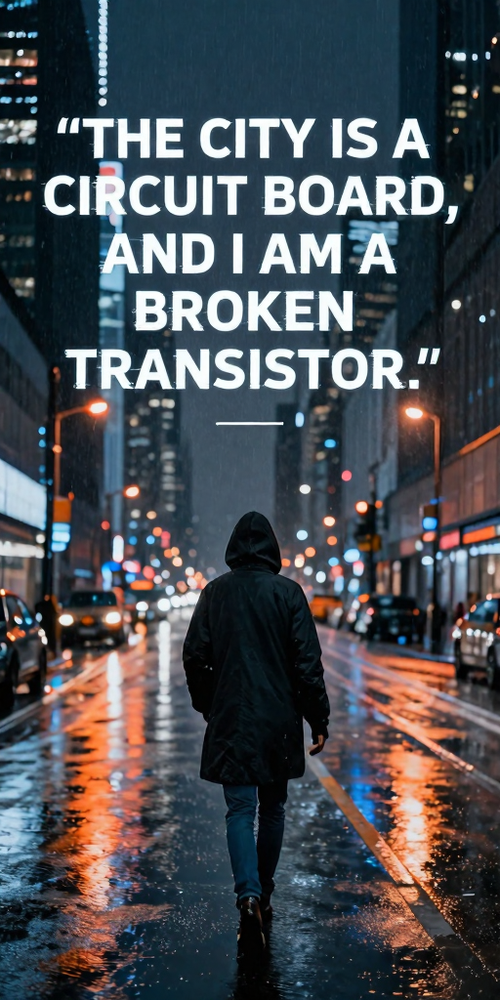
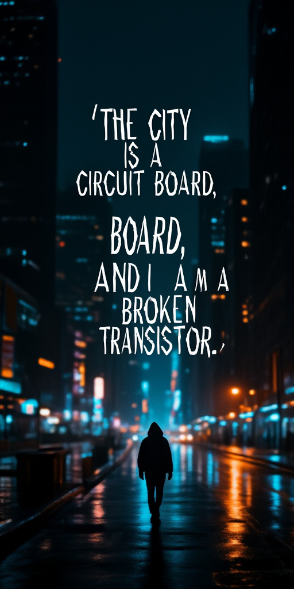
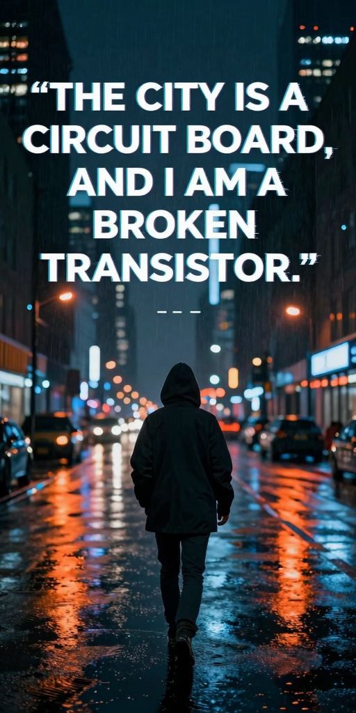
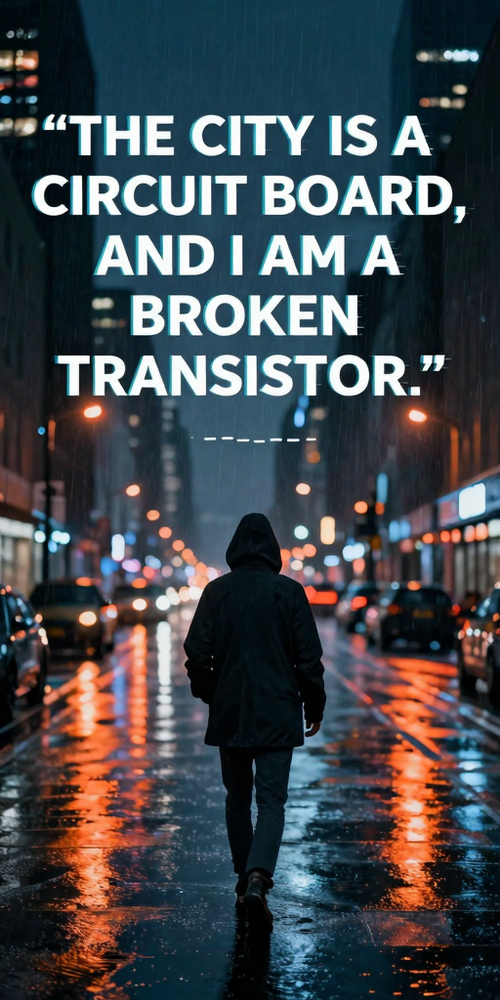
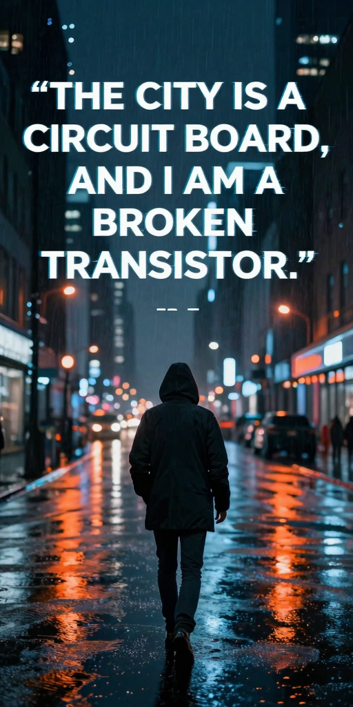
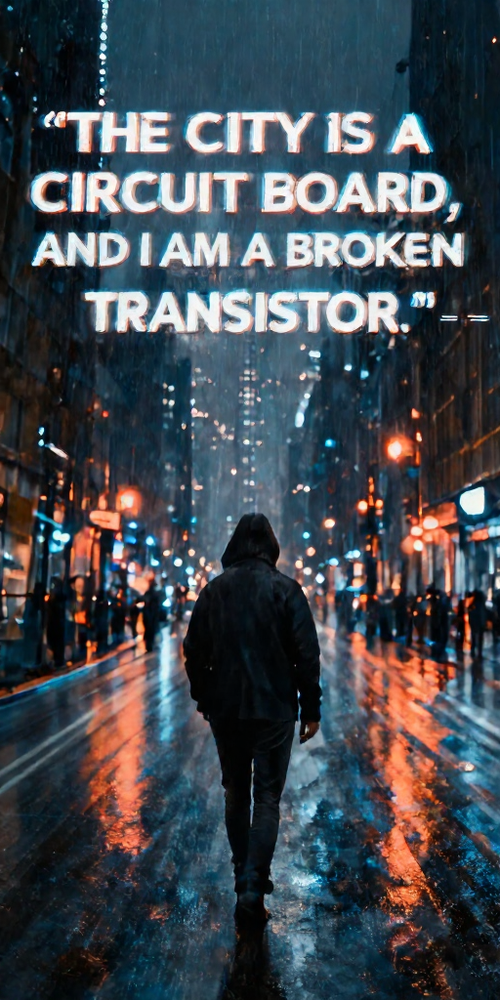

# Z-Image

Z-Image and Z-Image-Turbo generate images from text using Qwen3 4B and the FLUX VAE.

You can run Z-Image with stable-diffusion.cpp on GPUs with 4GB of VRAM — or even less.

## Model files

| Component | Weights and downloads | CLI option | Requirement |
| --- | --- | --- | --- |
| Z-Image-Turbo | [Safetensors](https://huggingface.co/Comfy-Org/z_image_turbo/tree/main/split_files/diffusion_models)<br>[GGUF](https://huggingface.co/leejet/Z-Image-Turbo-GGUF/tree/main) | `--diffusion-model` | Choose matching variant |
| Z-Image | [Safetensors](https://huggingface.co/Comfy-Org/z_image/tree/main/split_files/diffusion_models)<br>[GGUF](https://huggingface.co/unsloth/Z-Image-GGUF/tree/main) | `--diffusion-model` | Choose matching variant |
| vae | [Safetensors](https://huggingface.co/black-forest-labs/FLUX.1-schnell/tree/main) | `--vae` | Use matching VAE |
| Qwen3 4b | [Safetensors](https://huggingface.co/Comfy-Org/z_image_turbo/tree/main/split_files/text_encoders)<br>[GGUF](https://huggingface.co/unsloth/Qwen3-4B-Instruct-2507-GGUF/tree/main) | `--llm` | Use matching text encoder |

## Usage

CLI examples use the [shared path and shell conventions](README.md#example-conventions).

### Web UI

Follow the [Web UI guide](../../examples/server/README.md#web-ui) to start the
server, then select the recipe matching your weights. Fill the component slots
below and click **Load models**.
Use the files and compatibility requirements in [Model files](#model-files).

| Recipe | Component slots |
| --- | --- |
| Z-Image (`z-image`) | `diffusion_model`, `llm`, `vae`, `tae` |
| Z-Image Turbo (`z-image-turbo`) | `diffusion_model`, `llm`, `vae`, `tae` |

Slot IDs correspond to CLI component options: `diffusion_model` uses
`--diffusion-model`, `llm` uses `--llm`, and `model` uses `-m` / `--model`.
Select optional components when required by your checkpoint or task.

### CLI

#### Z-Image-Turbo

**Windows (PowerShell)**

```powershell
.\bin\Release\sd-cli.exe `
  --diffusion-model ..\models\diffusion_models\z_image_turbo-Q3_K.gguf `
  --vae ..\models\vae\ae.sft `
  --llm ..\models\text_encoders\Qwen3-4B-Instruct-2507-Q4_K_M.gguf `
  -p "A cinematic, melancholic photograph of a solitary hooded figure walking through a sprawling, rain-slicked metropolis at night. The city lights are a chaotic blur of neon orange and cool blue, reflecting on the wet asphalt. The scene evokes a sense of being a single component in a vast machine. Superimposed over the image in a sleek, modern, slightly glitched font is the philosophical quote: 'THE CITY IS A CIRCUIT BOARD, AND I AM A BROKEN TRANSISTOR.' -- moody, atmospheric, profound, dark academic" `
  --cfg-scale 1.0 `
  --steps 8 `
  -H 1024 `
  -W 512 `
  --offload-to-cpu `
  -v
```

**Linux/macOS**

```sh
./bin/sd-cli \
  --diffusion-model ../models/diffusion_models/z_image_turbo-Q3_K.gguf \
  --vae ../models/vae/ae.sft \
  --llm ../models/text_encoders/Qwen3-4B-Instruct-2507-Q4_K_M.gguf \
  -p "A cinematic, melancholic photograph of a solitary hooded figure walking through a sprawling, rain-slicked metropolis at night. The city lights are a chaotic blur of neon orange and cool blue, reflecting on the wet asphalt. The scene evokes a sense of being a single component in a vast machine. Superimposed over the image in a sleek, modern, slightly glitched font is the philosophical quote: 'THE CITY IS A CIRCUIT BOARD, AND I AM A BROKEN TRANSISTOR.' -- moody, atmospheric, profound, dark academic" \
  --cfg-scale 1.0 \
  --steps 8 \
  -H 1024 \
  -W 512 \
  --offload-to-cpu \
  -v
```



#### Z-Image-Base

**Windows (PowerShell)**

```powershell
.\bin\Release\sd-cli.exe `
  --diffusion-model ..\models\diffusion_models\z_image_bf16.safetensors `
  --vae ..\models\vae\ae.sft `
  --llm ..\models\text_encoders\qwen_3_4b.safetensors `
  -p "A cinematic, melancholic photograph of a solitary hooded figure walking through a sprawling, rain-slicked metropolis at night. The city lights are a chaotic blur of neon orange and cool blue, reflecting on the wet asphalt. The scene evokes a sense of being a single component in a vast machine. Superimposed over the image in a sleek, modern, slightly glitched font is the philosophical quote: 'THE CITY IS A CIRCUIT BOARD, AND I AM A BROKEN TRANSISTOR.' -- moody, atmospheric, profound, dark academic" `
  --cfg-scale 5.0 `
  -H 1024 `
  -W 512 `
  --offload-to-cpu `
  -v
```

**Linux/macOS**

```sh
./bin/sd-cli \
  --diffusion-model ../models/diffusion_models/z_image_bf16.safetensors \
  --vae ../models/vae/ae.sft \
  --llm ../models/text_encoders/qwen_3_4b.safetensors \
  -p "A cinematic, melancholic photograph of a solitary hooded figure walking through a sprawling, rain-slicked metropolis at night. The city lights are a chaotic blur of neon orange and cool blue, reflecting on the wet asphalt. The scene evokes a sense of being a single component in a vast machine. Superimposed over the image in a sleek, modern, slightly glitched font is the philosophical quote: 'THE CITY IS A CIRCUIT BOARD, AND I AM A BROKEN TRANSISTOR.' -- moody, atmospheric, profound, dark academic" \
  --cfg-scale 5.0 \
  -H 1024 \
  -W 512 \
  --offload-to-cpu \
  -v
```



#### Comparison of Different Quantization Types

| bf16 | q8_0 | q6_K | q5_0 | q4_K | q4_0 | q3_K | q2_K|
|---|---|---|---|---|---|---|---|
|  |  |  |   |  |  |  |  |
