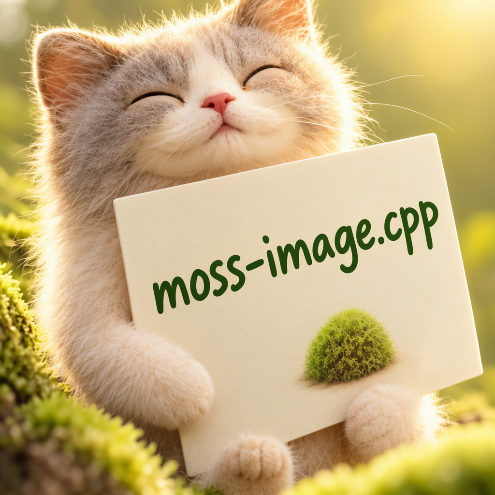

# How to Use

MOSS-Image uses a 5B diffusion transformer, the FLUX.2 VAE, and Qwen3.5 9B as the LLM text encoder. Both Base and SFT are supported. Prompt enhancement is not included.

## Download weights

- Download MOSS-Image Base or SFT
    - safetensors: https://huggingface.co/Comfy-Org/MOSS-Image/tree/main/diffusion_models
- Download vae
    - safetensors: https://huggingface.co/Comfy-Org/MOSS-Image/tree/main/vae
- Download Qwen3.5 9B
    - gguf: https://huggingface.co/unsloth/Qwen3.5-9B-GGUF/tree/main
- Download `tokenizer.json`
    - https://huggingface.co/OpenMOSS-Team/MOSS-Image-Base/tree/main/tokenizer

Pass the external `tokenizer.json` with `--tokenizer`; Qwen3.5 uses a different vocabulary from the embedded Qwen tokenizer.

## Examples

### MOSS-Image Base

```
.\bin\Release\sd-cli.exe --diffusion-model ..\models\diffusion_models\moss_image_base_int8_convrot_attn.safetensors --llm ..\models\text_encoders\Qwen3.5-9B-Q4_K_M.gguf --vae ..\models\vae\flux2_ae.safetensors --tokenizer ..\models\tokenizers\tokenizer_qwen3.5.json --cfg-scale 3.0 -p "a lovely cat holding a sign says 'moss-image.cpp'" -v --offload-to-cpu -H 1024 -W 1024
```

### MOSS-Image SFT

```
.\bin\Release\sd-cli.exe --diffusion-model ..\models\diffusion_models\moss_image_sft_int8_convrot_attn.safetensors --llm ..\models\text_encoders\Qwen3.5-9B-Q4_K_M.gguf --vae ..\models\vae\flux2_ae.safetensors --tokenizer ..\models\tokenizers\tokenizer_qwen3.5.json --cfg-scale 3.0 -p "a lovely cat holding a sign says 'moss-image.cpp'" -v --offload-to-cpu -H 1024 -W 1024
```



Use dimensions divisible by 16. The default discrete scheduler uses the upstream time shift of 5. Use `--flow-shift` to override it. The negative CFG branch skips DiT layer 22 (zero-based), matching the upstream pipeline.
