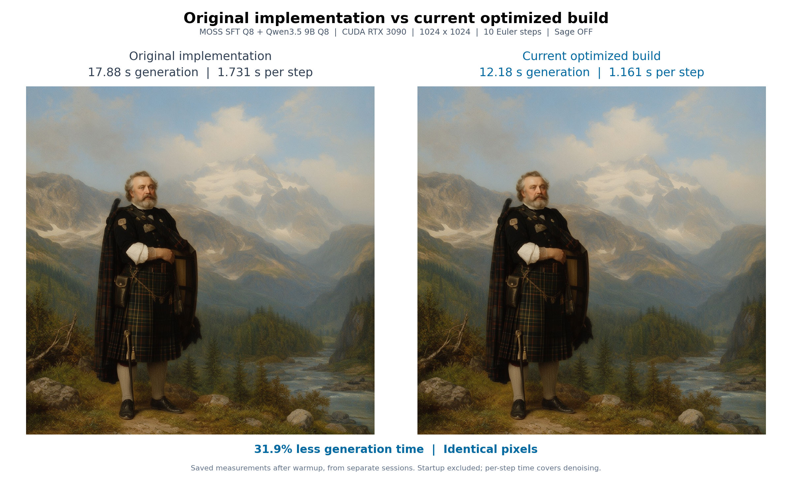

# How to Use

MOSS-Image uses a 5B diffusion transformer, the FLUX.2 VAE, and Qwen3.5 9B as the LLM text encoder. Both Base and SFT are supported. Prompt enhancement is not included.

## Download weights

- Download MOSS-Image Base or SFT
    - safetensors: https://huggingface.co/Comfy-Org/MOSS-Image/tree/main/diffusion_models
    - gguf:
        - Base: https://huggingface.co/leejet/MOSS-Image-Base-GGUF/tree/main
        - SFT: https://huggingface.co/leejet/MOSS-Image-SFT-GGUF/tree/main
- Download vae
    - safetensors: https://huggingface.co/Comfy-Org/MOSS-Image/tree/main/vae
- Download Qwen3.5 9B
    - gguf: https://huggingface.co/unsloth/Qwen3.5-9B-GGUF/tree/main
- Download `tokenizer.json`
    - https://huggingface.co/OpenMOSS-Team/MOSS-Image-Base/tree/main/tokenizer

Pass the external `tokenizer.json` with `--tokenizer`; Qwen3.5 uses a different vocabulary from the embedded Qwen tokenizer.

## Examples

### MOSS-Image Base

```
.\bin\Release\sd-cli.exe --diffusion-model ..\models\diffusion_models\moss_image_base_int8_convrot_attn.safetensors --llm ..\models\text_encoders\Qwen3.5-9B-Q4_K_M.gguf --vae ..\models\vae\flux2_ae.safetensors --tokenizer ..\models\tokenizers\tokenizer_qwen3.5.json --cfg-scale 3.0 -p "a lovely cat holding a sign says 'moss-image.cpp'" -v --offload-to-cpu -H 1024 -W 1024
```

### MOSS-Image SFT

```
.\bin\Release\sd-cli.exe --diffusion-model ..\models\diffusion_models\moss_image_sft_int8_convrot_attn.safetensors --llm ..\models\text_encoders\Qwen3.5-9B-Q4_K_M.gguf --vae ..\models\vae\flux2_ae.safetensors --tokenizer ..\models\tokenizers\tokenizer_qwen3.5.json --cfg-scale 3.0 -p "a lovely cat holding a sign says 'moss-image.cpp'" -v --offload-to-cpu -H 1024 -W 1024
```


Use dimensions divisible by 16. The default discrete scheduler uses the upstream time shift of 5. Use `--flow-shift` to override it. The negative CFG branch skips DiT layer 22 (zero-based), matching the upstream pipeline.

## CUDA performance

With the matching ggml backend changes, MOSS can reuse positional embeddings
and modulation slices, consume Q/K views without materializing the combined
projection, and use fused SiTU activation. Eligible SM86 CUDA paths combine
activation or modulated RMS normalization with Q8 matrix-input packing, and
combine head normalization, rotary positioning and the final FP16 K conversion.
The attention path reuses K/V tiles across more queries and overlaps complete
tile loads with computation. Unsupported devices, shapes and layouts retain
their existing paths. SageAttention is a separate option.

Fused SiTU is compiled only when ggml advertises `GGML_HAS_SITU`; older
headers keep the original composite activation. Backend capability checks
still select the fallback when the operation is unavailable on a device.

The following saved measurements use an RTX 3090, MOSS-Image-SFT Q8_0,
Qwen3.5-9B Q8_0, the FLUX.2 VAE, 1024x1024, 10 Euler steps, CFG 3, flow shift 5,
seed 42 and automatic VRAM placement. Ordinary Flash Attention is enabled;
SageAttention, CUDA Graphs and the server conditioning cache are disabled.

| Implementation | Generation | Denoising per step | Peak VRAM |
|---|---:|---:|---:|
| Original | 17.88 s | 1.731 s | 17.04 GiB |
| Optimized | 12.18 s | 1.161 s | 17.04 GiB |

This is 31.9% less measured generation time. The decoded RGB arrays match
exactly for this configuration. Each build had one warmup and one timed image;
the original and optimized results were recorded in separate sessions. Startup
and HTTP/PNG transfer are excluded, and timing uncertainty was not quantified.
Pixel equality and this speedup are not established for untested configurations.


